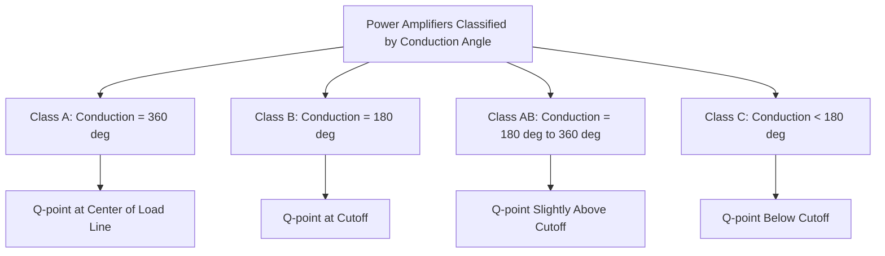
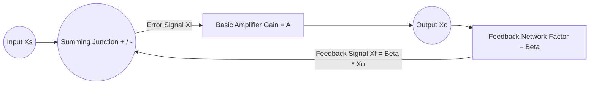
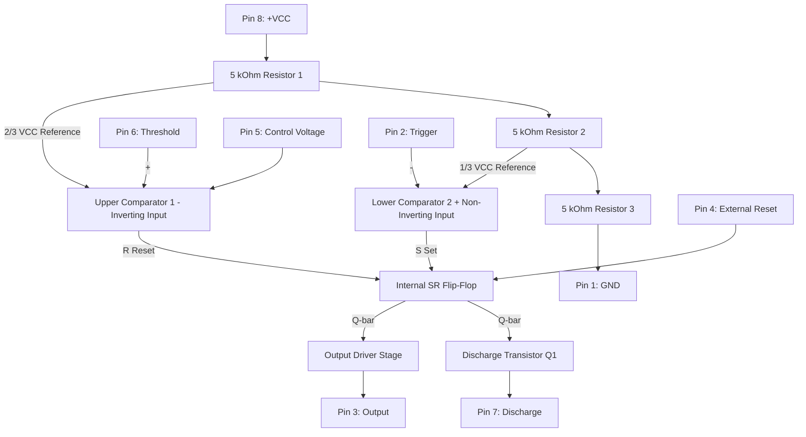

# DIGITAL AND ANALOG CIRCUITS
## Unit 1: Analog Amplifiers, Oscillators & Timers
### A Complete Textbook-Style Study Guide for B.Tech Computer Science and Engineering

---

## 1. Title Page

* **Course Title:** Digital and Analog Circuits
* **Module:** Unit 1 – Analog Amplifiers, Oscillators & Timers
* **Target Audience:** B.Tech Computer Science and Engineering (CSE) Undergraduates
* **Document Type:** Comprehensive Self-Contained University Textbook & Examination Guide
* **Pedagogical Approach:** First-Principles Conceptual Foundations, Step-by-Step Circuit Analysis, Rigorous Mathematical Derivations, and Structured Semester Exam Preparation

---

## 2. Table of Contents

1. [Title Page](#1-title-page)
2. [Table of Contents](#2-table-of-contents)
3. [How to Use This Textbook](#3-how-to-use-this-textbook)
4. [Prerequisite Concepts](#4-prerequisite-concepts)
5. [Chapter 1 – Amplifier Classification](#5-chapter-1--amplifier-classification)
6. [Chapter 2 – Feedback and Oscillation Fundamentals](#6-chapter-2--feedback-and-oscillation-fundamentals)
7. [Chapter 3 – Oscillator Circuits](#7-chapter-3--oscillator-circuits)
8. [Chapter 4 – Multivibrators](#8-chapter-4--multivibrators)
9. [Chapter 5 – Schmitt Trigger and 555 Timer](#9-chapter-5--schmitt-trigger-and-555-timer)
10. [Complete Unit 1 Formula Handbook](#10-complete-unit-1-formula-handbook)
11. [Important Circuit Diagram Collection](#11-important-circuit-diagram-collection)
12. [Important Derivations Collection](#12-important-derivations-collection)
13. [Unit 1 Question Bank](#13-unit-1-question-bank)
14. [Numerical Practice Set](#14-numerical-practice-set)
15. [Full-Length Model Semester Examination](#15-full-length-model-semester-examination)
16. [Answer Key and Solutions](#16-answer-key-and-solutions)
17. [Last-Minute Revision Notes](#17-last-minute-revision-notes)
18. [Glossary of Important Technical Terms](#18-glossary-of-important-technical-terms)

---

## 3. How to Use This Textbook

As a Computer Science and Engineering (CSE) student, you are accustomed to thinking in terms of binary states (`0` and `1`), discrete clock edges, and algorithmic logic. However, every digital computer, microcontroller, clock generator, and communication interface relies on **analog electronic circuits** underneath to amplify signals, generate system clocks, clean noisy waveforms, and measure time intervals.

To get the maximum benefit from this textbook:
1. **Start with Section 4 (Prerequisite Concepts):** If terms like *Q-point*, *saturation*, *virtual ground*, or *RC time constant* feel unfamiliar, read Section 4 carefully before starting Chapter 1.
2. **Trace Every Circuit Step by Step:** Never memorize a circuit diagram blindly. Follow the current path from the positive supply ($+V_{CC}$) to ground ($0\text{ V}$) during both positive and negative half-cycles of the input.
3. **Practice Derivations with Pen and Paper:** University examinations heavily test your ability to derive efficiency formulas, oscillation frequencies, and timing pulse widths. Write out every derivation in Section 12 at least twice.
4. **Master the Standard Numerical Format:** Every numerical problem in this book is solved using a seven-step examination format (*Problem, Given, Required, Formula, Substitution, Calculation, Final Answer*). Adopting this format in your exam guarantees partial credit even if an arithmetic slip occurs.
5. **Use Sections 10–18 for Revision:** In the final week before your semester exam, use the Formula Handbook, Circuit Collection, Model Exam, and Last-Minute Revision Notes to test your speed and accuracy.

---

## 4. Prerequisite Concepts

Before diving into power amplifiers, oscillators, and timers, let us establish the fundamental building blocks of analog electronics from scratch.

### 4.1 Direct Current (DC) vs. Alternating Current (AC)
* **Direct Current (DC):** A steady, unidirectional voltage or current whose magnitude does not change with time (e.g., a $+5\text{ V}$ or $+12\text{ V}$ battery). In electronic circuits, DC power supplies provide the energy needed for active devices (transistors and op-amps) to operate.
* **Alternating Current (AC):** A time-varying signal that periodically reverses direction or fluctuates around an average value. A standard sinusoidal AC voltage is written as:
  $$v(t) = V_m \sin(\omega t) = V_m \sin(2\pi f t)$$
  where $V_m$ is the peak amplitude (in volts, $\text{V}$), $f$ is the frequency (in hertz, $\text{Hz}$), and $\omega = 2\pi f$ is the angular frequency (in radians per second, $\text{rad/s}$).
* **RMS (Root Mean Square) Value:** For a pure sine wave of peak value $V_m$ and peak current $I_m$, the effective DC-equivalent values that deliver the same average power to a resistor are:
  $$V_{\text{rms}} = \frac{V_m}{\sqrt{2}} \approx 0.707 V_m, \qquad I_{\text{rms}} = \frac{I_m}{\sqrt{2}} \approx 0.707 I_m$$
* **Average AC Power:** Delivered to a purely resistive load $R_L$:
  $$P_{\text{ac}} = V_{\text{rms}} \cdot I_{\text{rms}} = \frac{V_m}{\sqrt{2}} \cdot \frac{I_m}{\sqrt{2}} = \frac{V_m I_m}{2} = \frac{V_m^2}{2 R_L} = \frac{I_m^2 R_L}{2}$$

### 4.2 Passive Components: Resistors, Capacitors, and Inductors
1. **Resistor ($R$):** Opposes current flow according to **Ohm's Law**, $V = I R$. It dissipates electrical energy as heat: $P = I^2 R = V^2 / R$.
2. **Capacitor ($C$):** Stores energy in an electric field between two conductive plates separated by an insulator (dielectric).
   * **Key Physical Law:** The voltage across a capacitor **cannot change instantaneously** ($v_C(0^+) = v_C(0^-)$).
   * **Capacitive Reactance ($X_C$):** Opposition to sinusoidal AC current:
     $$X_C = \frac{1}{2\pi f C} = \frac{1}{\omega C}$$
     At DC ($f = 0\text{ Hz}$), $X_C \to \infty$ (acts as an **open circuit**). At very high frequencies, $X_C \to 0$ (acts as a **short circuit**).
   * **RC Charging and Discharging Equation:** When a capacitor $C$ charges or discharges through a resistor $R$ toward a target final voltage $V_{\text{final}}$ starting from an initial voltage $V_{\text{initial}}$, the voltage at any time $t$ is governed by the universal exponential equation:
     $$v_C(t) = V_{\text{final}} + \left(V_{\text{initial}} - V_{\text{final}}\right) e^{-t / (RC)}$$
     Here, $\tau = RC$ is the **time constant** (in seconds). After $t = 1\tau$, the capacitor completes $63.2\%$ of its voltage change; after $t = 5\tau$, it is considered fully charged/discharged ($>99.3\%$).
3. **Inductor ($L$):** A coil of wire that stores energy in a magnetic field.
   * **Key Physical Law:** Current through an inductor cannot change instantaneously.
   * **Inductive Reactance ($X_L$):** $X_L = 2\pi f L = \omega L$. At DC ($f = 0$), $X_L = 0$ (acts as a **short circuit**).

### 4.3 Bipolar Junction Transistor (BJT) Basics
A **BJT** is a three-terminal semiconductor device (**Base** $B$, **Collector** $C$, **Emitter** $E$) available in **NPN** and **PNP** types.
* **Biasing & Operating Regions:**
  * **Cutoff Region:** Both Base-Emitter ($BE$) and Base-Collector ($BC$) junctions are reverse-biased. Collector current $I_C \approx 0$. The transistor acts like an **open switch**.
  * **Active Region:** $BE$ junction is forward-biased ($V_{BE} \approx 0.7\text{ V}$ for silicon) and $BC$ junction is reverse-biased. Here, a small base current $I_B$ controls a large collector current: $I_C = \beta I_B$, where $\beta$ (or $h_{FE}$) is the DC current gain. Amplifiers operate in this region.
  * **Saturation Region:** Both junctions are forward-biased. Collector-Emitter voltage drops to a tiny saturation value $V_{CE(\text{sat})} \approx 0.2\text{ V}$. The transistor acts like a **closed switch**.
* **Quiescent Point (Q-Point):** The steady DC operating values $(I_{CQ}, V_{CEQ})$ established by the biasing network when no AC input signal is applied. The position of the Q-point on the DC load line determines the **class of operation** of a power amplifier.

### 4.4 Operational Amplifier (Op-Amp) Basics
An **Operational Amplifier (Op-Amp)** (such as the classic IC 741) is a high-gain differential voltage amplifier with two inputs and one output:
* **Non-Inverting Input ($+$):** Voltage $V_+$.
* **Inverting Input ($-$):** Voltage $V_-$.
* **Output ($V_{\text{out}}$):** Powered by dual supplies $+V_{CC}$ and $-V_{EE}$ (or $+V_{\text{sat}}$ and $-V_{\text{sat}}$).

#### Ideal Op-Amp Golden Rules
1. **Infinite Open-Loop Gain ($A_{OL} \to \infty$):** $V_{\text{out}} = A_{OL}(V_+ - V_-)$.
2. **Infinite Input Impedance ($Z_{\text{in}} \to \infty$):** **Zero current flows into either the $+$ or $-$ input terminal** ($I_+ = I_- = 0$).
3. **Zero Output Impedance ($Z_{\text{out}} \to 0$):** Can drive any load without voltage drop.
4. **Two Operating Modes:**
   * **With Negative Feedback (Linear Mode):** The op-amp adjusts its output so that $V_+ = V_-$ (**Virtual Short** concept; if $V_+ = 0\text{ V}$, $V_-$ is at **Virtual Ground**).
   * **Without Feedback or With Positive Feedback (Comparator/Saturation Mode):** Because $A_{OL}$ is huge, even a microvolt difference causes the output to slam to its saturation rails:
     * If $V_+ > V_- \implies V_{\text{out}} = +V_{\text{sat}}$
     * If $V_+ < V_- \implies V_{\text{out}} = -V_{\text{sat}}$

---

## 5. Chapter 1 – Amplifier Classification

### 5.1 Fundamental Operational Concepts of Power Amplifiers
In any electronic system—such as a smartphone audio speaker, a public address system, or a radio transmitter—signal amplification happens in two distinct stages:
1. **Voltage Amplifiers (Small-Signal Amplifiers):** The initial stages boost weak microvolt/millivolt signals from sensors or microphones up to a few volts. Here, the signal excursion is small, and the primary goal is high voltage gain and low noise.
2. **Power Amplifiers (Large-Signal Amplifiers):** The final output stage must deliver substantial **electrical power** ($P = V \times I$) to a low-impedance load (such as an $8\,\Omega$ loudspeaker or an antenna).

#### Why Power Amplifiers Differ from Voltage Amplifiers
* **Large Signal Swings:** Transistors operate over nearly their entire active region, driving large collector currents (hundreds of milliamperes to amperes) and large collector-emitter voltage swings.
* **Heat Dissipation:** Because large currents flow through transistors with non-zero voltage drops across them, significant electrical power is converted into heat ($P_D = V_{CE} \cdot I_C$). Power transistors have bulky metal packages and require **heat sinks** to prevent thermal destruction.
* **Collector Efficiency ($\eta$):** Because power amplifiers draw substantial DC power from the battery or power supply, our primary design metric is **power conversion efficiency**—how effectively the amplifier converts DC supply power into useful AC signal power at the load:
  $$\eta (\%) = \frac{\text{AC Output Power delivered to load } (P_{\text{ac}})}{\text{DC Input Power drawn from supply } (P_{\text{dc}})} \times 100\%$$

### 5.2 Classification of Power Amplifiers
Power amplifiers are classified into **Class A, Class B, Class AB, and Class C** based on the **location of the Q-point** on the load line and the **conduction angle ($\theta$)**—the fraction of the $360^\circ$ ($2\pi$ radians) input sine-wave cycle during which the active transistor conducts collector current.



---

### 5.3 Class-A Power Amplifier

#### 1. Working Principle
In a **Class-A power amplifier**, the transistor is biased such that its Q-point lies right at the **exact center** of the AC load line. As a result, the transistor remains in the active region and conducts collector current continuously throughout the **entire $360^\circ$ cycle** of the input sinusoidal signal—even when no input signal is present!

#### 2. Circuit Configuration
There are two common configurations:
1. **Series-Fed (Direct-Coupled) Class-A Amplifier:** The load resistor $R_L$ is connected directly in the collector circuit. Because DC bias current flows continuously through $R_L$, substantial DC power is wasted as heat in $R_L$, limiting maximum theoretical efficiency to **$25\%$**.
2. **Transformer-Coupled Class-A Amplifier:** A step-down output transformer couples the collector to the load $R_L$. Because the primary winding of an ideal transformer has zero DC resistance, no DC power is wasted in the load, doubling the maximum theoretical efficiency to **$50\%$**.

##### ASCII Circuit Diagram: Transformer-Coupled Class-A Power Amplifier
```text
                        +VCC
                         |
            +------------+------------+
            |                         |
           [R1]                  (Primary: N1)
            |                      )||
            +-------+-------||-----)||   Transformer
            |       |       C1     )||   (Turns Ratio n = N1/N2)
           [R2]     |              )||---+---(Secondary: N2)---+
            |     |/ C             |     |                     |
            |  +--|   Q1 (NPN)     |     |                    [RL] (Load, e.g., 8 Ohm)
            |  |  |\ E             |     |                     |
   Vin ~ ---+--+    |              |    === (GND)             === (GND)
   (AC In)         [RE]=== [CE]    |
                    |       |      |
                   ===     ===    === (GND)
```

* **Component Roles:**
  * **$R_1, R_2$:** Voltage-divider biasing resistors that fix the DC base voltage so the Q-point sits at the center of the load line.
  * **$R_E$:** Emitter resistor providing thermal stabilization against temperature variations.
  * **$C_E$:** Emitter bypass capacitor; acts as a short circuit to AC signals so that AC voltage gain is not reduced by $R_E$.
  * **$C_1$:** Input coupling capacitor; blocks DC from the signal source while allowing the AC input $V_{\text{in}}$ to pass to the base.
  * **Output Transformer ($N_1 : N_2$):** Matches the low load impedance $R_L$ to the high collector impedance ($R_L' = n^2 R_L$, where $n = N_1/N_2$) for maximum power transfer, while blocking DC from reaching the load.

#### 3. Input and Output Waveforms & Conduction Angle
* **Conduction Angle:** $\theta = 360^\circ$ ($2\pi\text{ radians}$).
* **Waveform Relationship:**
  ```text
  Input Voltage (Vin):      _.-"-._         _.-"-._
                          -'       '-._.-'       '-._   (0 to 360 deg)

  Collector Current (ic):   _.-"-._         _.-"-._
               ICQ ------ -'-------'-._.-'-------'-._   (Always > 0; conducts 360 deg)
               0 A ----------------------------------

  Collector Voltage (vce):  '-._.-'         '-._.-'
               VCC ------ _.-"-._         _.-"-._       (180 deg out of phase with Vin)
               0 V ----------------------------------
  ```
  Notice that $i_C$ never drops to zero, so the output is an exact, undistorted replica of the input (lowest harmonic distortion of all classes).

#### 4. Power Dissipation
* **Zero-Signal (Quiescent) Condition ($V_{\text{in}} = 0$):** Since $P_{\text{ac}} = 0$, **all** DC power drawn from the supply is dissipated as heat inside the transistor:
  $$P_{D(\text{max})} = P_{\text{dc}} = V_{CC} \cdot I_{CQ}$$
  *Crucial Insight:* A Class-A amplifier runs **hottest when there is no input signal**! When an input signal is applied, part of the DC power is converted into AC load power ($P_D = P_{\text{dc}} - P_{\text{ac}}$), so the transistor actually cools down slightly under full signal drive.

#### 5. Efficiency Derivation (Class-A Power Amplifier)

##### Case A: Series-Fed Class-A Amplifier (Maximum $\eta = 25\%$)
* **Governing Equations & Assumptions:**
  Assume an ideal transistor with zero saturation voltage ($V_{CE(\text{min})} = 0\text{ V}$) and zero cutoff leakage current ($I_{C(\text{min})} = 0\text{ A}$). For maximum undistorted symmetrical swing, the Q-point is centered at:
  $$V_{CEQ} = \frac{V_{CC}}{2}, \qquad I_{CQ} = \frac{I_{C(\text{max})}}{2} = \frac{V_{CC}}{2 R_L}$$
* **Step 1: DC Input Power ($P_{\text{dc}}$):**
  The average current drawn from the supply is $I_{CQ}$. Thus:
  $$P_{\text{dc}} = V_{CC} \cdot I_{CQ} = V_{CC} \left(\frac{V_{CC}}{2 R_L}\right) = \frac{V_{CC}^2}{2 R_L}$$
* **Step 2: Maximum AC Output Power ($P_{\text{ac(max)}}$):**
  The peak-to-peak output voltage swing is $V_{pp} = V_{CC}$, so peak voltage $V_m = \frac{V_{CC}}{2}$. Similarly, peak current $I_m = I_{CQ} = \frac{V_{CC}}{2 R_L}$.
  $$P_{\text{ac(max)}} = \frac{V_m I_m}{2} = \frac{\left(\frac{V_{CC}}{2}\right) \left(\frac{V_{CC}}{2 R_L}\right)}{2} = \frac{V_{CC}^2}{8 R_L}$$
* **Step 3: Maximum Collector Efficiency ($\eta_{\text{max}}$):**
  $$\eta_{\text{max}} = \frac{P_{\text{ac(max)}}}{P_{\text{dc}}} \times 100\% = \frac{V_{CC}^2 / (8 R_L)}{V_{CC}^2 / (2 R_L)} \times 100\% = \frac{2}{8} \times 100\% = 25\%$$

##### Case B: Transformer-Coupled Class-A Amplifier (Maximum $\eta = 50\%$)
* **Governing Equations & Assumptions:**
  In an ideal transformer-coupled stage, the primary winding has zero DC resistance, so the quiescent collector-emitter voltage equals the full supply voltage:
  $$V_{CEQ} = V_{CC}$$
  Under maximum symmetrical signal swing, the collector voltage swings from $0\text{ V}$ to $2 V_{CC}$ (peak swing $V_m = V_{CC}$), and collector current swings from $0$ to $2 I_{CQ}$ (peak swing $I_m = I_{CQ}$).
* **Step 1: DC Input Power ($P_{\text{dc}}$):**
  $$P_{\text{dc}} = V_{CC} \cdot I_{CQ}$$
* **Step 2: Maximum AC Output Power ($P_{\text{ac(max)}}$):**
  $$P_{\text{ac(max)}} = \frac{V_m I_m}{2} = \frac{V_{CC} \cdot I_{CQ}}{2}$$
* **Step 3: Maximum Collector Efficiency ($\eta_{\text{max}}$):**
  $$\eta_{\text{max}} = \frac{P_{\text{ac(max)}}}{P_{\text{dc}}} \times 100\% = \frac{\frac{1}{2} V_{CC} I_{CQ}}{V_{CC} I_{CQ}} \times 100\% = 50\%$$

> **Highlighted Final Formula (Class-A Efficiency):**
> $$\eta_{\text{Class-A (Series-Fed, max)}} = 25\%, \qquad \eta_{\text{Class-A (Transformer-Coupled, max)}} = 50\%$$

---

### 5.4 Class-B Power Amplifier

#### 1. Working Principle
In a **Class-B power amplifier**, the transistor is biased right at the **cutoff point** ($I_{CQ} = 0\text{ A}$, $V_{CEQ} = V_{CC}$). When there is no input signal, **zero current flows**, so standby power dissipation is practically zero!
* When a sinusoidal input is applied, a single Class-B transistor conducts only during the **positive half-cycle** ($180^\circ$) and remains OFF during the negative half-cycle.
* To reconstruct the complete $360^\circ$ sine wave at the load, **two complementary transistors** (one NPN and one PNP, or a center-tapped transformer pair) are arranged in a **Push-Pull configuration**.

#### 2. Push-Pull Configuration
In a **Complementary-Symmetry Class-B Push-Pull Amplifier**, an NPN transistor ($Q_1$) and a PNP transistor ($Q_2$) share a common input at their bases and drive the load $R_L$ from their joined emitters.

##### ASCII Circuit Diagram: Complementary-Symmetry Class-B Push-Pull Amplifier
```text
                         +VCC
                          |
                        |/ C
                  +-----|   Q1 (NPN)
                  |     |\ E
                  |       |
   Vin ~ ---------+       +-------+---------> Vout
   (AC Input)     |       |       |
                  |     |/ E     [RL] (Load)
                  +-----|   Q2    |
                        |\ C     === (GND)
                          |
                         -VEE (-VCC)
```

* **Step-by-Step Operation:**
  1. **Zero Input ($V_{\text{in}} = 0\text{ V}$):** Both $V_{BE1} = 0\text{ V}$ and $V_{EB2} = 0\text{ V}$. Both $Q_1$ and $Q_2$ are in cutoff ($I_{C1} = I_{C2} = 0$). Zero power is wasted.
  2. **Positive Half-Cycle ($V_{\text{in}} > +0.7\text{ V}$):** The base of $Q_1$ becomes positive relative to its emitter, turning **$Q_1$ ON** while $Q_2$ is reverse-biased (OFF). Current flows from $+V_{CC}$ through $Q_1$ into the load $R_L$ to ground ("pushing" current into the load).
  3. **Negative Half-Cycle ($V_{\text{in}} < -0.7\text{ V}$):** The base of $Q_2$ becomes negative relative to its emitter, turning **$Q_2$ ON** while $Q_1$ is reverse-biased (OFF). Current flows from ground through $R_L$ and through $Q_2$ to $-V_{CC}$ ("pulling" current from the load).

#### 3. Crossover Distortion
* **What is Crossover Distortion?**
  A silicon BJT does not begin conducting the instant its base-emitter voltage exceeds $0\text{ V}$; it requires a forward barrier potential of **$V_{BE(\text{on})} \approx 0.7\text{ V}$** (or $0.3\text{ V}$ for germanium).
* **Physical Cause:**
  Whenever the input sine wave passes through zero—specifically in the dead-zone window between **$-0.7\text{ V} < V_{\text{in}} < +0.7\text{ V}$**—**neither $Q_1$ nor $Q_2$ is turned ON**. Both transistors sit in cutoff simultaneously, causing the output voltage $V_{\text{out}}$ to remain flat at $0\text{ V}$ during every zero-crossing.
* **Waveform Illustration of Crossover Distortion:**
  ```text
  Input Sine Wave (Vin):      _.-"-._         _.-"-._
                            -'       '-._.-'       '-._
                           +0.7V  -------------------  (Dead zone: -0.7V to +0.7V)
                           -0.7V  -------------------

  Distorted Output (Vout):    _.-"-._         _.-"-._
                           --'       '--_--'       '--  (Flat "notch" at zero crossings)
  ```
* **Consequence:** Produces unpleasant high-frequency harmonic distortion ("raspy" audio at low volume levels).

#### 4. Efficiency Derivation (Class-B Power Amplifier)
* **Governing Equations & Assumptions:**
  Assume ideal complementary transistors ($V_{BE(\text{on})} = 0$, $V_{CE(\text{sat})} = 0$) powered by dual supplies $\pm V_{CC}$ driving a load $R_L$ with a sinusoidal voltage of peak amplitude $V_m \le V_{CC}$ and peak current $I_m = V_m / R_L$.
* **Step 1: AC Output Power ($P_{\text{ac}}$):**
  Since $Q_1$ delivers the positive half-cycle and $Q_2$ delivers the negative half-cycle, a full sine wave appears across $R_L$:
  $$P_{\text{ac}} = \frac{V_m I_m}{2} = \frac{V_m^2}{2 R_L}$$
* **Step 2: DC Input Power ($P_{\text{dc}}$):**
  Each supply ($+V_{CC}$ and $-V_{CC}$) delivers a half-wave rectified sine wave of current with peak value $I_m$. Together, the two supplies deliver a full-wave rectified sine wave of current whose DC (average) value is:
  $$I_{\text{dc}} = \frac{1}{\pi} \int_0^\pi I_m \sin(\omega t)\, d(\omega t) = \frac{I_m}{\pi} \left[-\cos(\omega t)\right]_0^\pi = \frac{2 I_m}{\pi}$$
  Therefore, the total DC power drawn from the power supply is:
  $$P_{\text{dc}} = V_{CC} \cdot I_{\text{dc}} = V_{CC} \left(\frac{2 I_m}{\pi}\right) = \frac{2 V_{CC} I_m}{\pi}$$
* **Step 3: General Efficiency ($\eta$):**
  $$\eta = \frac{P_{\text{ac}}}{P_{\text{dc}}} \times 100\% = \frac{\frac{1}{2} V_m I_m}{\frac{2}{\pi} V_{CC} I_m} \times 100\% = \frac{\pi}{4} \left(\frac{V_m}{V_{CC}}\right) \times 100\% \approx 78.54\% \left(\frac{V_m}{V_{CC}}\right)$$
* **Step 4: Maximum Theoretical Efficiency ($\eta_{\text{max}}$):**
  Maximum efficiency occurs at full signal swing when $V_m = V_{CC}$:
  $$\eta_{\text{max}} = \frac{\pi}{4} \times 100\% \approx 78.54\%$$
* **Maximum Power Dissipation per Transistor:**
  Differentiating $P_D = P_{\text{dc}} - P_{\text{ac}} = \frac{2 V_{CC} V_m}{\pi R_L} - \frac{V_m^2}{2 R_L}$ with respect to $V_m$ and setting $\frac{dP_D}{dV_m} = 0$ reveals that maximum heat dissipation occurs at $V_m = \frac{2 V_{CC}}{\pi} \approx 0.636 V_{CC}$, giving total maximum dissipation $P_{D(\text{total, max})} = \frac{2 V_{CC}^2}{\pi^2 R_L}$, or per transistor:
  $$P_{D(\text{per transistor, max})} = \frac{V_{CC}^2}{\pi^2 R_L} \approx 0.1013 \frac{V_{CC}^2}{R_L}$$

> **Highlighted Final Formula (Class-B Efficiency):**
> $$\eta_{\text{Class-B}} = \frac{\pi}{4} \left(\frac{V_m}{V_{CC}}\right) \times 100\%, \qquad \eta_{\text{Class-B (max)}} = \frac{\pi}{4} \times 100\% \approx 78.54\%$$

---

### 5.5 Class-AB Power Amplifier

#### 1. Working Principle
A **Class-AB power amplifier** combines the high linearity of Class-A with the high efficiency of Class-B, specifically designed to **eliminate crossover distortion**.
* Instead of biasing $Q_1$ and $Q_2$ right at cutoff ($0\text{ V}$), a small quiescent forward bias voltage (approximately $1.4\text{ V}$ total, i.e., $0.7\text{ V}$ per base-emitter junction) is applied between the two bases so that **both transistors conduct a tiny trickle quiescent current ($I_{CQ}$)** even when $V_{\text{in}} = 0\text{ V}$.
* Each transistor conducts for **slightly more than $180^\circ$** ($180^\circ < \theta < 360^\circ$).

#### 2. Biasing and Operation (Diode-Biased Class-AB Stage)
To ensure thermal stability (preventing **thermal runaway**), two silicon diodes ($D_1, D_2$) matched to the base-emitter junctions of $Q_1$ and $Q_2$ are placed between their bases.

##### ASCII Circuit Diagram: Diode-Biased Class-AB Push-Pull Amplifier
```text
                         +VCC
                          |
                         [R1]
                          |
                          +------->|/ C
                          |        |   Q1 (NPN)
                         [D1]      |\ E
                          |          |
   Vin ~ -----||----------+          +-------+---------> Vout
              C1          |          |       |
                         [D2]      |/ E     [RL] (Load)
                          |        |   Q2    |
                          +------->|\ C     === (GND)
                          |          |
                         [R2]       -VEE (-VCC)
                          |
                         -VEE
```

* **How It Works:**
  1. Resistors $R_1$ and $R_2$ pass a small DC bias current through diodes $D_1$ and $D_2$, creating a voltage drop of $V_{D1} + V_{D2} \approx 0.7\text{ V} + 0.7\text{ V} = 1.4\text{ V}$ between the base of $Q_1$ and the base of $Q_2$.
  2. This pre-biases both $Q_1$ and $Q_2$ right at the threshold of conduction ($V_{BE1} \approx 0.7\text{ V}$, $V_{EB2} \approx 0.7\text{ V}$).
  3. **Thermal Compensation:** As $Q_1$ and $Q_2$ warm up, their $V_{BE(\text{on})}$ decreases by $\approx 2\text{ mV}/^\circ\text{C}$. Because diodes $D_1, D_2$ are mounted near the transistors, their forward voltage drops decrease by the exact same amount, keeping $I_{CQ}$ constant and preventing thermal runaway.
  4. When $V_{\text{in}}$ crosses $0\text{ V}$, $Q_1$ smoothly hands over conduction to $Q_2$ with **zero dead zone**.

#### 3. Advantages over Class-B
1. **Eliminates Crossover Distortion:** Smooth transition at zero crossings produces clean, high-fidelity output suitable for modern hi-fi audio systems.
2. **Retains High Efficiency:** Because the quiescent current $I_{CQ}$ is very small compared to peak load current, practical efficiency remains high (**$50\%$ to $70\%$**), far superior to Class-A ($25\%$–$50\%$).

---

### 5.6 Class-C Power Amplifier

#### 1. Working Principle
In a **Class-C power amplifier**, the transistor is biased **below cutoff** (e.g., via a negative base bias voltage $-V_{BB}$ for an NPN transistor).
* Consequently, the transistor remains OFF for more than half the input cycle and conducts only during the **very peaks** of the positive input half-cycle.
* **Conduction Angle:** $\theta < 180^\circ$ (typically $90^\circ$ to $150^\circ$).
* Because the collector current flows in narrow, sharp pulses, the output waveform is severely distorted and **cannot be used for audio amplification**. Instead, a **parallel LC resonant tank circuit** is used as the collector load to reconstruct a pure high-frequency sine wave!

##### ASCII Circuit Diagram: Tuned Class-C Power Amplifier
```text
                         +VCC
                          |
                 +--------+--------+
                 |                 |
                (L)               === (C)   Parallel LC Tank Circuit
                 |                 |        (Resonant Frequency fr = 1 / (2*pi*sqrt(L*C)))
                 +--------+--------+
                          |
                          +--------||---------> Vout (Pure RF Sine Wave)
                          |        Cc
                        |/ C
   Vin ~ -----||---+----|   Q1 (NPN)
              C1   |    |\ E
                  [RB]    |
                   |     === (GND)
                  -VBB (Reverse Bias Supply)
```

* **Role of the LC Tank Circuit (Flywheel Effect):**
  1. During the brief conduction pulse ($\theta < 180^\circ$), $Q_1$ turns ON and injects a pulse of current into the parallel $LC$ tank circuit, charging capacitor $C$.
  2. When $Q_1$ turns OFF, the charged capacitor discharges through inductor $L$, transferring energy back and forth between the electric field of $C$ and magnetic field of $L$ at the natural resonant frequency:
     $$f_r = \frac{1}{2\pi\sqrt{LC}}$$
  3. Just as a heavy mechanical flywheel keeps spinning smoothly when pushed briefly once per revolution, the high-$Q$ tank circuit filters out all unwanted harmonics and outputs a clean, continuous sine wave at $f_r$.

#### 2. Efficiency and Applications
* **Efficiency:** Because the transistor conducts only when $V_{CE}$ is near its minimum ($V_{CE(\text{sat})}$), internal power loss ($P_D = V_{CE} \cdot I_C$) is tiny. Theoretical efficiency approaches **$100\%$** as $\theta \to 0^\circ$, with practical efficiencies reaching **$80\%$ to $90\%$**.
* **Applications:** Strictly restricted to **fixed-frequency or narrowband Radio Frequency (RF)** systems—such as AM/FM radio transmitters, TV transmitters, RF induction heaters, and wireless communication power stages.

---

### 5.7 Comparison of Class-A, B, AB, and C Amplifiers

| Parameter | Class-A | Class-B | Class-AB | Class-C |
| :--- | :--- | :--- | :--- | :--- |
| **Q-Point Location** | Center of load line | Exactly at cutoff | Slightly above cutoff | Below cutoff |
| **Conduction Angle ($\theta$)** | $360^\circ$ ($2\pi$) | $180^\circ$ ($\pi$) | $180^\circ < \theta < 360^\circ$ | $< 180^\circ$ (typically $90^\circ$–$150^\circ$) |
| **Active Devices Needed** | 1 transistor | 2 transistors (Push-Pull) | 2 transistors (Push-Pull) | 1 transistor + LC tank |
| **Max Theoretical Efficiency** | $25\%$ (Series-fed)<br>$50\%$ (Transformer) | $78.54\%$ ($\pi/4$) | $50\%$ to $78.5\%$ | Up to $90\%$–$95\%$ (Ideal $\to 100\%$) |
| **Signal Distortion / Linearity** | Lowest distortion (Highest linearity) | Crossover distortion at zero crossings | Very low distortion (No crossover distortion) | Severe harmonic distortion (requires LC tank) |
| **Standby (Zero-Signal) Power** | Maximum ($V_{CC} I_{CQ}$) | Zero | Very small | Zero |
| **Primary Applications** | Low-power audio preamps, instrumentation | Battery-operated audio stages | Hi-Fi audio power amplifiers, IC op-amp outputs | RF transmitters, tuned radio-frequency circuits |

---

### 5.8 Solved Numerical Problems (Chapter 1)

#### Problem 1.1 (Basic – Class-A Series-Fed Amplifier)
* **Problem:** A series-fed Class-A power amplifier operates from a DC supply of $V_{CC} = 20\text{ V}$ and drives a load resistance of $R_L = 16\,\Omega$. If the quiescent collector current is $I_{CQ} = 0.6\text{ A}$ and the AC output voltage has a peak amplitude of $V_m = 8\text{ V}$, calculate: (a) DC input power, (b) AC output power, (c) Collector efficiency, and (d) Power dissipated by the transistor.
* **Given:**
  * $V_{CC} = 20\text{ V}$, $R_L = 16\,\Omega$, $I_{CQ} = 0.6\text{ A}$, $V_m = 8\text{ V}$
* **Required:**
  * $P_{\text{dc}}$, $P_{\text{ac}}$, $\eta$, and $P_D$
* **Formula:**
  $$P_{\text{dc}} = V_{CC} \cdot I_{CQ}, \qquad P_{\text{ac}} = \frac{V_m^2}{2 R_L}, \qquad \eta = \frac{P_{\text{ac}}}{P_{\text{dc}}} \times 100\%, \qquad P_D = P_{\text{dc}} - P_{\text{ac}}$$
* **Substitution & Calculation:**
  * **(a) DC Input Power:**
    $$P_{\text{dc}} = 20\text{ V} \times 0.6\text{ A} = 12\text{ W}$$
  * **(b) AC Output Power:**
    $$P_{\text{ac}} = \frac{(8\text{ V})^2}{2 \times 16\,\Omega} = \frac{64}{32} = 2\text{ W}$$
  * **(c) Collector Efficiency:**
    $$\eta = \frac{2\text{ W}}{12\text{ W}} \times 100\% = 16.67\%$$
  * **(d) Transistor Power Dissipation:**
    $$P_D = 12\text{ W} - 2\text{ W} = 10\text{ W}$$
* **Final Answer:**
  * $P_{\text{dc}} = \mathbf{12\text{ W}}$, $P_{\text{ac}} = \mathbf{2\text{ W}}$, $\eta = \mathbf{16.67\%}$, $P_D = \mathbf{10\text{ W}}$.

#### Problem 1.2 (Basic – Class-B Push-Pull Amplifier)
* **Problem:** A complementary-symmetry Class-B push-pull amplifier operates with dual supplies of $\pm 15\text{ V}$ and drives an $8\,\Omega$ loudspeaker. If the peak sinusoidal output voltage across the speaker is $V_m = 12\text{ V}$, determine: (a) AC output power, (b) DC input power, (c) Efficiency, and (d) Power dissipated per transistor.
* **Given:**
  * $V_{CC} = 15\text{ V}$, $R_L = 8\,\Omega$, $V_m = 12\text{ V}$
* **Required:**
  * $P_{\text{ac}}$, $P_{\text{dc}}$, $\eta$, and $P_{D(\text{per transistor})}$
* **Formula:**
  $$I_m = \frac{V_m}{R_L}, \qquad P_{\text{ac}} = \frac{V_m^2}{2 R_L}, \qquad P_{\text{dc}} = \frac{2 V_{CC} I_m}{\pi}, \qquad \eta = \frac{P_{\text{ac}}}{P_{\text{dc}}} \times 100\%$$
* **Substitution & Calculation:**
  * Peak load current: $I_m = \frac{12\text{ V}}{8\,\Omega} = 1.5\text{ A}$
  * **(a) AC Output Power:**
    $$P_{\text{ac}} = \frac{12^2}{2 \times 8} = \frac{144}{16} = 9\text{ W}$$
  * **(b) DC Input Power:**
    $$P_{\text{dc}} = \frac{2 \times 15\text{ V} \times 1.5\text{ A}}{\pi} = \frac{45}{3.14159} \approx 14.32\text{ W}$$
  * **(c) Efficiency:**
    $$\eta = \frac{9\text{ W}}{14.32\text{ W}} \times 100\% = 62.85\%$$
  * **(d) Power Dissipated per Transistor:**
    $$P_{D(\text{total})} = P_{\text{dc}} - P_{\text{ac}} = 14.32\text{ W} - 9\text{ W} = 5.32\text{ W}$$
    $$P_{D(\text{per transistor})} = \frac{5.32\text{ W}}{2} = 2.66\text{ W}$$
* **Final Answer:**
  * $P_{\text{ac}} = \mathbf{9\text{ W}}$, $P_{\text{dc}} = \mathbf{14.32\text{ W}}$, $\eta = \mathbf{62.85\%}$, $P_{D(\text{per transistor})} = \mathbf{2.66\text{ W}}$.

#### Problem 1.3 (Intermediate – Transformer-Coupled Class-A Design)
* **Problem:** A transformer-coupled Class-A amplifier supplies $4\text{ W}$ of AC power to a $4\,\Omega$ speaker. The transistor operates from a $V_{CC} = 12\text{ V}$ supply with $V_{CE(\text{min})} = 0\text{ V}$ and achieves maximum theoretical efficiency ($50\%$). Calculate: (a) Required DC supply power, (b) Quiescent collector current $I_{CQ}$, and (c) Required transformer turns ratio $n = N_1 / N_2$.
* **Given:**
  * $P_{\text{ac}} = 4\text{ W}$, $R_L = 4\,\Omega$, $V_{CC} = 12\text{ V}$, $\eta = 50\%$
* **Required:**
  * $P_{\text{dc}}$, $I_{CQ}$, and $n = N_1 / N_2$
* **Formula:**
  $$\eta = \frac{P_{\text{ac}}}{P_{\text{dc}}}, \qquad P_{\text{dc}} = V_{CC} I_{CQ}, \qquad R_L' = \frac{V_{CC}}{I_{CQ}}, \qquad n = \sqrt{\frac{R_L'}{R_L}}$$
* **Substitution & Calculation:**
  * **(a) DC Supply Power:**
    $$P_{\text{dc}} = \frac{P_{\text{ac}}}{0.50} = \frac{4\text{ W}}{0.50} = 8\text{ W}$$
  * **(b) Quiescent Collector Current:**
    $$I_{CQ} = \frac{P_{\text{dc}}}{V_{CC}} = \frac{8\text{ W}}{12\text{ V}} = 0.667\text{ A}$$
  * **(c) Transformer Turns Ratio:**
    Reflected primary resistance $R_L' = \frac{V_{CC}}{I_{CQ}} = \frac{12\text{ V}}{0.667\text{ A}} = 18\,\Omega$.
    $$n = \sqrt{\frac{18\,\Omega}{4\,\Omega}} = \sqrt{4.5} \approx 2.12 : 1$$
* **Final Answer:**
  * $P_{\text{dc}} = \mathbf{8\text{ W}}$, $I_{CQ} = \mathbf{0.667\text{ A}}$, Turns Ratio $n = \mathbf{2.12 : 1}$.

#### Problem 1.4 (Intermediate – Class-B Maximum Dissipation Design)
* **Problem:** A Class-B push-pull amplifier operates with $\pm 24\text{ V}$ supplies and drives an $8\,\Omega$ load. Determine: (a) Maximum possible AC output power, (b) Maximum total DC power drawn at full output, and (c) Worst-case maximum power dissipation per transistor (which determines heat sink selection).
* **Given:**
  * $V_{CC} = 24\text{ V}$, $R_L = 8\,\Omega$
* **Required:**
  * $P_{\text{ac(max)}}$, $P_{\text{dc(max)}}$, and $P_{D(\text{per transistor, max})}$
* **Formula:**
  $$P_{\text{ac(max)}} = \frac{V_{CC}^2}{2 R_L}, \qquad P_{\text{dc(max)}} = \frac{2 V_{CC}^2}{\pi R_L}, \qquad P_{D(\text{per transistor, max})} = \frac{V_{CC}^2}{\pi^2 R_L}$$
* **Substitution & Calculation:**
  * **(a) Maximum AC Output Power:**
    $$P_{\text{ac(max)}} = \frac{24^2}{2 \times 8} = \frac{576}{16} = 36\text{ W}$$
  * **(b) Maximum DC Power Drawn:**
    $$P_{\text{dc(max)}} = \frac{2 \times 24^2}{\pi \times 8} = \frac{1152}{25.1327} \approx 45.84\text{ W}$$
  * **(c) Maximum Dissipation per Transistor:**
    $$P_{D(\text{per transistor, max})} = \frac{24^2}{\pi^2 \times 8} = \frac{576}{78.9568} \approx 7.30\text{ W}$$
* **Final Answer:**
  * $P_{\text{ac(max)}} = \mathbf{36\text{ W}}$, $P_{\text{dc(max)}} = \mathbf{45.84\text{ W}}$, $P_{D(\text{per transistor, max})} = \mathbf{7.30\text{ W}}$.

---

### 5.9 Chapter 1 Examination Preparation & Revision Sheet

#### A. Important Definitions (2 Marks Each)
1. **Power Amplifier:** An electronic amplifier designed to deliver substantial electrical power ($P = V \times I$) to a low-impedance load (such as a loudspeaker or antenna) rather than merely increasing signal voltage.
2. **Conduction Angle ($\theta$):** The fraction of the $360^\circ$ ($2\pi$ radians) input sinusoidal cycle during which an active transistor conducts collector current.
3. **Collector Efficiency ($\eta$):** The ratio of AC signal power delivered to the load to the total DC power drawn from the power supply, expressed as a percentage: $\eta = (P_{\text{ac}}/P_{\text{dc}}) \times 100\%$.
4. **Crossover Distortion:** A non-linear waveform distortion occurring in Class-B push-pull amplifiers around zero crossings because neither transistor conducts until the input signal exceeds the base-emitter barrier potential ($\approx \pm 0.7\text{ V}$).

#### B. Short & Medium Answer Questions
* **Q1 (3 Marks): Why is a Class-A amplifier hottest when there is no input signal?**
  * *Answer:* In a Class-A amplifier, the DC supply power $P_{\text{dc}} = V_{CC} I_{CQ}$ remains constant regardless of signal amplitude. By conservation of energy, $P_{\text{dc}} = P_{\text{ac}} + P_D$. When no input signal is applied, $P_{\text{ac}} = 0$, so $100\%$ of the drawn DC power is converted into heat inside the transistor ($P_{D(\text{max})} = V_{CC} I_{CQ}$).
* **Q2 (4 Marks): How does a Class-AB amplifier overcome crossover distortion without sacrificing efficiency?**
  * *Answer:* By placing two forward-biased silicon diodes between the bases of the complementary NPN and PNP transistors, a quiescent bias voltage of $\approx 1.4\text{ V}$ ($0.7\text{ V}$ per junction) is established. Both transistors conduct a tiny trickle current even at $V_{\text{in}} = 0\text{ V}$, eliminating the $\pm 0.7\text{ V}$ dead zone while keeping standby power negligible.

#### C. Common Examination Mistakes
1. **Confusing Series-Fed and Transformer-Coupled Class-A Efficiency:** Students frequently write $50\%$ for series-fed Class-A. Remember: Series-fed = **$25\%$**; Transformer-coupled = **$50\%$**.
2. **Using Peak Voltage Instead of RMS Voltage in Power Calculations:** AC load power is $P_{\text{ac}} = V_{\text{rms}}^2 / R_L = V_m^2 / (2 R_L)$. Forgetting the factor of $2$ in the denominator doubles the calculated power erroneously.
3. **Dividing Total Class-B Dissipation Wrongly:** Total power dissipated by the stage is $P_{\text{dc}} - P_{\text{ac}}$, which is shared equally between **two** transistors ($P_D$ per transistor $= (P_{\text{dc}} - P_{\text{ac}})/2$).

#### D. Chapter 1 Revision Sheet
* **Must-Know Formulas:**
  * $\eta_{\text{Class-A (series)}} = 25\%$ max; $\eta_{\text{Class-A (transformer)}} = 50\%$ max
  * Class-B: $P_{\text{ac}} = \frac{V_m^2}{2 R_L}$, $P_{\text{dc}} = \frac{2 V_{CC} I_m}{\pi}$, $\eta_{\text{max}} = \frac{\pi}{4} \times 100\% = 78.54\%$
  * Resonant frequency of Class-C tank: $f_r = \frac{1}{2\pi\sqrt{LC}}$
* **Must-Practise Diagrams & Derivations:**
  1. Transformer-coupled Class-A circuit & $50\%$ efficiency derivation.
  2. Complementary Class-B push-pull circuit, crossover distortion waveform, & $78.54\%$ efficiency derivation.
  3. Diode-biased Class-AB circuit diagram.

---

## 6. Chapter 2 – Feedback and Oscillation Fundamentals

### 6.1 Introduction to Feedback in Electronic Circuits
Consider driving a car: your eyes observe the road position (output), compare it to the lane center (reference input), and your hands adjust the steering wheel (error correction). This continuous self-monitoring loop is **feedback**.

* **Definition of Feedback:** The process of taking a fraction of the output signal (voltage or current) of an amplifier and feeding it back to the input so that it combines with the external input signal.

#### Open-Loop vs. Closed-Loop Systems
1. **Open-Loop System:** The output has **no effect** on the input. An amplifier without feedback has a fixed open-loop gain $A$. Its gain fluctuates wildly with temperature, power supply variations, and component aging.
2. **Closed-Loop System:** A feedback network samples the output and routes a feedback signal $X_f = \beta X_o$ back to the input summing junction, where $\beta$ is the **feedback factor** (or reverse transmission ratio).



---

### 6.2 Positive Feedback vs. Negative Feedback

Depending on the phase relationship between the feedback signal $X_f$ and the external input signal $X_s$, feedback is divided into two fundamentally opposite types:

#### 1. Negative Feedback (Degenerative Feedback)
* **Mechanism:** The feedback signal $X_f$ is **$180^\circ$ out of phase** with (or subtracted from) the external input signal $X_s$.
* **Net Input Signal:** $X_i = X_s - X_f = X_s - \beta X_o$.
* **Effect on Gain:** Because $X_o = A X_i = A(X_s - \beta X_o)$, rearranging yields the **Closed-Loop Gain ($A_f$)**:
  $$A_f = \frac{X_o}{X_s} = \frac{A}{1 + A\beta}$$
  Here, $(1 + A\beta)$ is called the **desensitivity factor** (or amount of feedback). Since $|1 + A\beta| > 1$, negative feedback **reduces** overall voltage gain, trading excess gain for tremendous improvements in stability, bandwidth, linearity, and impedance control.
* **Primary Application:** **Linear Amplifiers** and control systems.

#### 2. Positive Feedback (Regenerative Feedback)
* **Mechanism:** The feedback signal $X_f$ is **in phase** ($0^\circ$ or $360^\circ$ phase shift) with the external input signal $X_s$, reinforcing it.
* **Net Input Signal:** $X_i = X_s + X_f = X_s + \beta X_o$.
* **Closed-Loop Gain ($A_f$):**
  $$A_f = \frac{A}{1 - A\beta}$$
* **Effect:** As the loop gain $A\beta$ approaches $1$, the denominator $(1 - A\beta) \to 0$, causing $A_f \to \infty$. The circuit produces an output signal **even with zero external input ($X_s = 0$)**—meaning it becomes an **oscillator** or a bistable trigger!
* **Primary Application:** **Sinusoidal Oscillators**, **Multivibrators**, and **Schmitt Triggers**.

---

### 6.3 Detailed Effects of Negative Feedback

Why do engineers deliberately throw away gain using negative feedback? Let us derive and explain all six major benefits:

#### 1. Gain Stabilization (Desensitivity)
* **Derivation:** Differentiating $A_f = \frac{A}{1 + A\beta}$ with respect to open-loop gain $A$:
  $$\frac{dA_f}{dA} = \frac{(1 + A\beta)(1) - A(\beta)}{(1 + A\beta)^2} = \frac{1}{(1 + A\beta)^2}$$
  Dividing both sides by $A_f = \frac{A}{1 + A\beta}$:
  $$\frac{dA_f}{A_f} = \frac{1}{1 + A\beta} \left(\frac{dA}{A}\right)$$
* **Physical Meaning:** Any percentage variation in internal transistor gain ($\frac{dA}{A}$) due to temperature or aging is reduced by a factor of **$(1 + A\beta)$**! Furthermore, if $A\beta \gg 1$:
  $$A_f \approx \frac{A}{A\beta} = \frac{1}{\beta}$$
  The closed-loop gain depends **solely on passive precision resistors** in the feedback network $\beta$, completely independent of active device parameters!

#### 2. Increase in Bandwidth (Gain-Bandwidth Product Conservation)
* In an amplifier, the **Gain-Bandwidth Product (GBP)** is a constant: $A \cdot BW = A_f \cdot BW_f$.
* Because negative feedback reduces mid-band gain by $(1 + A\beta)$, it **extends the upper cutoff frequency ($f_H$)** and **reduces the lower cutoff frequency ($f_L$)** by the exact same factor:
  $$f_{Hf} = f_H (1 + A\beta), \qquad f_{Lf} = \frac{f_L}{1 + A\beta}$$
  $$BW_f = f_{Hf} - f_{Lf} \approx BW (1 + A\beta)$$

#### 3. Reduction in Non-Linear Distortion
* If a high-amplitude signal causes a transistor to introduce internal distortion voltage $D$, negative feedback samples this distortion at the output, inverts it, and subtracts it at the input, reducing output distortion to:
  $$D_f = \frac{D}{1 + A\beta}$$

#### 4. Reduction in Internal Noise
* Noise generated *inside* the amplifier stage (such as thermal agitation in collector resistors) is reduced by $(1 + A\beta)$:
  $$N_f = \frac{N}{1 + A\beta}$$
  *(Note: Noise already mixed with the external input signal before the summing junction cannot be separated from the signal).*

#### 5. Modification of Input Impedance ($Z_{\text{in}}$) and Output Impedance ($Z_{\text{out}}$)
Depending on how the feedback network is connected at the input (**Series** vs. **Shunt**) and sampled at the output (**Voltage/Shunt** vs. **Current/Series**), there are **four feedback topologies**:

| Feedback Topology | Input Connection | Output Sampling | Closed-Loop $Z_{\text{in}, f}$ | Closed-Loop $Z_{\text{out}, f}$ | Ideal Amplifier Type |
| :--- | :--- | :--- | :--- | :--- | :--- |
| **Voltage-Series** | Series | Voltage (Shunt) | **Increases:** $Z_{\text{in}}(1 + A\beta)$ | **Decreases:** $\frac{Z_{\text{out}}}{1 + A\beta}$ | Voltage Amplifier |
| **Voltage-Shunt** | Shunt | Voltage (Shunt) | **Decreases:** $\frac{Z_{\text{in}}}{1 + A\beta}$ | **Decreases:** $\frac{Z_{\text{out}}}{1 + A\beta}$ | Transresistance Amplifier |
| **Current-Series** | Series | Current (Series) | **Increases:** $Z_{\text{in}}(1 + A\beta)$ | **Increases:** $Z_{\text{out}}(1 + A\beta)$ | Transconductance Amplifier |
| **Current-Shunt** | Shunt | Current (Series) | **Decreases:** $\frac{Z_{\text{in}}}{1 + A\beta}$ | **Increases:** $Z_{\text{out}}(1 + A\beta)$ | Current Amplifier |

> **Memory Trick for Impedances:**
> * **Series** connection at input or output **multiplies** impedance by $(1 + A\beta)$ (increases $Z$).
> * **Shunt** connection at input or output **divides** impedance by $(1 + A\beta)$ (decreases $Z$).

---

### 6.4 Barkhausen Criterion and Conditions for Sustained Oscillations

How does a positive-feedback circuit sustain a continuous sinusoidal output without any external AC input signal?

#### Mathematical Derivation of the Barkhausen Criterion
In a positive-feedback closed-loop system, the transfer function is:
$$A_f = \frac{X_o}{X_s} = \frac{A}{1 - A\beta}$$
For the circuit to produce a finite, non-zero output signal ($X_o \ne 0$) when the external input is completely removed ($X_s = 0$), the denominator must equal zero:
$$1 - A\beta = 0 \implies A\beta = 1$$
Because both the amplifier gain $A$ and feedback factor $\beta$ are frequency-dependent complex quantities (having both magnitude and phase angle), the vector equation $A\beta = 1 \angle 0^\circ$ splits into **two mandatory conditions**:

> **Highlighted Principle: The Barkhausen Criterion for Sustained Oscillations**
> 1. **Magnitude Condition:** The magnitude of the loop gain must equal unity:
>    $$|A \beta| = 1$$
> 2. **Phase Condition:** The total phase shift around the closed loop (amplifier phase shift $\theta_A$ plus feedback network phase shift $\theta_\beta$) must be zero or an integral multiple of $360^\circ$:
>    $$\angle A\beta = \theta_A + \theta_\beta = 0^\circ \text{ or } 360^\circ n \quad (n = 0, 1, 2, \dots)$$

#### Practical Startup vs. Steady-State Condition
* **At Startup ($t = 0$):** Where does the initial signal come from if there is no input? Every resistor generates tiny random thermal noise voltages spanning all frequencies. To ensure oscillations build up reliably from thermal noise, practical oscillators are designed with loop gain slightly greater than unity at startup:
  $$|A\beta| > 1 \quad (\text{e.g., } 1.05 \text{ to } 1.2)$$
* **At Steady State:** As the sinusoidal amplitude grows, slight non-linearity in the transistor/op-amp (or an automatic gain control limiter) reduces the effective gain until **$|A\beta| = 1$**, locking the output at a constant, stable peak amplitude.
* **What happens if $|A\beta| < 1$?** Oscillations die out exponentially (**damped oscillations**).
* **What happens if $|A\beta| \gg 1$?** The output saturates at the supply rails, turning the sine wave into a clipped square-like wave.

---

### 6.5 Difference Between Amplifier and Oscillator

| Feature | Electronic Amplifier | Electronic Oscillator |
| :--- | :--- | :--- |
| **Energy Conversion** | Converts DC supply power into a larger AC replica of an input signal | Converts DC supply power directly into a periodic AC signal |
| **External AC Input** | **Mandatory** (requires an input signal to amplify) | **Not required** (self-starting from internal thermal noise) |
| **Type of Feedback** | **Negative feedback** (for stability and linearity) | **Positive feedback** (satisfying Barkhausen criterion) |
| **Loop Gain ($A\beta$)** | Negative ($1 + A\beta > 1$) | Unity ($|A\beta| = 1$ at steady state, $> 1$ at startup) |
| **Output Waveform** | Mirrors the shape of the applied input signal | Fixed periodic waveform (sine, square, or triangular) |

---

### 6.6 Solved Numerical Problems (Chapter 2)

#### Problem 2.1 (Basic – Closed-Loop Gain and Desensitivity)
* **Problem:** An amplifier has an open-loop voltage gain of $A = 500$. When negative feedback with feedback factor $\beta = 0.018$ is applied, calculate: (a) Desensitivity factor, (b) Closed-loop voltage gain $A_f$, and (c) Percentage reduction in gain sensitivity if open-loop gain drops by $20\%$.
* **Given:**
  * $A = 500$, $\beta = 0.018$, $\frac{dA}{A} = -20\%$
* **Required:**
  * Desensitivity factor $(1 + A\beta)$, $A_f$, and $\frac{dA_f}{A_f}$
* **Formula:**
  $$D = 1 + A\beta, \qquad A_f = \frac{A}{1 + A\beta}, \qquad \frac{dA_f}{A_f} = \frac{1}{1 + A\beta} \left(\frac{dA}{A}\right)$$
* **Substitution & Calculation:**
  * **(a) Desensitivity Factor:**
    $$1 + A\beta = 1 + (500 \times 0.018) = 1 + 9 = 10$$
  * **(b) Closed-Loop Gain:**
    $$A_f = \frac{500}{10} = 50$$
  * **(c) Change in Closed-Loop Gain:**
    $$\frac{dA_f}{A_f} = \frac{-20\%}{10} = -2\%$$
* **Final Answer:**
  * Desensitivity factor = $\mathbf{10}$, $A_f = \mathbf{50}$, closed-loop gain changes by only $\mathbf{-2\%}$ (instead of $-20\%$).

#### Problem 2.2 (Intermediate – Bandwidth and Impedances in Voltage-Series Feedback)
* **Problem:** A voltage amplifier has open-loop gain $A = 200$, input resistance $R_{\text{in}} = 2\text{ k}\Omega$, output resistance $R_{\text{out}} = 400\,\Omega$, and bandwidth $BW = 100\text{ kHz}$. Negative voltage-series feedback with $\beta = 0.045$ is introduced. Find the new closed-loop values: $A_f$, $R_{\text{in}, f}$, $R_{\text{out}, f}$, and $BW_f$.
* **Given:**
  * $A = 200$, $R_{\text{in}} = 2\text{ k}\Omega$, $R_{\text{out}} = 400\,\Omega$, $BW = 100\text{ kHz}$, $\beta = 0.045$
* **Required:**
  * $A_f$, $R_{\text{in}, f}$, $R_{\text{out}, f}$, $BW_f$
* **Formula:**
  $$1 + A\beta = 1 + (200)(0.045) = 10$$
  $$A_f = \frac{A}{1 + A\beta}, \quad R_{\text{in}, f} = R_{\text{in}}(1 + A\beta), \quad R_{\text{out}, f} = \frac{R_{\text{out}}}{1 + A\beta}, \quad BW_f = BW(1 + A\beta)$$
* **Substitution & Calculation:**
  * $A_f = \frac{200}{10} = 20$
  * $R_{\text{in}, f} = 2\text{ k}\Omega \times 10 = 20\text{ k}\Omega$
  * $R_{\text{out}, f} = \frac{400\,\Omega}{10} = 40\,\Omega$
  * $BW_f = 100\text{ kHz} \times 10 = 1000\text{ kHz} = 1\text{ MHz}$
* **Final Answer:**
  * $A_f = \mathbf{20}$, $R_{\text{in}, f} = \mathbf{20\text{ k}\Omega}$, $R_{\text{out}, f} = \mathbf{40\,\Omega}$, $BW_f = \mathbf{1\text{ MHz}}$.

---

### 6.7 Chapter 2 Examination Preparation & Revision Sheet

* **Must-Know Definitions:** Negative feedback, positive feedback, feedback factor ($\beta$), desensitivity factor ($1 + A\beta$), Barkhausen criterion.
* **Key Formulas:**
  * Negative Feedback Gain: $A_f = \frac{A}{1 + A\beta}$
  * Positive Feedback Gain: $A_f = \frac{A}{1 - A\beta}$
  * Barkhausen Criterion: $|A\beta| = 1$ and $\angle A\beta = 0^\circ$ or $360^\circ n$
* **Common Examination Mistake:** Writing $A_f = \frac{A}{1 - A\beta}$ for *negative* feedback. Remember: **Negative** feedback has a **plus ($+$)** sign in the denominator ($1 + A\beta$); **Positive** feedback has a **minus ($-$)** sign in the denominator ($1 - A\beta$).

---

## 7. Chapter 3 – Oscillator Circuits

### 7.1 Introduction and Classification of Oscillators
An **electronic oscillator** is a circuit that generates a continuous, repetitive alternating waveform at a desired frequency without any external AC input signal, drawing energy solely from a DC power supply.

#### Classification of Oscillators
1. **Based on Output Waveform:**
   * **Sinusoidal (Harmonic) Oscillators:** Produce pure sine waves (e.g., RC Phase Shift, Wien Bridge, Hartley, Colpitts, Crystal oscillators).
   * **Non-Sinusoidal (Relaxation) Oscillators:** Produce square, rectangular, triangular, or sawtooth waves (e.g., Astable Multivibrator, 555 Timer).
2. **Based on Frequency-Determining Components:**
   * **RC Oscillators:** Use Resistors ($R$) and Capacitors ($C$). Best for **low and audio frequencies** ($1\text{ Hz}$ to $\approx 1\text{ MHz}$) because inductors at audio frequencies are bulky, heavy, and expensive.
   * **LC Oscillators:** Use Inductors ($L$) and Capacitors ($C$). Best for **Radio Frequencies (RF)** ($1\text{ MHz}$ to $500\text{ MHz}$).
   * **Crystal Oscillators:** Use a piezoelectric quartz crystal for ultra-high frequency stability (used in computer CPU clocks and wristwatches).

---

### 7.2 RC Phase Shift Oscillator

#### 1. Construction and Working Principle
To satisfy the Barkhausen phase condition ($\theta_A + \theta_\beta = 360^\circ$), an RC Phase Shift Oscillator combines:
1. **An Inverting Amplifier Stage** (either a Common-Emitter BJT or an Inverting Op-Amp), which inherently provides **$180^\circ$ of phase shift** ($\theta_A = 180^\circ$).
2. **A Cascaded Three-Section RC Ladder Network**, which provides the remaining **$180^\circ$ of phase shift** ($\theta_\beta = 180^\circ$) at one specific resonant frequency $f_o$.

##### Why Three RC Sections Are Required (and Not One or Two)
* A single resistor-capacitor ($RC$) network produces a phase shift between $0^\circ$ and $90^\circ$, reaching $90^\circ$ only at infinite frequency (where output amplitude drops to zero).
* Two RC sections can produce at most $180^\circ$ at infinite frequency (zero output).
* Therefore, a **minimum of three identical RC sections** is required, where each section contributes approximately **$60^\circ$ phase shift** ($3 \times 60^\circ = 180^\circ$) at the oscillation frequency $f_o$!

##### ASCII Circuit Diagram: Op-Amp RC Phase Shift Oscillator
```text
                        +-----------[ Rf ]-----------+
                        |                            |
                        |         |\                 |
       +----------------+-+-------|- \               |
       |                  |       |   \              |
       |                 [R]      |    >----+--------+-----> Vout (Sine Wave)
       |                  |   +---|+ /      |
       |                 ===  |   |/        |
       |                (GND) |             |
       |                     ===           === (C)
       |                    (GND)           |
       |                                    +-------+-------+
       |                                    |       |       |
       |                                   [R]     === (C)  |
       |                                    |       |       |
       |                                   ===      +-------+
       |                                  (GND)     |       |
       |                                           [R]     === (C)
       |                                            |       |
       +--------------------------------------------+-------+
                  (3-Stage RC Phase-Shift Feedback Network)
```
*(Note: In the standard high-pass RC ladder shown above, the three capacitors $C$ are in the series path and the three resistors $R$ go to ground; the final resistor $R$ is connected to the virtual ground of the inverting op-amp input so all three sections have equal resistance $R$ to ground).*

#### 2. Derivation of Oscillation Frequency and Gain Condition
Let us derive both the frequency of oscillation $f_o$ and the required amplifier gain $|A|$ using standard mesh/nodal analysis of the three identical RC sections (each having impedance $Z_C = \frac{1}{j\omega C}$ in series and $R$ in shunt):

* **Step 1: Transfer Function ($\beta$) of the 3-Stage RC Network:**
  Applying Kirchhoff's Current Law (KCL) sequentially from the last stage back to the output $V_{\text{out}}$ (treating the inverting op-amp input as virtual ground, so the last resistor $R$ terminates at $0\text{ V}$):
  Let $I_3$ be the current in the final resistor $R$, so $V_f = I_3 R$.
  Working backward across the three identical sections gives the exact feedback factor $\beta = \frac{V_f}{V_{\text{out}}}$:
  $$\frac{1}{\beta} = 1 - \frac{5}{(\omega R C)^2} + j \left[ \frac{1}{(\omega R C)^3} - \frac{6}{\omega R C} \right]$$
* **Step 2: Apply Barkhausen Phase Condition (Imaginary Part = 0):**
  For the feedback network to produce an exact $180^\circ$ phase shift, $\beta$ must be a purely real negative number, meaning its **imaginary part must equal zero** at $\omega = \omega_o = 2\pi f_o$:
  $$\frac{1}{(\omega_o R C)^3} - \frac{6}{\omega_o R C} = 0$$
  Multiplying through by $(\omega_o R C)^3$:
  $$1 - 6 (\omega_o R C)^2 = 0 \implies (\omega_o R C)^2 = \frac{1}{6} \implies \omega_o R C = \frac{1}{\sqrt{6}}$$
  Since $\omega_o = 2\pi f_o$:
  $$2\pi f_o R C = \frac{1}{\sqrt{6}} \implies f_o = \frac{1}{2\pi R C \sqrt{6}} \approx \frac{0.065}{R C}$$
* **Step 3: Apply Barkhausen Magnitude Condition ($|A \beta| = 1$):**
  Substitute $(\omega_o R C)^2 = \frac{1}{6}$ into the real part of $\frac{1}{\beta}$:
  $$\frac{1}{\beta} = 1 - \frac{5}{1/6} = 1 - 30 = -29 \implies \beta = -\frac{1}{29}$$
  Notice the negative sign confirms the **$180^\circ$ phase shift**! The RC network attenuates the signal by a factor of $29$.
  By the Barkhausen magnitude condition $|A \beta| = 1$:
  $$|A| \cdot \left(\frac{1}{29}\right) = 1 \implies |A| = \frac{R_f}{R} = 29$$
  Thus, the inverting op-amp must have a minimum voltage gain of **$29$** ($R_f \ge 29 R$) to sustain oscillations!

> **Highlighted Final Formulas (RC Phase Shift Oscillator):**
> $$f_o = \frac{1}{2\pi R C \sqrt{6}}, \qquad |A_{\text{min}}| = \frac{R_f}{R} = 29$$

*(Note for BJT RC Phase Shift Oscillator: When built using a single BJT where the collector load resistor $R_C$ loads the third RC section, the frequency formula modifies to $f_o = \frac{1}{2\pi R C \sqrt{6 + 4k}}$, where $k = R_C / R$, and the required transistor current gain is $h_{fe} \ge 4k + 23 + \frac{29}{k}$).*

#### 3. Advantages, Disadvantages, and Applications
* **Advantages:** Simple circuit using inexpensive resistors and capacitors (no bulky inductors); generates a reasonably pure sine wave at audio frequencies.
* **Disadvantages:** Difficult to vary frequency continuously because all three resistors (or all three capacitors) must be varied simultaneously (ganged); poor frequency stability compared to Wien Bridge or Crystal oscillators; requires high amplifier gain ($|A| \ge 29$).
* **Applications:** Fixed-frequency audio signal generators, musical tone generators, voice synthesis.

---

### 7.3 Wien Bridge Oscillator

#### 1. Construction and Working Principle
The **Wien Bridge Oscillator** is the standard circuit used in laboratory audio signal generators because it produces an exceptionally pure, low-distortion sine wave and allows easy frequency tuning.
* Unlike the Phase Shift Oscillator, it uses a **Non-Inverting Op-Amp** ($0^\circ$ phase shift, $\theta_A = 0^\circ$).
* Therefore, the feedback network—called a **Lead-Lag Network**—must provide **$0^\circ$ phase shift** ($\theta_\beta = 0^\circ$) at the resonant frequency $f_o$.

##### ASCII Circuit Diagram: Op-Amp Wien Bridge Oscillator
```text
                         +-----------[ Rf ]-----------+
                         |                            |
                         |         |\                 |
       +-----------------+---------|- \               |
       |                           |   \              |
      [R1]                         |    >----+--------+-----> Vout (Sine Wave)
       |                       +---|+ /      |
      ===                      |   |/        |
     (GND)                     |            [R]   (Series RC Branch)
                               |             |
                               |            === (C)
                               |             |
                               +------+------+
                                      |      |
                                     [R]    === (C)  (Parallel RC Branch)
                                      |      |
                                     ===    === (GND)
```

* **Bridge Structure Explanation:**
  Look closely at the four arms forming a balanced Wheatstone-type bridge:
  1. **Arm 1 (Series RC):** Resistor $R$ and Capacitor $C$ in series between $V_{\text{out}}$ and the non-inverting input ($+$).
  2. **Arm 2 (Parallel RC):** Resistor $R$ and Capacitor $C$ in parallel between the non-inverting input ($+$) and ground.
  3. **Arm 3 ($R_f$):** Feedback resistor between $V_{\text{out}}$ and the inverting input ($-$).
  4. **Arm 4 ($R_1$):** Resistor between the inverting input ($-$) and ground.

#### 2. Lead-Lag Network Behavior
* At **very low frequencies** ($f \ll f_o$), the series capacitor $C$ acts nearly as an open circuit, blocking the signal ($\beta \to 0$) and introducing a **phase lead** ($+90^\circ$).
* At **very high frequencies** ($f \gg f_o$), the parallel capacitor $C$ acts nearly as a short circuit to ground, shunting the signal to zero ($\beta \to 0$) and introducing a **phase lag** ($-90^\circ$).
* At the exact **resonant frequency ($f_o$)**, the phase lead and phase lag cancel out completely (**$0^\circ$ phase shift**), and the feedback voltage $V_+$ reaches its **maximum peak**!

#### 3. Derivation of Oscillation Frequency and Gain Condition
* **Step 1: Impedances of the Series and Parallel Arms:**
  * Series arm impedance:
    $$Z_s = R + \frac{1}{j\omega C} = \frac{1 + j\omega R C}{j\omega C}$$
  * Parallel arm impedance:
    $$Z_p = R \parallel \frac{1}{j\omega C} = \frac{R \cdot \frac{1}{j\omega C}}{R + \frac{1}{j\omega C}} = \frac{R}{1 + j\omega R C}$$
* **Step 2: Feedback Factor ($\beta = V_+ / V_{\text{out}}$) by Voltage Divider:**
  $$\beta = \frac{Z_p}{Z_s + Z_p} = \frac{\frac{R}{1 + j\omega R C}}{\frac{1 + j\omega R C}{j\omega C} + \frac{R}{1 + j\omega R C}}$$
  Multiply numerator and denominator by $j\omega C (1 + j\omega R C)$:
  $$\beta = \frac{j\omega R C}{(1 + j\omega R C)^2 + j\omega R C} = \frac{j\omega R C}{1 + 2j\omega R C - (\omega R C)^2 + j\omega R C}$$
  $$\beta = \frac{j\omega R C}{\left[1 - (\omega R C)^2\right] + j(3\omega R C)}$$
  Divide numerator and denominator by $j\omega R C$:
  $$\beta = \frac{1}{3 + j\left(\omega R C - \frac{1}{\omega R C}\right)}$$
* **Step 3: Apply Barkhausen Phase Condition ($\angle \beta = 0^\circ$):**
  For $\beta$ to have zero phase shift, the imaginary term in the denominator must be zero at $\omega = \omega_o = 2\pi f_o$:
  $$\omega_o R C - \frac{1}{\omega_o R C} = 0 \implies (\omega_o R C)^2 = 1 \implies \omega_o R C = 1$$
  $$2\pi f_o R C = 1 \implies f_o = \frac{1}{2\pi R C}$$
* **Step 4: Apply Barkhausen Magnitude Condition ($|A \beta| = 1$):**
  At $\omega = \omega_o$, substituting $\omega_o R C = 1$ gives:
  $$\beta = \frac{1}{3 + j(0)} = \frac{1}{3}$$
  For a non-inverting op-amp, the closed-loop voltage gain is $A = 1 + \frac{R_f}{R_1}$.
  Applying $|A \beta| = 1$:
  $$\left(1 + \frac{R_f}{R_1}\right) \cdot \left(\frac{1}{3}\right) = 1 \implies 1 + \frac{R_f}{R_1} = 3 \implies \frac{R_f}{R_1} = 2 \implies R_f = 2 R_1$$
  Thus, the non-inverting amplifier must have a voltage gain of **$A = 3$** ($R_f = 2 R_1$)!

> **Highlighted Final Formulas (Wien Bridge Oscillator):**
> $$f_o = \frac{1}{2\pi R C}, \qquad A_{\text{min}} = 1 + \frac{R_f}{R_1} = 3 \quad (R_f = 2 R_1)$$

#### 4. Advantages, Disadvantages, and Applications
* **Advantages:** Very low harmonic distortion (pure sine wave); requires a low amplifier gain of only $3$ (allowing wide bandwidth); easy continuous frequency tuning using a dual-gang variable capacitor or potentiometer; good frequency stability.
* **Disadvantages:** Requires automatic amplitude stabilization (e.g., a tungsten lamp or back-to-back Zener diodes across $R_f$) so gain stays locked at $3.0$; practical upper frequency limited to $\approx 1\text{ MHz}$ due to op-amp slew rate.
* **Applications:** Laboratory audio function generators, harmonic distortion analyzers, biomedical and acoustic test equipment.

---

### 7.4 Comparison Between Phase Shift and Wien Bridge Oscillators

| Parameter | RC Phase Shift Oscillator | Wien Bridge Oscillator |
| :--- | :--- | :--- |
| **Amplifier Configuration** | Inverting Amplifier ($180^\circ$ phase shift) | Non-Inverting Amplifier ($0^\circ$ phase shift) |
| **Feedback Network** | 3-section cascaded RC ladder ($180^\circ$ shift) | Lead-Lag RC bridge network ($0^\circ$ shift) |
| **Oscillation Frequency ($f_o$)** | $f_o = \frac{1}{2\pi R C \sqrt{6}}$ | $f_o = \frac{1}{2\pi R C}$ |
| **Feedback Attenuation ($\beta$)** | $\beta = -\frac{1}{29}$ | $\beta = +\frac{1}{3}$ |
| **Minimum Amplifier Gain ($|A|$)** | $|A| = 29$ ($R_f = 29 R$) | $A = 3$ ($R_f = 2 R_1$) |
| **Waveform Purity** | Good (moderate harmonic content) | Excellent (very low distortion) |
| **Ease of Frequency Tuning** | Difficult (3 elements must vary together) | Easy (only 2 elements vary together) |

---

### 7.5 Solved Numerical Problems (Chapter 3)

#### Problem 3.1 (Basic – Op-Amp RC Phase Shift Oscillator)
* **Problem:** Design an op-amp RC phase shift oscillator to generate a sinusoidal output at $f_o = 1\text{ kHz}$ using capacitors of $C = 10\text{ nF}$. Determine the required values of $R$ and the feedback resistor $R_f$.
* **Given:**
  * $f_o = 1\text{ kHz} = 1000\text{ Hz}$, $C = 10\text{ nF} = 10 \times 10^{-9}\text{ F}$
* **Required:**
  * $R$ and $R_f$
* **Formula:**
  $$f_o = \frac{1}{2\pi R C \sqrt{6}} \implies R = \frac{1}{2\pi f_o C \sqrt{6}}, \qquad R_f = 29 R$$
* **Substitution & Calculation:**
  * **Calculate $R$:**
    $$R = \frac{1}{2 \times \pi \times 1000 \times (10 \times 10^{-9}) \times 2.4495} = \frac{1}{1.53906 \times 10^{-4}} \approx 6497\,\Omega \approx 6.5\text{ k}\Omega$$
  * **Calculate $R_f$:**
    $$R_f = 29 \times 6497\,\Omega = 188,413\,\Omega \approx 188.4\text{ k}\Omega$$
* **Final Answer:**
  * $R = \mathbf{6.5\text{ k}\Omega}$, $R_f = \mathbf{188.4\text{ k}\Omega}$.

#### Problem 3.2 (Basic – Wien Bridge Oscillator)
* **Problem:** A Wien Bridge oscillator uses $R = 15\text{ k}\Omega$ and $C = 2.2\text{ nF}$ in its frequency-determining arms, and $R_1 = 10\text{ k}\Omega$. Find: (a) Frequency of oscillation $f_o$, and (b) Minimum value of feedback resistor $R_f$ to sustain oscillations.
* **Given:**
  * $R = 15\text{ k}\Omega = 15 \times 10^3\,\Omega$, $C = 2.2\text{ nF} = 2.2 \times 10^{-9}\text{ F}$, $R_1 = 10\text{ k}\Omega$
* **Required:**
  * $f_o$ and $R_f$
* **Formula:**
  $$f_o = \frac{1}{2\pi R C}, \qquad A = 1 + \frac{R_f}{R_1} = 3 \implies R_f = 2 R_1$$
* **Substitution & Calculation:**
  * **(a) Oscillation Frequency:**
    $$f_o = \frac{1}{2 \times \pi \times (15 \times 10^3) \times (2.2 \times 10^{-9})} = \frac{1}{2.07345 \times 10^{-4}} \approx 4822.9\text{ Hz} = 4.82\text{ kHz}$$
  * **(b) Feedback Resistor:**
    $$R_f = 2 \times 10\text{ k}\Omega = 20\text{ k}\Omega$$
* **Final Answer:**
  * $f_o = \mathbf{4.82\text{ kHz}}$, $R_f = \mathbf{20\text{ k}\Omega}$.

#### Problem 3.3 (Intermediate – Variable-Frequency Wien Bridge Audio Generator)
* **Problem:** A Wien Bridge audio generator is required to tune across the entire audible frequency range from $20\text{ Hz}$ to $20\text{ kHz}$ using a dual-gang variable capacitor whose capacitance ranges from $C_{\text{min}} = 50\text{ pF}$ to $C_{\text{max}} = 500\text{ pF}$ per section, along with switched decade resistors. Calculate the resistor values needed for the lowest band ($20\text{ Hz}$ to $200\text{ Hz}$) and the highest band ($2\text{ kHz}$ to $20\text{ kHz}$).
* **Given:**
  * $C_{\text{max}} = 500\text{ pF} = 500 \times 10^{-12}\text{ F}$ (gives lowest frequency in each band)
  * $C_{\text{min}} = 50\text{ pF} = 50 \times 10^{-12}\text{ F}$ (gives highest frequency in each band)
* **Required:**
  * $R_{\text{low-band}}$ and $R_{\text{high-band}}$
* **Formula:**
  $$R = \frac{1}{2\pi f_o C}$$
* **Substitution & Calculation:**
  * **Lowest Band ($20\text{ Hz}$ at $C_{\text{max}} = 500\text{ pF}$):**
    $$R_{\text{low-band}} = \frac{1}{2\pi \times 20 \times (500 \times 10^{-12})} = \frac{1}{6.2832 \times 10^{-8}} \approx 15.92\text{ M}\Omega$$
    *(Check at $C_{\text{min}} = 50\text{ pF}$: $f = 20 \times \frac{500}{50} = 200\text{ Hz}$ — exact!)*
  * **Highest Band ($2\text{ kHz}$ at $C_{\text{max}} = 500\text{ pF}$):**
    $$R_{\text{high-band}} = \frac{1}{2\pi \times 2000 \times (500 \times 10^{-12})} = 159.15\text{ k}\Omega$$
    *(Check at $C_{\text{min}} = 50\text{ pF}$: $f = 2000 \times 10 = 20\text{ kHz}$ — exact!)*
* **Final Answer:**
  * $R_{\text{low-band}} = \mathbf{15.92\text{ M}\Omega}$, $R_{\text{high-band}} = \mathbf{159.15\text{ k}\Omega}$.

#### Problem 3.4 (Intermediate – BJT RC Phase Shift Oscillator)
* **Problem:** A BJT RC phase shift oscillator uses $R = 4.7\text{ k}\Omega$, $C = 47\text{ nF}$, and a collector load resistor $R_C = 4.7\text{ k}\Omega$. Determine: (a) Frequency of oscillation $f_o$, and (b) Minimum transistor current gain $h_{fe}$ required to sustain oscillations.
* **Given:**
  * $R = 4.7\text{ k}\Omega$, $C = 47\text{ nF} = 47 \times 10^{-9}\text{ F}$, $R_C = 4.7\text{ k}\Omega$
* **Required:**
  * $f_o$ and $h_{fe(\text{min})}$
* **Formula:**
  $$k = \frac{R_C}{R}, \qquad f_o = \frac{1}{2\pi R C \sqrt{6 + 4k}}, \qquad h_{fe(\text{min})} = 4k + 23 + \frac{29}{k}$$
* **Substitution & Calculation:**
  * Ratio $k = \frac{4.7\text{ k}\Omega}{4.7\text{ k}\Omega} = 1$
  * **(a) Frequency of Oscillation:**
    $$f_o = \frac{1}{2\pi \times (4.7 \times 10^3) \times (47 \times 10^{-9}) \times \sqrt{6 + 4(1)}} = \frac{1}{(1.38796 \times 10^{-3}) \times \sqrt{10}}$$
    $$f_o = \frac{1}{(1.38796 \times 10^{-3}) \times 3.1623} = \frac{1}{4.3891 \times 10^{-3}} \approx 227.8\text{ Hz}$$
  * **(b) Minimum $h_{fe}$:**
    $$h_{fe(\text{min})} = 4(1) + 23 + \frac{29}{1} = 56$$
* **Final Answer:**
  * $f_o = \mathbf{227.8\text{ Hz}}$, $h_{fe(\text{min})} = \mathbf{56}$.

---

### 7.6 Chapter 3 Examination Preparation & Revision Sheet

* **Must-Know Formulas:**
  * Op-Amp RC Phase Shift: $f_o = \frac{1}{2\pi R C \sqrt{6}}$, $|A_{\text{min}}| = 29$
  * BJT RC Phase Shift: $f_o = \frac{1}{2\pi R C \sqrt{6 + 4k}}$ where $k = R_C / R$
  * Wien Bridge Oscillator: $f_o = \frac{1}{2\pi R C}$, $A_{\text{min}} = 1 + \frac{R_f}{R_1} = 3$ ($R_f = 2 R_1$)
* **Common Examination Mistake:** Forgetting the $\sqrt{6}$ in the denominator of the RC Phase Shift frequency formula, or confusing the non-inverting gain formula ($1 + R_f/R_1 = 3 \implies R_f = 2 R_1$) with $R_f = 3 R_1$ in the Wien Bridge oscillator.

---

## 8. Chapter 4 – Multivibrators

### 8.1 Introduction and Classification of Multivibrators
A **multivibrator** is a regenerative (positive-feedback) switching circuit that operates between two distinct output voltage levels—**HIGH ($+V_{\text{sat}}$)** and **LOW ($-V_{\text{sat}}$ or $0\text{ V}$)**—rather than producing a smooth sine wave. Because the output transitions abruptly between two levels, multivibrators are rich in harmonics (hence the historical name *multi-vibrator*) and form the foundation of digital clock generators, pulse stretchers, and memory flip-flops.

#### Classification Based on State Stability
A state is **stable** if the circuit can remain in that state indefinitely until an external trigger arrives. A state is **quasi-stable (unstable)** if the circuit automatically switches out of that state after an internal RC timing interval expires.

| Multivibrator Type | Number of Stable States | Number of Quasi-Stable States | Trigger Requirement | Primary Function |
| :--- | :---: | :---: | :--- | :--- |
| **Astable (Free-Running)** | **0** | **2** | None (self-oscillating) | Square-wave / Clock generator |
| **Monostable (One-Shot)** | **1** | **1** | 1 external trigger per output pulse | Single pulse generator / Delay timer |
| **Bistable (Flip-Flop)** | **2** | **0** | 2 triggers (one to Set, one to Reset) | 1-bit binary memory element |

---

### 8.2 Astable Multivibrator (Op-Amp Square-Wave Generator)

#### 1. Working Principle
An **Astable Multivibrator** has **zero stable states**—it continuously toggles back and forth between $+V_{\text{sat}}$ and $-V_{\text{sat}}$ without needing any external trigger input.
* It combines **positive feedback** (via voltage divider $R_1, R_2$ to the non-inverting input $+$) with **negative RC timing feedback** (via $R$ and $C$ to the inverting input $-$).
* The positive feedback creates two switching thresholds ($\pm \beta V_{\text{sat}}$), while the capacitor $C$ repeatedly charges and discharges through resistor $R$ between these two thresholds!

##### ASCII Circuit Diagram: Op-Amp Astable Multivibrator
```text
                         +-----------[ R ]-----------+
                         |                           |
                         |        |\                 |
       +-----------------+--------|- \               |
       |                          |   \              |
      === (C)                     |    >----+--------+-----> Vout (Square Wave: +Vsat / -Vsat)
       |                      +---|+ /      |
      === (GND)               |   |/        |
                              |            [R1]
                              |             |
                              +------+------+
                                     |
                                    [R2]
                                     |
                                    === (GND)
```

#### 2. Step-by-Step Switching Operation & Capacitor Charging/Discharging
Let $\beta = \frac{R_2}{R_1 + R_2}$ be the positive feedback fraction. The voltage at the non-inverting terminal is always $V_+ = \beta V_{\text{out}}$.
1. **State 1 ($V_{\text{out}} = +V_{\text{sat}}$):**
   * Suppose at $t = 0$ the op-amp output saturates at $+V_{\text{sat}}$.
   * The non-inverting reference threshold becomes **Upper Threshold Voltage ($V_{UT}$)**:
     $$V_+ = +\beta V_{\text{sat}}$$
   * Meanwhile, capacitor $C$ begins **charging exponentially toward $+V_{\text{sat}}$** through resistor $R$. Thus, $V_- = v_C(t)$ rises steadily.
   * **Switching Event:** The exact instant $v_C(t)$ reaches $+\beta V_{\text{sat}}$, $V_-$ exceeds $V_+$, causing the op-amp output to slam instantaneously from **$+V_{\text{sat}}$ to $-V_{\text{sat}}$**!
2. **State 2 ($V_{\text{out}} = -V_{\text{sat}}$):**
   * Now that $V_{\text{out}} = -V_{\text{sat}}$, the non-inverting reference threshold flips to **Lower Threshold Voltage ($V_{LT}$)**:
     $$V_+ = -\beta V_{\text{sat}}$$
   * Capacitor $C$ (which was at $+\beta V_{\text{sat}}$) now **discharges (and charges negatively) toward $-V_{\text{sat}}$** through resistor $R$. Thus, $v_C(t)$ falls exponentially.
   * **Switching Event:** The exact instant $v_C(t)$ drops to $-\beta V_{\text{sat}}$, $V_-$ becomes more negative than $V_+$, causing the op-amp output to snap back from **$-V_{\text{sat}}$ to $+V_{\text{sat}}$**, repeating the cycle indefinitely!

#### 3. Waveforms (Capacitor Voltage $v_C(t)$ and Output Voltage $V_{\text{out}}(t)$)
```text
  Capacitor Voltage vC(t):
     +Beta*Vsat  --------/\----------/\----------/\--------
                        /  \        /  \        /  \
     0 V        -------/----\------/----\------/----\------
                      /      \    /      \    /      \
     -Beta*Vsat -----/--------\--/--------\--/--------\----
                     |<--T1-->|<-T2->|

  Output Voltage Vout(t):
     +Vsat      -----+        +------+        +------+
                     |        |      |        |      |
     0 V        -----+--------+------+--------+------+-----
                     |        |      |        |      |
     -Vsat           +--------+      +--------+      +-----
                     |<------ Period T ------>|
```

#### 4. Time Period and Frequency Derivation
* **Governing Equation:**
  During the positive half-period $T_1$ (when $V_{\text{out}} = +V_{\text{sat}}$), capacitor $C$ starts at initial voltage $V_{\text{initial}} = -\beta V_{\text{sat}}$ and charges exponentially toward final target $V_{\text{final}} = +V_{\text{sat}}$ with time constant $\tau = RC$:
  $$v_C(t) = V_{\text{final}} + (V_{\text{initial}} - V_{\text{final}}) e^{-t / (RC)}$$
  $$v_C(t) = V_{\text{sat}} + (-\beta V_{\text{sat}} - V_{\text{sat}}) e^{-t / (RC)} = V_{\text{sat}} \left[ 1 - (1 + \beta) e^{-t / (RC)} \right]$$
* **Step 1: Solve for Half-Period $T_1$:**
  Switching occurs at $t = T_1$ when $v_C(T_1) = +\beta V_{\text{sat}}$:
  $$\beta V_{\text{sat}} = V_{\text{sat}} \left[ 1 - (1 + \beta) e^{-T_1 / (RC)} \right]$$
  Cancel $V_{\text{sat}}$ from both sides and rearrange:
  $$(1 + \beta) e^{-T_1 / (RC)} = 1 - \beta \implies e^{-T_1 / (RC)} = \frac{1 - \beta}{1 + \beta}$$
  Invert both sides:
  $$e^{T_1 / (RC)} = \frac{1 + \beta}{1 - \beta}$$
  Take the natural logarithm ($\ln$) of both sides:
  $$\frac{T_1}{RC} = \ln\left(\frac{1 + \beta}{1 - \beta}\right) \implies T_1 = R C \ln\left(\frac{1 + \beta}{1 - \beta}\right)$$
* **Step 2: Total Time Period ($T$) and Frequency ($f$):**
  By symmetry (assuming $+V_{\text{sat}}$ and $-V_{\text{sat}}$ have equal magnitudes), $T_2 = T_1$. Therefore:
  $$T = T_1 + T_2 = 2 R C \ln\left(\frac{1 + \beta}{1 - \beta}\right)$$
  Since $\beta = \frac{R_2}{R_1 + R_2}$, note that $\frac{1 + \beta}{1 - \beta} = \frac{1 + \frac{R_2}{R_1 + R_2}}{1 - \frac{R_2}{R_1 + R_2}} = \frac{R_1 + 2 R_2}{R_1} = 1 + \frac{2 R_2}{R_1}$.
  Thus, the time period and oscillation frequency are:
  $$T = 2 R C \ln\left(1 + \frac{2 R_2}{R_1}\right), \qquad f = \frac{1}{T} = \frac{1}{2 R C \ln\left(1 + \frac{2 R_2}{R_1}\right)}$$
  *(Special Case: If $R_1 = R_2$, then $\beta = 0.5$ and $\ln(3) \approx 1.0986$, giving $T \approx 2.2 R C$).*

> **Highlighted Final Formulas (Astable Multivibrator):**
> $$T = 2 R C \ln\left(\frac{1 + \beta}{1 - \beta}\right) = 2 R C \ln\left(1 + \frac{2 R_2}{R_1}\right), \qquad f = \frac{1}{T}$$

#### 5. Applications of Astable Multivibrator
* Square-wave clock generators for digital logic circuits, LED flashers, tone/buzzer generators, and pulse-width modulation (PWM) carrier generators.

---

### 8.3 Monostable Multivibrator (One-Shot Pulse Generator)

#### 1. Working Principle
A **Monostable Multivibrator** has **one stable state** ($V_{\text{out}} = +V_{\text{sat}}$) and **one quasi-stable state** ($V_{\text{out}} = -V_{\text{sat}}$).
* Normally, it sits peacefully in its stable state forever.
* When an external negative trigger pulse is applied, the output flips to the quasi-stable state ($-V_{\text{sat}}$) for a precisely determined **pulse width ($T$)** governed by $R$ and $C$, and then **automatically returns** to its stable state!

##### ASCII Circuit Diagram: Op-Amp Monostable Multivibrator
```text
                         +-----------[ R ]-----------+
                         |                           |
                         |        |\                 |
       +-----------------+--------|- \               |
       |                 |        |   \              |
      === (C)          [D1]       |    >----+--------+-----> Vout (Single Output Pulse)
       |                 |    +---|+ /      |
      === (GND)         ===   |   |/        |
                       (GND)  |            [R1]
                              |             |
   Trigger ---||----+---|<----+------+------+
              Ct    |   D2           |
                   [Rt]             [R2]
                    |                |
                   ===              === (GND)
```

* **Role of Clamping Diode $D_1$ and Trigger Network ($C_t, R_t, D_2$):**
  * **Clamping Diode $D_1$:** Connected in parallel with timing capacitor $C$ (anode to ground, cathode to $V_-$). During the stable state ($V_{\text{out}} = +V_{\text{sat}}$), $D_1$ forward-biases and **clamps the capacitor voltage at $v_C = +V_{D1} \approx +0.7\text{ V}$** (or $0\text{ V}$ for an ideal diode), preventing it from charging up to $+V_{\text{sat}}$.
  * **$C_t, R_t$ Differentiator & Diode $D_2$:** Converts an incoming negative step edge into a sharp negative trigger spike. Diode $D_2$ blocks positive spikes while allowing negative trigger spikes to pull $V_+$ momentarily below $v_C$, initiating switching.

#### 2. Timing Operation & Output Waveforms
1. **Stable State ($t < 0$):** $V_{\text{out}} = +V_{\text{sat}}$, $V_+ = +\beta V_{\text{sat}}$. Diode $D_1$ conducts, clamping $V_- = v_C \approx 0\text{ V}$ (or $+0.7\text{ V}$). Since $V_+ > V_-$, the output stays locked at $+V_{\text{sat}}$.
2. **Triggering ($t = 0$):** A narrow negative trigger pulse pulls $V_+$ below $0\text{ V}$ ($V_+ < V_-$). Instantly, $V_{\text{out}}$ switches from **$+V_{\text{sat}}$ to $-V_{\text{sat}}$** (entering the **quasi-stable state**).
3. **Quasi-Stable State ($0 < t < T$):** With $V_{\text{out}} = -V_{\text{sat}}$, the non-inverting threshold is now $V_+ = -\beta V_{\text{sat}}$. Diode $D_1$ becomes reverse-biased (open circuit), allowing capacitor $C$ to **discharge/charge negatively toward $-V_{\text{sat}}$** through resistor $R$.
4. **Automatic Recovery ($t = T$):** At $t = T$, $v_C(t)$ reaches $-\beta V_{\text{sat}}$. Now $V_-$ drops below $V_+$, flipping $V_{\text{out}}$ back to **$+V_{\text{sat}}$**. Diode $D_1$ turns back ON and rapidly recharges $C$ back to $0\text{ V}$ (recovery time).

```text
  Trigger Input:       ---------+   +-------------------------------
                                |   |
                                +---+  (Narrow Negative Spike at t = 0)

  Capacitor Voltage vC(t):
     0 V               ---------+       +---------------------------
                                 \     / (Fast recovery via D1)
     -Beta*Vsat        -----------\---/-----------------------------
                                   |<T>|

  Output Vout(t):
     +Vsat             ---------+       +---------------------------
                                |       |
     -Vsat                      +-------+ (Quasi-stable pulse width T)
```

#### 3. Pulse-Width ($T$) Derivation
* **Governing Equation (Assuming ideal clamping diode $V_{D1} = 0\text{ V}$):**
  At $t = 0$, $v_C(0) = 0\text{ V}$. During $0 < t < T$, $C$ charges exponentially toward $V_{\text{final}} = -V_{\text{sat}}$ through $R$:
  $$v_C(t) = -V_{\text{sat}} + (0 - (-V_{\text{sat}})) e^{-t / (RC)} = -V_{\text{sat}} \left(1 - e^{-t / (RC)}\right)$$
* **Step 1: Apply Switching Condition at $t = T$:**
  Switching back to the stable state occurs when $v_C(T) = -\beta V_{\text{sat}}$:
  $$-\beta V_{\text{sat}} = -V_{\text{sat}} \left(1 - e^{-T / (RC)}\right)$$
  Cancel $-V_{\text{sat}}$ from both sides:
  $$\beta = 1 - e^{-T / (RC)} \implies e^{-T / (RC)} = 1 - \beta \implies e^{T / (RC)} = \frac{1}{1 - \beta}$$
* **Step 2: Solve for Pulse Width ($T$):**
  Taking the natural logarithm of both sides:
  $$T = R C \ln\left(\frac{1}{1 - \beta}\right)$$
  Since $\beta = \frac{R_2}{R_1 + R_2}$, we have $1 - \beta = \frac{R_1}{R_1 + R_2}$, so $\frac{1}{1 - \beta} = 1 + \frac{R_2}{R_1}$:
  $$T = R C \ln\left(1 + \frac{R_2}{R_1}\right)$$
  *(Special Case: If $R_1 = R_2$, then $\beta = 0.5$ and $T = R C \ln(2) \approx 0.693 R C$).*

> **Highlighted Final Formula (Op-Amp Monostable Pulse Width):**
> $$T = R C \ln\left(\frac{1}{1 - \beta}\right) = R C \ln\left(1 + \frac{R_2}{R_1}\right)$$

---

### 8.4 Brief Introduction to Bistable Multivibrator (Flip-Flop)
For completeness, a **Bistable Multivibrator** has **two stable states** ($+V_{\text{sat}}$ and $-V_{\text{sat}}$) and **zero quasi-stable states**. It contains no RC timing capacitors; instead, it uses pure resistive positive feedback. A **Set trigger** forces the output into State 1 ($+V_{\text{sat}}$), where it remains forever until a separate **Reset trigger** forces it into State 2 ($-V_{\text{sat}}$). It serves as a 1-bit static memory cell (latch/flip-flop) in digital computers.

---

### 8.5 Comparison Between Astable and Monostable Multivibrators

| Feature | Astable Multivibrator | Monostable Multivibrator |
| :--- | :--- | :--- |
| **Alternative Name** | Free-running multivibrator | One-shot / Single-shot multivibrator |
| **Stable States** | **None (0)** | **One (1)** |
| **Quasi-Stable States** | **Two (2)** | **One (1)** |
| **External Trigger** | **Not required** (self-oscillating) | **Required** for every output pulse |
| **Output Waveform** | Continuous square wave | Single rectangular pulse per trigger |
| **Timing Formula ($R_1 = R_2$)** | $T = 2 R C \ln(3) \approx 2.2 R C$ | $T = R C \ln(2) \approx 0.693 R C$ |
| **Applications** | System clock, frequency generator, LED blinker | Switch debouncing, pulse stretching, time delay |

---

### 8.6 Solved Numerical Problems (Chapter 4)

#### Problem 4.1 (Basic – Op-Amp Astable Multivibrator)
* **Problem:** An op-amp astable multivibrator has $R_1 = 10\text{ k}\Omega$, $R_2 = 10\text{ k}\Omega$, $R = 22\text{ k}\Omega$, and $C = 0.01\,\mu\text{F}$. Calculate: (a) Feedback factor $\beta$, (b) Time period $T$, and (c) Oscillation frequency $f$.
* **Given:**
  * $R_1 = 10\text{ k}\Omega$, $R_2 = 10\text{ k}\Omega$, $R = 22\text{ k}\Omega$, $C = 0.01\,\mu\text{F} = 10^{-8}\text{ F}$
* **Required:**
  * $\beta$, $T$, and $f$
* **Formula:**
  $$\beta = \frac{R_2}{R_1 + R_2}, \qquad T = 2 R C \ln\left(\frac{1 + \beta}{1 - \beta}\right), \qquad f = \frac{1}{T}$$
* **Substitution & Calculation:**
  * **(a) Feedback Factor:**
    $$\beta = \frac{10\text{ k}\Omega}{10\text{ k}\Omega + 10\text{ k}\Omega} = 0.5$$
  * **(b) Time Period:**
    $$T = 2 \times (22 \times 10^3) \times (10^{-8}) \times \ln\left(\frac{1 + 0.5}{1 - 0.5}\right) = (4.4 \times 10^{-4}) \times \ln(3)$$
    $$T = (4.4 \times 10^{-4}) \times 1.0986 = 4.834 \times 10^{-4}\text{ s} = 0.483\text{ ms}$$
  * **(c) Frequency:**
    $$f = \frac{1}{4.834 \times 10^{-4}\text{ s}} \approx 2068.7\text{ Hz} = 2.07\text{ kHz}$$
* **Final Answer:**
  * $\beta = \mathbf{0.5}$, $T = \mathbf{0.483\text{ ms}}$, $f = \mathbf{2.07\text{ kHz}}$.

#### Problem 4.2 (Basic – Op-Amp Monostable Multivibrator)
* **Problem:** Design an op-amp monostable multivibrator to produce an output pulse width of $T = 1.5\text{ ms}$ using $C = 0.1\,\mu\text{F}$ and $R_1 = R_2 = 10\text{ k}\Omega$. Find the required timing resistor $R$.
* **Given:**
  * $T = 1.5\text{ ms} = 1.5 \times 10^{-3}\text{ s}$, $C = 0.1\,\mu\text{F} = 10^{-7}\text{ F}$, $R_1 = R_2 = 10\text{ k}\Omega$
* **Required:**
  * Timing resistor $R$
* **Formula:**
  $$T = R C \ln\left(1 + \frac{R_2}{R_1}\right) \implies R = \frac{T}{C \ln\left(1 + \frac{R_2}{R_1}\right)}$$
* **Substitution & Calculation:**
  $$R = \frac{1.5 \times 10^{-3}}{10^{-7} \times \ln(1 + 1)} = \frac{1.5 \times 10^{-3}}{10^{-7} \times 0.69315} = \frac{15000}{0.69315} \approx 21,640\,\Omega = 21.64\text{ k}\Omega$$
* **Final Answer:**
  * $R = \mathbf{21.64\text{ k}\Omega}$.

#### Problem 4.3 (Intermediate – Unequal Divider in Astable Multivibrator)
* **Problem:** An op-amp astable multivibrator operates with $\pm 12\text{ V}$ saturation levels, $R_1 = 20\text{ k}\Omega$, $R_2 = 5\text{ k}\Omega$, $R = 10\text{ k}\Omega$, and $C = 0.05\,\mu\text{F}$. Calculate: (a) Upper and lower capacitor threshold voltages, and (b) Frequency of the square-wave output.
* **Given:**
  * $V_{\text{sat}} = 12\text{ V}$, $R_1 = 20\text{ k}\Omega$, $R_2 = 5\text{ k}\Omega$, $R = 10\text{ k}\Omega$, $C = 0.05\,\mu\text{F} = 5 \times 10^{-8}\text{ F}$
* **Required:**
  * $V_{UT}$, $V_{LT}$, and $f$
* **Formula:**
  $$\beta = \frac{R_2}{R_1 + R_2}, \qquad V_{UT} = +\beta V_{\text{sat}}, \qquad V_{LT} = -\beta V_{\text{sat}}, \qquad f = \frac{1}{2 R C \ln\left(\frac{1 + \beta}{1 - \beta}\right)}$$
* **Substitution & Calculation:**
  * $\beta = \frac{5\text{ k}\Omega}{20\text{ k}\Omega + 5\text{ k}\Omega} = \frac{5}{25} = 0.2$
  * **(a) Threshold Voltages:**
    $$V_{UT} = +0.2 \times 12\text{ V} = +2.4\text{ V}, \qquad V_{LT} = -0.2 \times 12\text{ V} = -2.4\text{ V}$$
  * **(b) Frequency:**
    $$T = 2 \times (10 \times 10^3) \times (5 \times 10^{-8}) \times \ln\left(\frac{1.2}{0.8}\right) = (10^{-3}) \times \ln(1.5) = 10^{-3} \times 0.40547 = 0.4055\text{ ms}$$
    $$f = \frac{1}{0.4055 \times 10^{-3}\text{ s}} \approx 2466.3\text{ Hz} = 2.47\text{ kHz}$$
* **Final Answer:**
  * $V_{UT} = \mathbf{+2.4\text{ V}}$, $V_{LT} = \mathbf{-2.4\text{ V}}$, $f = \mathbf{2.47\text{ kHz}}$.

#### Problem 4.4 (Intermediate – Accounting for Non-Ideal Diode Drop in Monostable)
* **Problem:** In an op-amp monostable multivibrator with $\pm V_{\text{sat}} = \pm 15\text{ V}$, $R_1 = R_2 = 10\text{ k}\Omega$, $R = 10\text{ k}\Omega$, and $C = 0.1\,\mu\text{F}$, calculate the pulse width $T$ when: (a) The clamping diode $D_1$ is ideal ($V_{D1} = 0\text{ V}$), and (b) $D_1$ is a silicon diode with forward drop $V_{D1} = 0.7\text{ V}$.
* **Given:**
  * $V_{\text{sat}} = 15\text{ V}$, $\beta = \frac{10}{10 + 10} = 0.5$, $R = 10\text{ k}\Omega$, $C = 0.1\,\mu\text{F}$
* **Required:**
  * $T_{\text{ideal}}$ and $T_{\text{practical}}$
* **Formula:**
  $$T_{\text{ideal}} = R C \ln\left(\frac{1}{1 - \beta}\right), \qquad T_{\text{practical}} = R C \ln\left(\frac{1 + V_{D1} / V_{\text{sat}}}{1 - \beta}\right)$$
* **Substitution & Calculation:**
  * $R C = (10 \times 10^3) \times (0.1 \times 10^{-6}) = 10^{-3}\text{ s} = 1\text{ ms}$
  * **(a) Ideal Diode ($V_{D1} = 0\text{ V}$):**
    $$T_{\text{ideal}} = 1\text{ ms} \times \ln\left(\frac{1}{0.5}\right) = 1\text{ ms} \times 0.6931 = 0.693\text{ ms}$$
  * **(b) Practical Silicon Diode ($V_{D1} = 0.7\text{ V}$):**
    $$T_{\text{practical}} = 1\text{ ms} \times \ln\left(\frac{1 + 0.7/15}{0.5}\right) = 1\text{ ms} \times \ln\left(\frac{1.0467}{0.5}\right) = 1\text{ ms} \times \ln(2.0933) = 0.739\text{ ms}$$
* **Final Answer:**
  * $T_{\text{ideal}} = \mathbf{0.693\text{ ms}}$, $T_{\text{practical}} = \mathbf{0.739\text{ ms}}$.

---

### 8.7 Chapter 4 Examination Preparation & Revision Sheet

* **Must-Know Formulas:**
  * Astable Multivibrator: $T = 2 R C \ln\left(\frac{1 + \beta}{1 - \beta}\right) = 2 R C \ln\left(1 + \frac{2 R_2}{R_1}\right)$
  * Monostable Multivibrator: $T = R C \ln\left(\frac{1}{1 - \beta}\right) = R C \ln\left(1 + \frac{R_2}{R_1}\right)$
* **Common Examination Mistake:** Mixing up $\ln(1 + 2R_2/R_1)$ (Astable) with $\ln(1 + R_2/R_1)$ (Monostable), or forgetting the factor of $2$ in front of $RC$ for the Astable period.

---

## 9. Chapter 5 – Schmitt Trigger and 555 Timer

---

### Part A: Schmitt Trigger

#### 9.1 Introduction to Wave-Shaping Circuits and Schmitt Trigger Architecture
In digital systems, clock and data signals traveling over long cables often become distorted into slow-rising, noisy, or sinusoidal-like analog waves. If fed directly into a standard comparator (with a single threshold $V_{\text{ref}}$), any small noise ripple near $V_{\text{ref}}$ will cause the comparator output to chatter rapidly back and forth!

A **Schmitt Trigger** is a **regenerative comparator** (a comparator employing **positive feedback**) that solves this problem by creating **two separate switching thresholds**—an **Upper Trigger Point ($V_{UTP}$)** for rising inputs and a **Lower Trigger Point ($V_{LTP}$)** for falling inputs.

##### ASCII Circuit Diagram: Inverting Op-Amp Schmitt Trigger
```text
                         |\
   Vin ------------------|- \
                         |   \
                         |    >----+------------> Vout (Clean Square Wave: +Vsat / -Vsat)
                     +---|+ /      |
                     |   |/        |
                     |            [R1]
                     |             |
                     +------+------+
                            |
                           [R2]
                            |
                           === (GND / or Vref)
```

#### 9.2 Working Principle, Positive Feedback, and Hysteresis
Let $\beta = \frac{R_2}{R_1 + R_2}$ be the feedback fraction fed to the non-inverting terminal ($+$). Notice that the input signal $V_{\text{in}}$ is applied to the inverting terminal ($-$), while positive feedback goes to the non-inverting terminal ($+$).

1. **When $V_{\text{out}} = +V_{\text{sat}}$ (Output HIGH):**
   * The voltage at the non-inverting terminal ($+$) is held at the **Upper Trigger Point ($V_{UTP}$)**:
     $$V_{UTP} = +\beta V_{\text{sat}} = \left(\frac{R_2}{R_1 + R_2}\right) V_{\text{sat}}$$
   * As $V_{\text{in}}$ increases from negative values, the output remains $+V_{\text{sat}}$ until $V_{\text{in}}$ crosses **$V_{UTP}$**. The instant $V_{\text{in}} > V_{UTP}$, $V_-$ exceeds $V_+$, and positive feedback snaps $V_{\text{out}}$ rapidly to **$-V_{\text{sat}}$**.
2. **When $V_{\text{out}} = -V_{\text{sat}}$ (Output LOW):**
   * Instantly, the non-inverting terminal ($+$) drops to the **Lower Trigger Point ($V_{LTP}$)**:
     $$V_{LTP} = -\beta V_{\text{sat}} = -\left(\frac{R_2}{R_1 + R_2}\right) V_{\text{sat}}$$
   * Now, if small noise ripples cause $V_{\text{in}}$ to dip slightly below $V_{UTP}$, **nothing happens**! To switch $V_{\text{out}}$ back to $+V_{\text{sat}}$, $V_{\text{in}}$ must fall all the way down below **$V_{LTP}$**.

##### Hysteresis and Hysteresis Width ($V_H$)
* **Definition of Hysteresis:** The property of a Schmitt trigger whereby its switching threshold depends on its current output state (i.e., the rising threshold $V_{UTP}$ is higher than the falling threshold $V_{LTP}$), creating a noise-immune deadband loop.
* **Hysteresis Width ($V_H$):** The voltage difference between the Upper Trigger Point and Lower Trigger Point:
  $$V_H = V_{UTP} - V_{LTP} = \beta V_{\text{sat}} - (-\beta V_{\text{sat}}) = 2 \beta V_{\text{sat}} = \frac{2 R_2}{R_1 + R_2} V_{\text{sat}}$$

*(Note: If a non-zero reference voltage $V_{\text{ref}}$ is connected to the bottom of $R_2$ instead of ground, superposition gives:
$$V_{UTP} = \frac{R_2}{R_1 + R_2} (+V_{\text{sat}}) + \frac{R_1}{R_1 + R_2} V_{\text{ref}}, \qquad V_{LTP} = \frac{R_2}{R_1 + R_2} (-V_{\text{sat}}) + \frac{R_1}{R_1 + R_2} V_{\text{ref}}$$
and the hysteresis width remains $V_H = V_{UTP} - V_{LTP} = \frac{2 R_2}{R_1 + R_2} V_{\text{sat}}$).*

#### 9.3 Transfer Characteristics and Waveform Conversion
```text
  Transfer Characteristic (Vout vs. Vin):       Waveform Conversion (Sine/Noisy to Square):
             Vout
              ^                                 Vin:      _.-"-._         _.-"-._
      +Vsat --+------->-------+                 VUTP  ---/-------\-------/-------\---
              |       ^       |                 0 V   --/---------\-----/---------\--
              |       |       v                 VLTP  -/-----------\---/-----------\-
      --------+-------+-------+--------> Vin
            VLTP      0      VUTP               Vout:
              |       ^       |                 +Vsat ---+         +-----+         +-
              +-------<-------+-- -Vsat                  |         |     |         |
              (Counter-clockwise Hysteresis Loop) -Vsat    +---------+     +---------+
```
* **Key Observation:** For an **Inverting Schmitt Trigger**, the hysteresis loop traverses **counter-clockwise** (at $V_{UTP}$ output goes down; at $V_{LTP}$ output goes up). For a **Non-Inverting Schmitt Trigger**, the loop traverses **clockwise**.

#### 9.4 Applications, Advantages, and Limitations
* **Applications:** Sine-to-square wave converter (squaring circuit), noisy digital pulse restoration, mechanical switch debouncing, zero-crossing detector with noise immunity.
* **Advantages:** High noise immunity (equal to $V_H$); ultra-fast regenerative output transitions regardless of how slowly $V_{\text{in}}$ changes.
* **Limitations:** Introduces a slight phase delay between input zero-crossing and output transition because switching waits until $V_{UTP}$ or $V_{LTP}$ is reached; signals smaller than $V_H$ will not trigger the circuit at all.

---

### Part B: 555 Universal Timer IC

#### 9.5 Introduction and Internal Architecture of the 555 Timer IC
Introduced by Hans Camenzind in 1971, the **555 Timer IC** (e.g., NE555) is one of the most popular, versatile, and reliable integrated circuits ever created. Operating from a single DC supply of **$+4.5\text{ V}$ to $+15\text{ V}$** (typically $+5\text{ V}$ or $+12\text{ V}$), it functions accurately as a precision monostable pulse generator or astable clock oscillator.

##### Mermaid Block Diagram: Internal Architecture of the 555 Timer IC


#### 9.6 Five Internal Functional Blocks
1. **Voltage Divider Network (Three $5\text{ k}\Omega$ Resistors):**
   * Three identical $5\text{ k}\Omega$ resistors connected in series between $+V_{CC}$ (Pin 8) and GND (Pin 1)—this is where the IC gets the name **"555"**!
   * By simple voltage division, they establish two rock-solid internal reference voltages:
     * **Upper Reference Voltage** (at $-$ input of Comparator 1): $\frac{2}{3} V_{CC}$
     * **Lower Reference Voltage** (at $+$ input of Comparator 2): $\frac{1}{3} V_{CC}$
2. **Two Voltage Comparators (Comparator 1 & Comparator 2):**
   * **Upper Comparator (Comparator 1):** Compares **Threshold (Pin 6)** against $\frac{2}{3} V_{CC}$. Whenever $V_{\text{Pin 6}} > \frac{2}{3} V_{CC}$, its output goes HIGH and **Resets ($R=1$)** the SR latch.
   * **Lower Comparator (Comparator 2):** Compares **Trigger (Pin 2)** against $\frac{1}{3} V_{CC}$. Whenever $V_{\text{Pin 2}} < \frac{1}{3} V_{CC}$, its output goes HIGH and **Sets ($S=1$)** the SR latch.
3. **SR Flip-Flop (Latch):**
   * Stores the binary state of the timer. Note the internal inverting convention:
     * When **Set ($S=1$)** (triggered by Pin 2 $< \frac{1}{3} V_{CC}$): $\bar{Q} = 0$, so the inverting **Output Stage (Pin 3) goes HIGH ($\approx V_{CC}$)**, and the **Discharge Transistor turns OFF**.
     * When **Reset ($R=1$)** (triggered by Pin 6 $> \frac{2}{3} V_{CC}$): $\bar{Q} = 1$, so the inverting **Output Stage (Pin 3) goes LOW ($0\text{ V}$)**, and the **Discharge Transistor turns ON**.
4. **Discharge Transistor ($Q_1$):**
   * An NPN transistor whose collector connects to **Pin 7 (Discharge)** and emitter connects to GND. When ON ($\bar{Q}=1$), it provides a low-resistance path to ground to discharge the external timing capacitor.
5. **High-Current Output Stage:**
   * A push-pull inverting buffer connected to **Pin 3**, capable of sourcing or sinking up to **$200\text{ mA}$** of current (enough to directly drive LEDs, relays, or small speakers).

#### 9.7 Pin Configuration and Functions (All 8 Pins)
```text
                   +------U------+
          GND   1 -|             |- 8   +VCC (+4.5V to +15V)
      Trigger   2 -|    NE555    |- 7   Discharge
       Output   3 -|    Timer    |- 6   Threshold
        Reset   4 -|             |- 5   Control Voltage
                   +-------------+
```

| Pin No. | Pin Name | Function & Operating Rule |
| :---: | :--- | :--- |
| **1** | **GND** | Ground reference ($0\text{ V}$). |
| **2** | **Trigger** | Active-LOW trigger input to Comparator 2. When voltage drops **below $\frac{1}{3} V_{CC}$**, Output (Pin 3) goes **HIGH**. |
| **3** | **Output** | Digital output switching between $\approx 0\text{ V}$ (LOW) and $\approx V_{CC} - 1.5\text{ V}$ (HIGH); sources/sinks up to $200\text{ mA}$. |
| **4** | **Reset** | Active-LOW master reset. Overrides all other inputs and forces Pin 3 LOW when pulled below $0.7\text{ V}$. **Must be tied to $+V_{CC}$** when unused. |
| **5** | **Control Voltage** | Direct access to the $\frac{2}{3} V_{CC}$ reference node. Normally bypassed to GND via a **$0.01\,\mu\text{F}$ capacitor** to prevent noise interference. |
| **6** | **Threshold** | Input to Comparator 1. When voltage rises **above $\frac{2}{3} V_{CC}$**, Output (Pin 3) goes **LOW** and Discharge (Pin 7) turns ON. |
| **7** | **Discharge** | Open-collector output of internal NPN discharge transistor; shorts timing capacitor to GND whenever Output (Pin 3) is LOW. |
| **8** | **$+V_{CC}$** | Positive DC power supply ($+4.5\text{ V}$ to $+15\text{ V}$). |

---

### 9.8 555 Timer in Monostable Mode (One-Shot Operation)

#### 1. Circuit Configuration
```text
                         +VCC
                          |
              +-----------+-----------+
              |           |           |
             [R]      +---+---+       |
              |       | 8   4 |       |
              +-------| 7     |       |
              |       |   555 | 3 |---+---> Vout (Single Positive Pulse of Width T)
              +-------| 6     |       |
              |       | 2   5 |---||--+ (0.01 uF Bypass Cap to GND)
             === (C)  +---+---+   |
              |         |   1 |  === (GND)
             === (GND)  |  ===
                        | (GND)
   Trigger In ----------+ (Active-LOW Pulse: drops below 1/3 VCC)
```

#### 2. Step-by-Step Operation and Timing Diagram
1. **Initially Stable State ($t < 0$):** Trigger (Pin 2) is held HIGH ($> \frac{1}{3} V_{CC}$). The SR latch is Reset ($\bar{Q}=1$), so **Output (Pin 3) is LOW ($0\text{ V}$)** and the internal **Discharge Transistor (Pin 7) is ON**, keeping capacitor $C$ completely discharged at $v_C = 0\text{ V}$.
2. **Triggering Event ($t = 0$):** A negative-going trigger pulse drops Pin 2 **below $\frac{1}{3} V_{CC}$**. Comparator 2 Sets the SR latch ($\bar{Q}=0$):
   * **Output (Pin 3) jumps HIGH ($+V_{CC}$)**.
   * **Discharge Transistor (Pin 7) turns OFF** (becomes an open circuit).
3. **Timing Interval ($0 < t < T$):** Capacitor $C$ now charges exponentially toward $+V_{CC}$ through resistor $R$. Even if the trigger pulse returns HIGH, Pin 3 stays HIGH.
4. **End of Pulse ($t = T$):** The moment $v_C(t)$ (monitored at Threshold Pin 6) reaches **$\frac{2}{3} V_{CC}$**, Comparator 1 Resets the SR latch ($\bar{Q}=1$):
   * **Output (Pin 3) returns LOW ($0\text{ V}$)**.
   * **Discharge Transistor (Pin 7) turns ON**, rapidly discharging $C$ back to $0\text{ V}$.

```text
  Trigger (Pin 2):   --------+   +-------------------------------
                     1/3 VCC |   |
                             +---+  (Negative Trigger at t = 0)

  Capacitor vC(t):   2/3 VCC -----------.------------------------
                                       / |
                     0 V     ---------/  +-----------------------

  Output (Pin 3):    +VCC    --------+   +-----------------------
                                     |   |
                     0 V     --------+   +-----------------------
                                     |<T>| (Pulse Width T = 1.1 * R * C)
```

#### 3. Pulse-Width ($T$) Derivation
* **Governing Equation:**
  Capacitor $C$ charges from $V_{\text{initial}} = 0\text{ V}$ toward $V_{\text{final}} = V_{CC}$ through resistor $R$:
  $$v_C(t) = V_{CC} + (0 - V_{CC}) e^{-t / (RC)} = V_{CC} \left(1 - e^{-t / (RC)}\right)$$
* **Step 1: Substitute Threshold Condition at $t = T$:**
  Switching occurs when $v_C(T) = \frac{2}{3} V_{CC}$:
  $$\frac{2}{3} V_{CC} = V_{CC} \left(1 - e^{-T / (RC)}\right)$$
* **Step 2: Solve for $T$:**
  Cancel $V_{CC}$ from both sides:
  $$\frac{2}{3} = 1 - e^{-T / (RC)} \implies e^{-T / (RC)} = 1 - \frac{2}{3} = \frac{1}{3} \implies e^{T / (RC)} = 3$$
  Take the natural logarithm of both sides:
  $$T = R C \ln(3) \approx 1.0986 R C \approx 1.1 R C$$

> **Highlighted Final Formula (555 Monostable Pulse Width):**
> $$T = R C \ln(3) \approx 1.1 R C$$

---

### 9.9 555 Timer in Astable Mode (Free-Running Oscillator)

#### 1. Circuit Configuration
In Astable Mode, **Pin 2 (Trigger)** and **Pin 6 (Threshold)** are tied together and connected across capacitor $C$, allowing the circuit to self-trigger continuously! Two resistors ($R_A$ and $R_B$) are used so that Pin 7 (Discharge) sits between them.

```text
                         +VCC
                          |
              +-----------+-----------+
              |           |           |
            [RA]      +---+---+       |
              |       | 8   4 |       |
              +-------| 7     |       |
              |       |   555 | 3 |---+---> Vout (Continuous Square/Rectangular Wave)
            [RB]      |       |       |
              |   +---| 6     |       |
              +---+---| 2   5 |---||--+ (0.01 uF Bypass Cap to GND)
              |       +---+---+   |
             === (C)      | 1 |  === (GND)
              |          ===
             === (GND)  (GND)
```

#### 2. Charging and Discharging Paths & Timing Diagram
1. **Charging Phase ($T_{\text{HIGH}}$ — Output Pin 3 is HIGH):**
   * When $v_C(t)$ drops below $\frac{1}{3} V_{CC}$, Comparator 2 Sets the SR latch: **Output (Pin 3) goes HIGH**, and **Discharge Transistor (Pin 7) is OFF (open)**.
   * Current flows from $+V_{CC}$ through **both $R_A$ and $R_B$ in series** into capacitor $C$.
   * Thus, $C$ charges from $\frac{1}{3} V_{CC}$ up to $\frac{2}{3} V_{CC}$ with charging time constant:
     $$\tau_1 = (R_A + R_B) C$$
2. **Discharging Phase ($T_{\text{LOW}}$ — Output Pin 3 is LOW):**
   * The instant $v_C(t)$ reaches $\frac{2}{3} V_{CC}$, Comparator 1 Resets the SR latch: **Output (Pin 3) goes LOW**, and **Discharge Transistor (Pin 7) turns ON (shorted to GND)**.
   * Capacitor $C$ now discharges to GND at Pin 7 **only through resistor $R_B$** ($R_A$ is isolated because Pin 7 shorts its bottom end to GND).
   * Thus, $C$ discharges from $\frac{2}{3} V_{CC}$ down to $\frac{1}{3} V_{CC}$ with discharging time constant:
     $$\tau_2 = R_B C$$
   * When $v_C(t)$ hits $\frac{1}{3} V_{CC}$, the cycle repeats endlessly!

```text
  Capacitor vC(t):
     2/3 VCC  --------/\----------/\----------/\--------
                     /  \        /  \        /  \
     1/3 VCC  ------/----\------/----\------/----\------
     0 V      ------------------------------------------
                    |<TH>|<-TL->|

  Output (Pin 3):
     +VCC     ------+    +------+    +------+    +------
                    |    |      |    |      |    |
     0 V      ------+----+------+----+------+----+------
                    |<---- Period T ---->|
```

#### 3. Derivations: High Time ($T_H$), Low Time ($T_L$), Frequency ($f$), and Duty Cycle ($D$)

##### Step 1: Derivation of High Time ($T_H$ or $t_{\text{HIGH}}$)
* Capacitor $C$ starts at $V_{\text{initial}} = \frac{1}{3} V_{CC}$ and charges toward $V_{\text{final}} = V_{CC}$ with time constant $\tau_1 = (R_A + R_B) C$:
  $$v_C(t) = V_{CC} + \left(\frac{1}{3} V_{CC} - V_{CC}\right) e^{-t / [(R_A + R_B) C]} = V_{CC} \left[ 1 - \frac{2}{3} e^{-t / [(R_A + R_B) C]} \right]$$
* At $t = T_H$, $v_C(T_H) = \frac{2}{3} V_{CC}$:
  $$\frac{2}{3} V_{CC} = V_{CC} \left[ 1 - \frac{2}{3} e^{-T_H / [(R_A + R_B) C]} \right]$$
  Cancel $V_{CC}$ and rearrange:
  $$\frac{2}{3} e^{-T_H / [(R_A + R_B) C]} = 1 - \frac{2}{3} = \frac{1}{3} \implies e^{-T_H / [(R_A + R_B) C]} = \frac{1}{2} \implies e^{T_H / [(R_A + R_B) C]} = 2$$
  Taking natural logarithm:
  $$T_H = (R_A + R_B) C \ln(2) \approx 0.693 (R_A + R_B) C$$

##### Step 2: Derivation of Low Time ($T_L$ or $t_{\text{LOW}}$)
* Capacitor $C$ starts at $V_{\text{initial}} = \frac{2}{3} V_{CC}$ and discharges toward $V_{\text{final}} = 0\text{ V}$ through $R_B$ with time constant $\tau_2 = R_B C$:
  $$v_C(t) = 0 + \left(\frac{2}{3} V_{CC} - 0\right) e^{-t / (R_B C)} = \frac{2}{3} V_{CC} e^{-t / (R_B C)}$$
* At $t = T_L$, $v_C(T_L) = \frac{1}{3} V_{CC}$:
  $$\frac{1}{3} V_{CC} = \frac{2}{3} V_{CC} e^{-T_L / (R_B C)} \implies e^{-T_L / (R_B C)} = \frac{1}{2} \implies e^{T_L / (R_B C)} = 2$$
  Taking natural logarithm:
  $$T_L = R_B C \ln(2) \approx 0.693 R_B C$$

##### Step 3: Total Period ($T$), Frequency ($f$), and Duty Cycle ($D$)
* **Total Time Period ($T$):**
  $$T = T_H + T_L = 0.693 (R_A + R_B) C + 0.693 R_B C = 0.693 (R_A + 2 R_B) C$$
* **Oscillation Frequency ($f$):**
  $$f = \frac{1}{T} = \frac{1}{0.693 (R_A + 2 R_B) C} = \frac{1.44}{(R_A + 2 R_B) C}$$
* **Duty Cycle ($D$):** The percentage of the total period during which the output remains HIGH:
  $$D (\%) = \frac{T_H}{T} \times 100\% = \frac{0.693 (R_A + R_B) C}{0.693 (R_A + 2 R_B) C} \times 100\% = \frac{R_A + R_B}{R_A + 2 R_B} \times 100\%$$
  *Crucial Design Insight:* In the standard 555 astable circuit, because $R_A > 0$, $(R_A + R_B)$ is always strictly greater than $\frac{1}{2}(R_A + 2 R_B)$. Therefore, **the duty cycle is always strictly greater than $50\%$** ($50\% < D < 100\%$). To achieve an exact $50\%$ square wave, a bypass diode is placed in parallel with $R_B$ (with $R_A = R_B$), so $C$ charges solely through $R_A$ and discharges solely through $R_B$.

> **Highlighted Final Formulas (555 Astable Multivibrator):**
> $$T_H = 0.693 (R_A + R_B) C, \qquad T_L = 0.693 R_B C, \qquad T = 0.693 (R_A + 2 R_B) C$$
> $$f = \frac{1.44}{(R_A + 2 R_B) C}, \qquad \text{Duty Cycle } D = \frac{R_A + R_B}{R_A + 2 R_B} \times 100\%$$

---

### 9.10 Comparison of 555 Monostable and Astable Operation

| Parameter | 555 Monostable Mode | 555 Astable Mode |
| :--- | :--- | :--- |
| **Pin Connections** | Pin 6 & Pin 7 tied together; Pin 2 receives external trigger | Pin 2 & Pin 6 tied together; Pin 7 between $R_A$ and $R_B$ |
| **External Timing Parts** | 1 Resistor ($R$) and 1 Capacitor ($C$) | 2 Resistors ($R_A, R_B$) and 1 Capacitor ($C$) |
| **Capacitor Voltage Range** | Charges from $0\text{ V}$ to $\frac{2}{3} V_{CC}$ | Oscillates between $\frac{1}{3} V_{CC}$ and $\frac{2}{3} V_{CC}$ |
| **Timing Formula** | $T = 1.1 R C$ | $T_H = 0.693(R_A + R_B)C$, $T_L = 0.693 R_B C$ |
| **Applications** | Missing-pulse detector, touch switch, PWM, timer delay | Square-wave clock, LED flasher, tone generator |

---

### 9.11 Solved Numerical Problems (Chapter 5)

#### Problem 5.1 (Basic – Inverting Schmitt Trigger Thresholds & Hysteresis)
* **Problem:** An inverting op-amp Schmitt trigger uses saturation voltages $\pm V_{\text{sat}} = \pm 14\text{ V}$, $R_1 = 10\text{ k}\Omega$, and $R_2 = 4\text{ k}\Omega$ (with $R_2$ grounded). Calculate: (a) Upper Trigger Point ($V_{UTP}$), (b) Lower Trigger Point ($V_{LTP}$), and (c) Hysteresis width ($V_H$).
* **Given:**
  * $V_{\text{sat}} = 14\text{ V}$, $R_1 = 10\text{ k}\Omega$, $R_2 = 4\text{ k}\Omega$
* **Required:**
  * $V_{UTP}$, $V_{LTP}$, and $V_H$
* **Formula:**
  $$\beta = \frac{R_2}{R_1 + R_2}, \qquad V_{UTP} = +\beta V_{\text{sat}}, \qquad V_{LTP} = -\beta V_{\text{sat}}, \qquad V_H = V_{UTP} - V_{LTP}$$
* **Substitution & Calculation:**
  * $\beta = \frac{4\text{ k}\Omega}{10\text{ k}\Omega + 4\text{ k}\Omega} = \frac{4}{14} = \frac{2}{7} \approx 0.2857$
  * **(a) Upper Trigger Point:** $V_{UTP} = +0.2857 \times 14\text{ V} = +4\text{ V}$
  * **(b) Lower Trigger Point:** $V_{LTP} = -0.2857 \times 14\text{ V} = -4\text{ V}$
  * **(c) Hysteresis Width:** $V_H = +4\text{ V} - (-4\text{ V}) = 8\text{ V}$
* **Final Answer:**
  * $V_{UTP} = \mathbf{+4\text{ V}}$, $V_{LTP} = \mathbf{-4\text{ V}}$, $V_H = \mathbf{8\text{ V}}$.

#### Problem 5.2 (Basic – 555 Timer in Monostable Mode)
* **Problem:** A 555 timer is configured in monostable mode with $R = 47\text{ k}\Omega$ and $C = 10\,\mu\text{F}$ powered by $V_{CC} = 9\text{ V}$. Calculate: (a) Output pulse width $T$, and (b) Capacitor voltage at the moment of switching.
* **Given:**
  * $R = 47\text{ k}\Omega = 47 \times 10^3\,\Omega$, $C = 10\,\mu\text{F} = 10 \times 10^{-6}\text{ F}$, $V_{CC} = 9\text{ V}$
* **Required:**
  * $T$ and $v_C(T)$
* **Formula:**
  $$T = 1.1 R C, \qquad v_C(T) = \frac{2}{3} V_{CC}$$
* **Substitution & Calculation:**
  * **(a) Output Pulse Width:**
    $$T = 1.1 \times (47 \times 10^3) \times (10 \times 10^{-6}) = 0.517\text{ s}$$
  * **(b) Switching Voltage:**
    $$v_C(T) = \frac{2}{3} \times 9\text{ V} = 6\text{ V}$$
* **Final Answer:**
  * $T = \mathbf{0.517\text{ s}}$, $v_C(T) = \mathbf{6\text{ V}}$.

#### Problem 5.3 (Intermediate – 555 Timer in Astable Mode)
* **Problem:** A 555 timer astable multivibrator has $R_A = 4.7\text{ k}\Omega$, $R_B = 6.8\text{ k}\Omega$, and $C = 0.022\,\mu\text{F}$. Calculate: (a) High time $T_H$, (b) Low time $T_L$, (c) Total period $T$, (d) Oscillation frequency $f$, and (e) Duty cycle $D$.
* **Given:**
  * $R_A = 4.7\text{ k}\Omega = 4700\,\Omega$, $R_B = 6.8\text{ k}\Omega = 6800\,\Omega$, $C = 0.022\,\mu\text{F} = 2.2 \times 10^{-8}\text{ F}$
* **Required:**
  * $T_H$, $T_L$, $T$, $f$, and $D$
* **Formula:**
  $$T_H = 0.693(R_A + R_B)C, \quad T_L = 0.693 R_B C, \quad T = T_H + T_L, \quad f = \frac{1}{T}, \quad D = \frac{R_A + R_B}{R_A + 2 R_B} \times 100\%$$
* **Substitution & Calculation:**
  * **(a) High Time:**
    $$T_H = 0.693 \times (4700 + 6800) \times (2.2 \times 10^{-8}) = 0.693 \times 11500 \times (2.2 \times 10^{-8}) = 1.7533 \times 10^{-4}\text{ s} = 0.175\text{ ms}$$
  * **(b) Low Time:**
    $$T_L = 0.693 \times 6800 \times (2.2 \times 10^{-8}) = 1.0367 \times 10^{-4}\text{ s} = 0.104\text{ ms}$$
  * **(c) Total Period:**
    $$T = 0.1753\text{ ms} + 0.1037\text{ ms} = 0.279\text{ ms}$$
  * **(d) Frequency:**
    $$f = \frac{1}{0.279 \times 10^{-3}\text{ s}} \approx 3584.2\text{ Hz} = 3.58\text{ kHz}$$
  * **(e) Duty Cycle:**
    $$D = \frac{4.7 + 6.8}{4.7 + 2(6.8)} \times 100\% = \frac{11.5}{18.3} \times 100\% = 62.84\%$$
* **Final Answer:**
  * $T_H = \mathbf{0.175\text{ ms}}$, $T_L = \mathbf{0.104\text{ ms}}$, $T = \mathbf{0.279\text{ ms}}$, $f = \mathbf{3.58\text{ kHz}}$, $D = \mathbf{62.84\%}$.

#### Problem 5.4 (Intermediate – Designing a 555 Astable Circuit for Given Frequency and Duty Cycle)
* **Problem:** Design a 555 astable oscillator to generate a $1\text{ kHz}$ clock signal with a $75\%$ duty cycle using a capacitor $C = 0.01\,\mu\text{F}$. Find the required resistors $R_A$ and $R_B$.
* **Given:**
  * $f = 1\text{ kHz} = 1000\text{ Hz}$, $D = 75\% = 0.75$, $C = 0.01\,\mu\text{F} = 10^{-8}\text{ F}$
* **Required:**
  * $R_A$ and $R_B$
* **Formula:**
  $$T = \frac{1}{f}, \qquad T_H = D \cdot T = 0.693(R_A + R_B)C, \qquad T_L = (1 - D) \cdot T = 0.693 R_B C$$
* **Substitution & Calculation:**
  * Total Period: $T = \frac{1}{1000\text{ Hz}} = 1\text{ ms} = 10^{-3}\text{ s}$
  * $T_H = 0.75 \times 1\text{ ms} = 0.75\text{ ms}$, $T_L = 0.25 \times 1\text{ ms} = 0.25\text{ ms}$
  * **Calculate $R_B$ from $T_L$:**
    $$R_B = \frac{T_L}{0.693 C} = \frac{0.25 \times 10^{-3}}{0.693 \times 10^{-8}} = \frac{25000}{0.693} \approx 36,075\,\Omega = 36.08\text{ k}\Omega$$
  * **Calculate $R_A$ from $T_H$:**
    $$R_A + R_B = \frac{T_H}{0.693 C} = \frac{0.75 \times 10^{-3}}{0.693 \times 10^{-8}} \approx 108,225\,\Omega = 108.23\text{ k}\Omega$$
    $$R_A = 108.23\text{ k}\Omega - 36.08\text{ k}\Omega = 72.15\text{ k}\Omega$$
* **Final Answer:**
  * $R_A = \mathbf{72.15\text{ k}\Omega}$, $R_B = \mathbf{36.08\text{ k}\Omega}$.

---

### 9.12 Chapter 5 Examination Preparation & Revision Sheet

* **Must-Know Formulas:**
  * Schmitt Trigger: $V_{UTP} = +\frac{R_2}{R_1 + R_2} V_{\text{sat}}$, $V_{LTP} = -\frac{R_2}{R_1 + R_2} V_{\text{sat}}$, $V_H = V_{UTP} - V_{LTP} = \frac{2 R_2}{R_1 + R_2} V_{\text{sat}}$
  * 555 Monostable: $T = 1.1 R C$
  * 555 Astable: $T_H = 0.693(R_A + R_B)C$, $T_L = 0.693 R_B C$, $f = \frac{1.44}{(R_A + 2R_B)C}$, $D = \frac{R_A + R_B}{R_A + 2R_B} \times 100\%$
* **Common Examination Mistake:** In the 555 Astable circuit, forgetting the factor of $2$ on $R_B$ in $T = 0.693(R_A + 2R_B)C$, or leaving Pin 4 (Reset) floating instead of connecting it to $+V_{CC}$.

---

## 10. Complete Unit 1 Formula Handbook

| Topic | Quantity / Parameter | Formula |
| :--- | :--- | :--- |
| **AC Basics** | Average AC Load Power | $P_{\text{ac}} = V_{\text{rms}} I_{\text{rms}} = \frac{V_m I_m}{2} = \frac{V_m^2}{2 R_L}$ |
| **Class-A Amp** | Collector Efficiency ($\eta$) | $\eta = \frac{P_{\text{ac}}}{P_{\text{dc}}} \times 100\%$; $\eta_{\text{max (series)}} = 25\%$; $\eta_{\text{max (transformer)}} = 50\%$ |
| **Class-B Amp** | DC Power & Efficiency | $P_{\text{dc}} = \frac{2 V_{CC} I_m}{\pi}$, $\eta = \frac{\pi}{4}\left(\frac{V_m}{V_{CC}}\right) \times 100\%$, $\eta_{\text{max}} = 78.54\%$ |
| **Class-B Amp** | Max Dissipation per Transistor | $P_{D(\text{per transistor, max})} = \frac{V_{CC}^2}{\pi^2 R_L}$ (occurs at $V_m = \frac{2 V_{CC}}{\pi}$) |
| **Class-C Amp** | Tank Resonant Frequency | $f_r = \frac{1}{2\pi\sqrt{LC}}$ |
| **Feedback** | Closed-Loop Gain | $A_f = \frac{A}{1 + A\beta}$ (Negative); $A_f = \frac{A}{1 - A\beta}$ (Positive) |
| **Feedback** | Gain Sensitivity & Bandwidth | $\frac{dA_f}{A_f} = \frac{1}{1 + A\beta}\left(\frac{dA}{A}\right)$, $BW_f = BW(1 + A\beta)$ |
| **Oscillators** | Barkhausen Criterion | $|A\beta| = 1$ and $\angle A\beta = 0^\circ$ or $360^\circ n$ |
| **RC Phase Shift** | Frequency & Min Gain (Op-Amp) | $f_o = \frac{1}{2\pi R C \sqrt{6}}$, $|A_{\text{min}}| = \frac{R_f}{R} = 29$ |
| **Wien Bridge** | Frequency & Min Gain (Op-Amp) | $f_o = \frac{1}{2\pi R C}$, $A_{\text{min}} = 1 + \frac{R_f}{R_1} = 3 \implies R_f = 2 R_1$ |
| **Op-Amp Astable** | Period & Frequency | $T = 2 R C \ln\left(\frac{1 + \beta}{1 - \beta}\right) = 2 R C \ln\left(1 + \frac{2 R_2}{R_1}\right)$, $f = \frac{1}{T}$ |
| **Op-Amp Monostable** | Pulse Width | $T = R C \ln\left(\frac{1}{1 - \beta}\right) = R C \ln\left(1 + \frac{R_2}{R_1}\right)$ |
| **Schmitt Trigger** | Trigger Points & Hysteresis | $V_{UTP} = +\beta V_{\text{sat}}$, $V_{LTP} = -\beta V_{\text{sat}}$, $V_H = V_{UTP} - V_{LTP} = 2 \beta V_{\text{sat}}$ |
| **555 Monostable** | Output Pulse Width | $T = R C \ln(3) \approx 1.1 R C$ |
| **555 Astable** | High Time, Low Time & Period | $T_H = 0.693(R_A + R_B)C$, $T_L = 0.693 R_B C$, $T = 0.693(R_A + 2 R_B)C$ |
| **555 Astable** | Frequency & Duty Cycle | $f = \frac{1.44}{(R_A + 2 R_B)C}$, $D (\%) = \frac{R_A + R_B}{R_A + 2 R_B} \times 100\%$ |

---

## 11. Important Circuit Diagram Collection

Keep this master checklist of all **9 examination-critical diagrams** from Unit 1 and practice sketching each cleanly with proper labels:
1. **Transformer-Coupled Class-A Power Amplifier** (Section 5.3) – Label $R_1, R_2, R_E, C_E, C_1, Q_1$, Step-down Transformer ($N_1:N_2$), and $R_L$.
2. **Complementary-Symmetry Class-B Push-Pull Amplifier & Crossover Distortion Waveform** (Section 5.4) – Label NPN $Q_1$, PNP $Q_2$, $+V_{CC}, -V_{EE}, R_L$, and the $\pm 0.7\text{ V}$ dead-zone notch.
3. **Diode-Biased Class-AB Power Amplifier** (Section 5.5) – Label biasing diodes $D_1, D_2$ between bases of $Q_1$ and $Q_2$.
4. **Op-Amp RC Phase Shift Oscillator** (Section 7.2) – Inverting op-amp with 3-section high-pass RC ladder network ($R_f = 29 R$).
5. **Op-Amp Wien Bridge Oscillator** (Section 7.3) – Non-inverting op-amp with Series-RC and Parallel-RC Lead-Lag arms ($R_f = 2 R_1$).
6. **Op-Amp Astable Multivibrator & Waveforms** (Section 8.2) – Positive divider ($R_1, R_2$), timing ($R, C$), exponential capacitor wave between $\pm \beta V_{\text{sat}}$, and square output wave.
7. **Op-Amp Monostable Multivibrator & Waveforms** (Section 8.3) – Include clamping diode $D_1$ across $C$ and trigger differentiator ($C_t, R_t, D_2$).
8. **Inverting Schmitt Trigger & Hysteresis Transfer Curve** (Section 9.1–9.3) – Show counter-clockwise loop between $V_{LTP}$ and $V_{UTP}$.
9. **555 Timer Internal Block Diagram, Monostable Circuit, and Astable Circuit** (Section 9.5–9.9) – Label all 8 pins, three $5\text{ k}\Omega$ resistors, two comparators, SR latch, discharge transistor, and output stage.

---

## 12. Important Derivations Collection

Every derivation listed below is a high-probability 6-to-10-mark university examination question:
1. **Maximum Theoretical Efficiency of Series-Fed ($25\%$) and Transformer-Coupled ($50\%$) Class-A Amplifiers** (Section 5.3).
2. **Maximum Theoretical Efficiency ($78.54\%$) of a Class-B Push-Pull Power Amplifier** (Section 5.4).
3. **Closed-Loop Gain ($A_f = \frac{A}{1 + A\beta}$) and Gain Sensitivity ($\frac{dA_f}{A_f} = \frac{1}{1+A\beta}\frac{dA}{A}$) of Negative Feedback** (Section 6.2–6.3).
4. **Frequency of Oscillation ($f_o = \frac{1}{2\pi R C \sqrt{6}}$) and Gain Condition ($|A| = 29$) for RC Phase Shift Oscillator** (Section 7.2).
5. **Frequency of Oscillation ($f_o = \frac{1}{2\pi R C}$) and Gain Condition ($A = 3$) for Wien Bridge Oscillator** (Section 7.3).
6. **Time Period ($T = 2 R C \ln\frac{1+\beta}{1-\beta}$) of an Op-Amp Astable Multivibrator** (Section 8.2).
7. **Pulse Width ($T = R C \ln\frac{1}{1-\beta}$) of an Op-Amp Monostable Multivibrator** (Section 8.3).
8. **Pulse Width ($T = 1.1 R C$) of a 555 Timer in Monostable Mode** (Section 9.8).
9. **High Time ($T_H$), Low Time ($T_L$), Frequency ($f$), and Duty Cycle ($D$) of a 555 Timer in Astable Mode** (Section 9.9).

---

## 13. Unit 1 Question Bank

*(Note: Questions below are categorized by marks and conceptual importance based on standard B.Tech university syllabi).*

### Part I: Short Answer Questions (2–3 Marks)
1. Define conduction angle and state its value for Class-A, Class-B, Class-AB, and Class-C amplifiers.
2. What is crossover distortion in a Class-B amplifier, and how is it eliminated?
3. State the Barkhausen criterion for sustained sinusoidal oscillations.
4. Distinguish between an amplifier and an oscillator on any three points.
5. Why are three RC sections used in an RC phase shift oscillator rather than one or two?
6. Define hysteresis and hysteresis width in a Schmitt trigger.
7. Explain the function of Pin 4 (Reset) and Pin 5 (Control Voltage) in the 555 timer IC.
8. Why can a standard 555 astable multivibrator never produce a duty cycle of $50\%$ or less without adding a diode?

### Part II: Medium Answer Questions (4–5 Marks)
1. Explain the working of a diode-biased Class-AB power amplifier and explain how it prevents thermal runaway.
2. Prove mathematically that negative feedback improves gain stability by a factor of $(1 + A\beta)$.
3. Compare RC Phase Shift and Wien Bridge oscillators in tabular form.
4. Draw the circuit diagram and transfer characteristics of an inverting Schmitt trigger and derive expressions for $V_{UTP}$, $V_{LTP}$, and $V_H$.
5. Compare Astable and Monostable multivibrators across six technical parameters.

### Part III: Long Answer Questions (8–10 Marks)
1. With a neat circuit diagram and waveforms, explain the operation of a Class-B push-pull amplifier and prove that its maximum collector efficiency is $78.54\%$.
2. Draw the circuit diagram of an op-amp Wien Bridge oscillator. Derive the expressions for its frequency of oscillation and minimum voltage gain required for sustained oscillations.
3. Draw the circuit diagram and waveforms of an op-amp astable multivibrator and derive the formula for its time period and frequency.
4. Draw the complete internal functional block diagram of the 555 Timer IC and explain each block. Using this architecture, explain the astable mode of operation and derive expressions for $T_H$, $T_L$, frequency, and duty cycle.

---

## 14. Numerical Practice Set

Solve these 8 practice problems on your own, then check your work against Section 16:

1. **Practice 1:** A series-fed Class-A amplifier operates with $V_{CC} = 24\text{ V}$, $R_L = 12\,\Omega$, and $I_{CQ} = 1\text{ A}$. If the peak AC output voltage is $V_m = 10\text{ V}$, find $P_{\text{dc}}$, $P_{\text{ac}}$, collector efficiency $\eta$, and transistor power dissipation $P_D$.
2. **Practice 2:** A Class-B push-pull amplifier powered by $\pm 18\text{ V}$ supplies delivers power to a $6\,\Omega$ load. If peak output voltage is $V_m = 15\text{ V}$, calculate $P_{\text{ac}}$, $P_{\text{dc}}$, efficiency $\eta$, and dissipation per transistor.
3. **Practice 3:** An amplifier with open-loop gain $A = 400$ and bandwidth $BW = 50\text{ kHz}$ has negative feedback applied with $\beta = 0.0225$. Calculate the closed-loop gain $A_f$ and closed-loop bandwidth $BW_f$.
4. **Practice 4:** Find the oscillation frequency and minimum required feedback resistor $R_f$ for an op-amp RC phase shift oscillator having $R = 10\text{ k}\Omega$ and $C = 4.7\text{ nF}$.
5. **Practice 5:** Design a Wien Bridge oscillator for $f_o = 2.5\text{ kHz}$ using $C = 10\text{ nF}$ and $R_1 = 12\text{ k}\Omega$. Find $R$ and $R_f$.
6. **Practice 6:** An op-amp astable multivibrator uses $R_1 = 15\text{ k}\Omega$, $R_2 = 5\text{ k}\Omega$, $R = 33\text{ k}\Omega$, and $C = 0.02\,\mu\text{F}$. Calculate its oscillation frequency $f$.
7. **Practice 7:** An inverting Schmitt trigger has $\pm V_{\text{sat}} = \pm 12\text{ V}$, $R_1 = 15\text{ k}\Omega$, and $R_2 = 5\text{ k}\Omega$. Calculate $V_{UTP}$, $V_{LTP}$, and $V_H$.
8. **Practice 8:** A 555 timer in astable mode uses $R_A = 10\text{ k}\Omega$, $R_B = 20\text{ k}\Omega$, and $C = 0.05\,\mu\text{F}$. Calculate $T_H$, $T_L$, frequency $f$, and duty cycle $D$.

---

## 15. Full-Length Model Semester Examination

**Subject:** Digital and Analog Circuits (Unit 1) | **Time:** 3 Hours | **Maximum Marks:** 70

### Section A: Short Answer Questions (Attempt all 5 $\times$ 2 = 10 Marks)
1. Why does a transformer-coupled Class-A amplifier achieve twice the maximum efficiency of a series-fed Class-A amplifier?
2. Write the closed-loop gain expressions for positive and negative feedback systems.
3. What is the role of the parallel LC tank circuit in a Class-C power amplifier?
4. Define quasi-stable state in a monostable multivibrator.
5. Draw the pinout diagram of the 8-pin 555 Timer IC.

### Section B: Medium Answer Questions (Attempt any 4 $\times$ 5 = 20 Marks)
1. Explain crossover distortion in Class-B amplifiers and show how Class-AB biasing eliminates it.
2. Summarize the effect of negative feedback on gain, bandwidth, distortion, and noise.
3. Explain why an inverting Schmitt trigger is preferred over a standard op-amp comparator for converting noisy sine waves into square waves.
4. Draw the circuit diagram and waveforms of an op-amp monostable multivibrator and derive its pulse-width expression.
5. A 555 timer astable oscillator is required to operate at $2\text{ kHz}$ with a duty cycle of $66.7\%$. Using $C = 0.01\,\mu\text{F}$, calculate $R_A$ and $R_B$.

### Section C: Long Answer Questions (Attempt any 4 $\times$ 10 = 40 Marks)
1. **(a)** Derive the maximum theoretical efficiency of a Class-B push-pull power amplifier. **(6 Marks)**
   **(b)** A Class-B amplifier with $\pm 20\text{ V}$ supplies drives an $8\,\Omega$ load at peak output $V_m = 16\text{ V}$. Find $P_{\text{ac}}$, $P_{\text{dc}}$, and efficiency. **(4 Marks)**
2. **(a)** State and explain the Barkhausen criterion for sustained oscillations. **(3 Marks)**
   **(b)** Derive the frequency of oscillation and minimum gain condition for an op-amp RC Phase Shift Oscillator. **(7 Marks)**
3. **(a)** Draw the circuit diagram of a Wien Bridge Oscillator and derive its oscillation frequency and gain condition. **(7 Marks)**
   **(b)** Calculate $R$ and $R_f$ for a Wien Bridge oscillator operating at $f_o = 10\text{ kHz}$ with $C = 1\text{ nF}$ and $R_1 = 10\text{ k}\Omega$. **(3 Marks)**
4. **(a)** Explain the internal functional blocks of the 555 Timer IC with a neat block diagram. **(5 Marks)**
   **(b)** Derive the pulse-width formula $T = 1.1 R C$ for the 555 timer in monostable mode. **(5 Marks)**
5. **(a)** Draw the circuit and waveforms of an op-amp astable multivibrator and derive its time period $T$. **(6 Marks)**
   **(b)** For an op-amp astable multivibrator with $R_1 = R_2 = 10\text{ k}\Omega$, $R = 47\text{ k}\Omega$, and $C = 0.01\,\mu\text{F}$, determine the oscillation frequency. **(4 Marks)**

---

## 16. Answer Key and Solutions

### Solutions to Section 14 (Numerical Practice Set)
1. **Practice 1:** $P_{\text{dc}} = 24 \times 1 = \mathbf{24\text{ W}}$; $P_{\text{ac}} = \frac{10^2}{2 \times 12} = \mathbf{4.17\text{ W}}$; $\eta = \frac{4.17}{24} \times 100\% = \mathbf{17.36\%}$; $P_D = 24 - 4.17 = \mathbf{19.83\text{ W}}$.
2. **Practice 2:** $I_m = \frac{15}{6} = 2.5\text{ A}$; $P_{\text{ac}} = \frac{15^2}{2 \times 6} = \mathbf{18.75\text{ W}}$; $P_{\text{dc}} = \frac{2 \times 18 \times 2.5}{\pi} = \mathbf{28.65\text{ W}}$; $\eta = \frac{18.75}{28.65} \times 100\% = \mathbf{65.45\%}$; $P_{D(\text{per transistor})} = \frac{28.65 - 18.75}{2} = \mathbf{4.95\text{ W}}$.
3. **Practice 3:** $1 + A\beta = 1 + (400 \times 0.0225) = 10$; $A_f = \frac{400}{10} = \mathbf{40}$; $BW_f = 50\text{ kHz} \times 10 = \mathbf{500\text{ kHz}}$.
4. **Practice 4:** $f_o = \frac{1}{2\pi \times 10^4 \times (4.7 \times 10^{-9}) \times \sqrt{6}} = \mathbf{1382.4\text{ Hz}}$; $R_f = 29 \times 10\text{ k}\Omega = \mathbf{290\text{ k}\Omega}$.
5. **Practice 5:** $R = \frac{1}{2\pi \times 2500 \times 10^{-8}} = \mathbf{6.37\text{ k}\Omega}$; $R_f = 2 \times 12\text{ k}\Omega = \mathbf{24\text{ k}\Omega}$.
6. **Practice 6:** $\beta = \frac{5}{15 + 5} = 0.25$; $T = 2 \times (33 \times 10^3) \times (2 \times 10^{-8}) \times \ln\left(\frac{1.25}{0.75}\right) = (1.32 \times 10^{-3}) \times 0.5108 = 0.6743\text{ ms}$; $f = \frac{1}{0.6743\text{ ms}} = \mathbf{1483\text{ Hz}}$.
7. **Practice 7:** $\beta = \frac{5}{15 + 5} = 0.25$; $V_{UTP} = +0.25 \times 12 = \mathbf{+3\text{ V}}$; $V_{LTP} = \mathbf{-3\text{ V}}$; $V_H = 3 - (-3) = \mathbf{6\text{ V}}$.
8. **Practice 8:** $T_H = 0.693 \times (10 + 20) \times 10^3 \times (5 \times 10^{-8}) = \mathbf{1.04\text{ ms}}$; $T_L = 0.693 \times (20 \times 10^3) \times (5 \times 10^{-8}) = \mathbf{0.693\text{ ms}}$; $T = 1.733\text{ ms} \implies f = \mathbf{577\text{ Hz}}$; $D = \frac{30}{50} \times 100\% = \mathbf{60\%}$.

### Numerical Solutions to Section 15 (Model Exam)
* **Section B, Q5:** $T = \frac{1}{2000} = 0.5\text{ ms}$; $T_H = 0.667 \times 0.5\text{ ms} = 0.3333\text{ ms}$; $T_L = 0.1667\text{ ms}$. $R_B = \frac{0.1667 \times 10^{-3}}{0.693 \times 10^{-8}} = \mathbf{24.05\text{ k}\Omega}$; $R_A + R_B = \frac{0.3333 \times 10^{-3}}{0.693 \times 10^{-8}} = 48.10\text{ k}\Omega \implies R_A = \mathbf{24.05\text{ k}\Omega}$.
* **Section C, Q1(b):** $I_m = \frac{16}{8} = 2\text{ A}$; $P_{\text{ac}} = \frac{16^2}{16} = \mathbf{16\text{ W}}$; $P_{\text{dc}} = \frac{2 \times 20 \times 2}{\pi} = \mathbf{25.46\text{ W}}$; $\eta = \frac{16}{25.46} \times 100\% = \mathbf{62.83\%}$.
* **Section C, Q3(b):** $R = \frac{1}{2\pi \times 10^4 \times 10^{-9}} = \mathbf{15.92\text{ k}\Omega}$; $R_f = 2 \times 10\text{ k}\Omega = \mathbf{20\text{ k}\Omega}$.
* **Section C, Q5(b):** $\beta = 0.5$; $T = 2 \times (47 \times 10^3) \times 10^{-8} \times \ln(3) = 1.0327\text{ ms}$; $f = \mathbf{968.3\text{ Hz}}$.

---

## 17. Last-Minute Revision Notes

* **Efficiency Ladder:** Class-A Series ($25\%$) $<$ Class-A Transformer ($50\%$) $<$ Class-AB ($\approx 50\%$–$70\%$) $<$ Class-B ($\frac{\pi}{4} = 78.54\%$) $<$ Class-C ($>90\%$).
* **Barkhausen Rules:** $|A\beta| = 1$ and Total Loop Phase $= 0^\circ$ or $360^\circ$.
* **Oscillator Gain Pairs:**
  * **RC Phase Shift:** Inverting ($180^\circ$ amp + $180^\circ$ 3-RC ladder), $f_o = \frac{1}{2\pi R C \sqrt{6}}$, Gain $= 29$ ($R_f = 29 R$).
  * **Wien Bridge:** Non-inverting ($0^\circ$ amp + $0^\circ$ Lead-Lag), $f_o = \frac{1}{2\pi R C}$, Gain $= 3$ ($R_f = 2 R_1$).
* **Multivibrator Quick Numbers:**
  * Op-Amp Astable ($R_1 = R_2$): $T = 2 R C \ln(3) \approx 2.2 R C$.
  * Op-Amp Monostable ($R_1 = R_2$): $T = R C \ln(2) \approx 0.693 R C$.
  * 555 Monostable: $T = R C \ln(3) \approx 1.1 R C$ (thresholds $0$ to $\frac{2}{3} V_{CC}$).
  * 555 Astable: $T = 0.693(R_A + 2 R_B)C$ (thresholds $\frac{1}{3} V_{CC}$ to $\frac{2}{3} V_{CC}$), Duty Cycle always $> 50\%$.

---

## 18. Glossary of Important Technical Terms

* **Barkhausen Criterion:** The two mathematical conditions ($|A\beta| = 1$ and $\angle A\beta = 0^\circ$ or $360^\circ n$) required for a positive-feedback circuit to sustain continuous sinusoidal oscillations.
* **Collector Efficiency ($\eta$):** The percentage of DC supply power converted into useful AC signal power delivered to a load.
* **Conduction Angle ($\theta$):** The angular portion (out of $360^\circ$) of an AC input cycle during which an active transistor conducts current.
* **Crossover Distortion:** Non-linear waveform clipping around $0\text{ V}$ in Class-B push-pull amplifiers caused by the $\pm 0.7\text{ V}$ base-emitter turn-on threshold of silicon transistors.
* **Desensitivity Factor ($1 + A\beta$):** The factor by which negative feedback reduces gain, distortion, and noise while extending amplifier bandwidth.
* **Duty Cycle ($D$):** The ratio of pulse HIGH time ($T_H$) to total wave period ($T$), expressed as a percentage.
* **Hysteresis:** The separation between the Upper Trigger Point ($V_{UTP}$) and Lower Trigger Point ($V_{LTP}$) in a Schmitt trigger, providing immunity against input noise.
* **Lead-Lag Network:** The frequency-selective RC bridge arm in a Wien Bridge oscillator that exhibits $0^\circ$ phase shift and maximum output at $f_o = \frac{1}{2\pi R C}$.
* **Quasi-Stable State:** A temporary circuit state in a multivibrator that automatically terminates after an internal RC timing interval expires.
* **Thermal Runaway:** A destructive positive-feedback condition in BJTs where rising temperature increases collector current, which further increases power dissipation and temperature until the transistor fails.