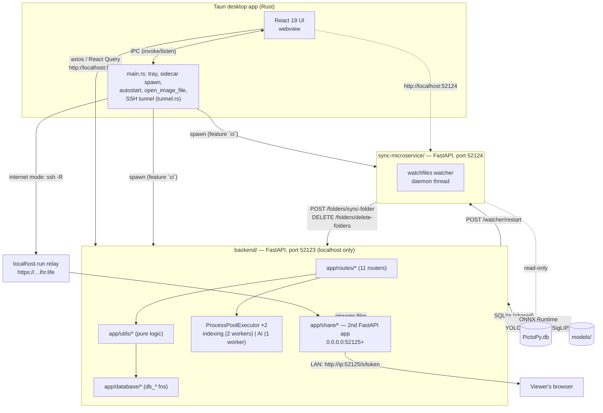

# PictoPy — Detailed Project Explanation

> A deep technical reference for the PictoPy codebase at `C:\Users\homro\Dev\GSoC\PictoPy`.
> Written against version **1.3.0-alpha** (2026-09-16). All file/line references are relative to the repository root.

---

## Table of contents

1. [What PictoPy is](#1-what-pictopy-is)
2. [Feature set](#2-feature-set)
3. [High-level architecture](#3-high-level-architecture)
4. [Repository map](#4-repository-map)
5. [The Python backend](#5-the-python-backend)
6. [Data model](#6-data-model)
7. [The AI/ML pipeline](#7-the-aiml-pipeline)
8. [The sync microservice](#8-the-sync-microservice)
9. [Album sharing](#9-album-sharing)
10. [The frontend](#10-the-frontend)
11. [The Tauri/Rust shell](#11-the-taurirust-shell)
12. [Build, CI and release](#12-build-ci-and-release)
13. [Development workflow](#13-development-workflow)
14. [Project history](#14-project-history)
15. [Known rough edges](#15-known-rough-edges)

---

## 1. What PictoPy is

PictoPy is an open-source, **privacy-first, fully offline desktop photo manager**. It brings AI-powered photo organisation — face grouping, object tagging, semantic ("search by words") retrieval, video analysis, and Google-Photos-style Memories — to the local machine, with **zero data leaving the user's computer**.

- **Organization:** AOSSIE (<https://aossie.org>), an umbrella open-source organization; the project was announced by AOSSIE and built from scratch.
- **Origin:** the UI and backend were both substantially rewritten as part of **GSoC 2025** (`CHANGELOG.md`, entries `#489` and `#466` under `1.0.0`).
- **License:** GNU GPL v3.0 (`LICENSE.md`), © 2026 AOSSIE (`COPYRIGHT.md`).
- **Current version:** `1.3.0-alpha`, triplicated across `package.json:4`, `frontend/package.json:4`, `frontend/src-tauri/Cargo.toml:3`.
- **Website / releases:** <https://pictopy.aossie.org/>, <https://github.com/AOSSIE-Org/PictoPy/releases>.
- **Distribution:** Windows NSIS installer, macOS `.app.tar.gz`, Debian `.deb`, Arch AUR (`publishing/PKGBUILD`).

The core value proposition: everything runs **on-device via ONNX Runtime**, models are downloaded on demand rather than bundled, and the SQLite database, thumbnails, and embeddings all live in the user's own data directory.

---

## 2. Feature set

### AI-powered

- **Object detection & smart tagging** — YOLOv11 (nano/small/medium tiers) labels photos and video keyframes with COCO classes.
- **Facial recognition** — YOLOv11-face detects faces, FaceNet-128D embeds them, DBSCAN clusters them into named "people" across the whole library.
- **Face search** — search by a photo/webcam probe, or by one or several people's names (`match_any` / `match_all`).
- **Semantic search** — SigLIP2 (CLIP-style vision/text pair) enables natural-language image and video search on-device; also used to auto-label photos against a 395-label vocabulary.
- **Videos** — keyframe sampling, frame-level tagging and embeddings, best-frame ranking, optional people-in-videos (off by default), frame-cache purge.
- **Memories** — curated "On This Day", location, and event collections with a full-screen story viewer.

### Gallery management

- Chronological photo/video timeline with a month-marker scrollbar.
- Favourites, albums (create/edit/delete/lock with password), album cover handling, memory→album conversion.
- Folder registration, indexing status, per-folder AI tagging toggles, filesystem sync.
- Cross-platform: Windows, macOS, Linux (X11/Wayland via webkit2gtk).

### Privacy, sharing, performance

- **Fully offline.** No cloud, no telemetry, no account.
- **Album sharing** over LAN (plain HTTP, no internet needed) or over the internet via an SSH reverse tunnel, with expiry, optional password, throttling, and QR codes.
- Parallel background processing with dedicated process pools; incremental re-indexing that skips unchanged files.
- Model Manager: install/switch/uninstall model tiers with live SSE download progress.

---

## 3. High-level architecture

PictoPy ships as **one desktop process (Tauri) managing two Python sidecar processes**, all talking over localhost HTTP, plus an optional third public listener for sharing.



### Ports and processes

| Service | Port | Bind | Owner |
| --- | --- | --- | --- |
| Main backend | **52123** | `localhost` | `backend/main.py` |
| Sync microservice | **52124** | `localhost` | `sync-microservice/main.py` |
| Album share listener | **52125** (+ up to 4 more) | **`0.0.0.0`** | `backend/app/share/server.py` |
| Frontend dev server | 1420 | localhost | Vite (`vite.config.ts`) |

The constants live in `backend/app/config/settings.py:19-23` and `frontend/src/config/Backend.ts`.

### The rules that shape this architecture

1. **Nothing leaves the machine.** Models are downloaded from the project's own GitHub release assets, not from a service; no inference happens remotely.
2. **Two FastAPI apps in one process** (`backend/main.py`) — a localhost-only app with `allow_origins=["*"]` CORS, and a deliberately separate, CORS-free, docs-disabled public share app, so the permissive CORS policy never leaks onto the internet-facing listener.
3. **Two process pools** (`backend/main.py:101-109`) so folder indexing never queues behind AI work.
4. **The sync service never writes the database.** It reads folder paths and reports progress, and delegates every mutation back to the main backend over HTTP — a single writer keeps the SQLite file consistent.
5. **The share registry is in-memory only** (`backend/app/share/registry.py:1-7`), so tokens are never written to disk and die with the process.

---

## 4. Repository map

```text
PictoPy/
├── frontend/                React 19 + TypeScript UI (Vite, Redux, Tailwind v4, shadcn/ui)
│   └── src-tauri/           Rust shell (Tauri v2): sidecars, tray, tunnel, packaging
├── backend/                 Python FastAPI sidecar — the AI + data brain (port 52123)
│   ├── main.py              entry point: lifespan, 11 routers, uvicorn on 52123
│   ├── app/{routes,schemas,database,utils,models,share,config,logging}
│   ├── app/data/semantic_vocabulary.json   395-label seed vocabulary
│   ├── tests/               44 pytest modules + sample inputs
│   └── PictoPy.spec         PyInstaller spec → PictoPy_Server
├── sync-microservice/       FastAPI file-watcher service (port 52124)
├── docs/                    MkDocs Material site → https://pictopy.aossie.org/
├── mkdocs.yml               site config (nav, Material theme, swagger-ui-tag)
├── agent-kit/               reusable AI-agent playbooks, references, templates, provider notes
├── .agents/ .claude/ .cursor/   agent skill stubs, Claude hooks, Cursor rules
├── .husky/                  git hooks → scripts/pre-commit.sh
├── .github/workflows/       11 CI workflows (pr-check, build-and-release, docs, …)
├── scripts/                 setup, version bump, agent format hook (with tests)
├── utils/logging/           shared logging_config.json bundled into dist/
├── publishing/              Arch AUR PKGBUILD
├── AGENTS.md                the project's always-loaded rules for coding agents
├── CHANGELOG.md             Keep-a-Changelog + SemVer history
└── CONTRIBUTING.md          setup, testing, release process, process rules
```

Four moving parts, as stated in `AGENTS.md`:

| Part | Tech | Job |
| --- | --- | --- |
| `frontend/src` | React 19, Redux Toolkit, Tailwind v4, shadcn/ui | UI and UI state |
| `frontend/src-tauri` | Rust, Tauri v2 | OS integration, packaging, process lifecycle |
| `backend` | Python, FastAPI, ONNX Runtime, SQLite | storage + all AI |
| `sync-microservice` | Python, FastAPI, watchfiles | filesystem watching |

---

## 5. The Python backend

### 5.1 Layering convention

`backend/AGENTS.md` defines four layers; every new endpoint crosses all four:

| Layer | Path | Rules |
| --- | --- | --- |
| Route | `app/routes/<resource>.py` | `router = APIRouter()`, Pydantic response models declared in-file |
| Schema | `app/schemas/<resource>.py` | shared request/response DTOs, notably `ErrorResponse` |
| Database | `app/database/<resource>.py` | every function prefixed `db_`, `TypedDict` row classes, module-private `_connect()`, never call `sqlite3.connect` directly |
| Utils | `app/utils/<domain>.py` | pure business logic, **no FastAPI imports** |

Current inventory: 12 route files, 10 schema files, 15 database modules, 24 util modules, 9 model wrappers.

### 5.2 Entry point and lifespan

`backend/main.py`:

1. Configures logging (`setup_logging("backend")`, uvicorn formatter), `main.py:63-66`.
2. Creates `FastAPI(lifespan=lifespan, title="PictoPy")` with `servers=[{"url": "http://localhost:52123"}]`, `main.py:127-138`.
3. Adds the single CORS middleware, `main.py:172-178`.
4. **Lifespan startup** (`main.py:74-123`):
   - export `openapi.json` for the docs site;
   - create all tables **in FK-dependency order**;
   - `db_clear_stale_processing_flags()` — clear leftover "busy" indexing/tagging flags;
   - `db_repair_orphaned_faces()` — repair faces whose parent row died;
   - `semantic_util_sync_vocabulary()` — seed the 395-label semantic vocabulary;
   - start `indexing_executor = ProcessPoolExecutor(max_workers=INDEXING_MAX_WORKERS)` (default 2) and a single-worker `executor` for AI/memories, then queue label-embedding build → image scoring → video scoring;
   - start `_cleanup_stale_tasks()` (reaps dead model-download SSE streams).
5. **Shutdown**: cancel cleanup task, shut both pools down, stop the share server.
6. Registers 11 routers, `main.py:187-201`.
7. `GET /health` → `{"message": "PictoPy Server is up and running!"}`, `main.py:182`.
8. `if __name__ == "__main__":` runs `uvicorn.Server(host="localhost", port=52123, log_config=None)`, `main.py:205-218`.

### 5.3 Routers and endpoint surface

Response envelope convention: `{success, message, data}`; errors are raised as `HTTPException(detail=ErrorResponse(...).model_dump())`, so clients receive `{"detail": {...}}`.

| Prefix | Router file | What it covers |
| --- | --- | --- |
| `/folders` | `app/routes/folders.py` | add/delete/sync folders, list with counts + `indexing_status`, enable/disable AI tagging |
| `/albums` | `app/routes/albums.py` | CRUD, create-from-memory, lock/password, add/remove images (get-images is a POST so the password travels in the body) |
| `/images` | `app/routes/images.py` | list, tag search, **semantic search**, toggle favourite |
| `/videos` | `app/routes/videos.py` | list, tag/semantic search (max-pooled per video), face scan + status, purge frame cache, favourite |
| `/face-clusters` | `app/routes/face_clusters.py` | list clusters + avatars, cluster images/videos, rename, face search (path/base64), multi-person search, global recluster |
| `/memories` | `app/routes/memories.py` | generate, status, today, list, detail, patch viewed/dismissed, delete |
| `/user-preferences` | `app/routes/user_preferences.py` | GET/PUT of a validated, deep-merged JSON blob (YOLO tier, GPU, video frame interval, memories weights) |
| `/models` | `app/routes/models.py` | status, hardware detection, download one model / whole tier, **SSE progress**, delete (guarded against active sessions) |
| `/share` | `app/routes/share.py` | interfaces, list shares, create share for an album, revoke |
| `/config` | `app/routes/config.py` | `GET /config/supported-extensions` — single source of truth for allowed file types |
| *(none)* | `app/routes/shutdown.py` | `POST /shutdown` — `os._exit(0)` on Windows, `SIGTERM` elsewhere, after 0.5 s |
| *(none)* | `main.py` | `GET /health` |

Representative examples:

```text
POST /folders/add-folder          → AddFolderRequest  → AddFolderResponse{data:{folder_id, folder_path}}
GET  /images/semantic-search?q=   →                   → SemanticSearchResponse{data:{images[…], …}}
POST /face-clusters/face-search   → FaceSearchRequest → GetAllImagesResponse (images + videos)
POST /memories/generate           → {force, date}     → GenerateMemoriesResponse{data:{run_date, status, queued}}
POST /share/albums/{id}           → {expires, password} → CreateShareResponse{data: Share}
```

Full endpoint documentation is exported to `docs/backend/backend_python/openapi.json` on every startup and rendered via `mkdocs-swagger-ui-tag`.

### 5.4 Background sequences

Long-running work never happens inside a request. `app/routes/folders.py` defines three sequences submitted to the process pools:

- **`post_folder_add_sequence`** (line 111): index images + videos → restart the sync watcher → mark `indexing_status` → curate memories.
- **`post_AI_tagging_enabled_sequence`** (line 157): download required models → tag images → cluster faces → embed images → score images → curate memories → tag videos → backfill video faces → attach keyframe faces → embed frames → score videos → set `taggingCompleted` (in `finally`).
- **`post_sync_folder_sequence`** (line 192): the same full chain after a filesystem sync.

---

## 6. Data model

**SQLite only, no migration framework.** Schema lives inside the `db_create_*_table()` functions in `backend/app/database/*.py`, executed at startup (`main.py:78-90`) and identically in `tests/conftest.py:29-41` — the creation order *encodes* FK dependencies. Evolution is done with guarded `ALTER TABLE` statements that run only when an existing legacy table is detected (e.g. `albums.is_hidden → is_locked`, `images.favouritedAt`, `faces.frame_id`).

Connections: `backend/app/database/connection.py` (`get_db_connection()` with `PRAGMA foreign_keys=ON`, …); each module also has a private `_connect()`. Long ID lists are chunked at `SQLITE_ID_CHUNK = 500`.

| Table | Purpose / notable columns |
| --- | --- |
| `folders` | self-referencing tree (`parent_folder_id`), `folder_path UNIQUE`, `AI_Tagging`, `taggingCompleted`, `indexing_status` |
| `images` | `path UNIQUE`, FK `folder_id`, `thumbnailPath UNIQUE`, `metadata` (JSON: EXIF, GPS, capture time), `isTagged/isFavourite/isEmbedded`, `latitude/longitude/captured_at` + indexes |
| `image_classes` | (image_id, class_id) tags; `score REAL` is NULL for YOLO (confidence lives elsewhere) and populated for semantic tags |
| `videos` | mirror of `images` plus `facesScanned` |
| `video_frames` | sampled keyframes: `frame_path UNIQUE`, `timestamp_sec`, `isEmbedded` |
| `video_frame_embeddings` | per-frame SigLIP2 embedding blob + `model_version` + `scored_signature` |
| `video_classes` | video-level tags aggregated from frames with a minimum frame-support vote |
| `faces` | `image_id` XOR `frame_id` (exclusive arc), `embeddings` JSON, `confidence`, `bbox` JSON, FK `cluster_id` (`ON DELETE SET NULL`) |
| `face_clusters` | `cluster_id` TEXT PK, `cluster_name`, `face_image_base64` avatar |
| `albums` / `album_images` | name UNIQUE, `is_locked`, `password_hash` (bcrypt), `cover_image_path`; junction both-CASCADE |
| `mappings` | class_id → name; seeded with COCO-80 (index 0 = `"person"`), semantic labels get `class_id >= 1000` |
| `semantic_labels` | 395-label vocabulary: category, descriptions, per-label threshold, `label_embedding` blob |
| `image_embeddings` | SigLIP2 image embedding (float32, L2-normalized) + `scored_signature` |
| `metadata` | single-row JSON blob: `user_preferences`, `reclustering_time`, … |
| `memories` | `dedupe_key UNIQUE`, `event_type ∈ {anniversary, import_event, semantic_event}`, `status ∈ {pending, complete, failed, empty}`, signals/score/params_signature, GPS + period |
| `memory_images` / `memory_videos` | separate junctions on purpose — a single id column can't reference two parents |
| `memory_runs` | `run_date` PK, `status ∈ {running, complete, failed}` |

Views `image_classes_display` / `video_classes_display` cut the tag list: all YOLO tags, only the top-K semantic tags.

**Row shapes are never bare dicts** — `ImageRecord`, `VideoRecord`, `FaceData`, `ClusterData`, `AlbumRow`, `MemoryRecord`, `ModelSpec`, etc. are `TypedDict`/dataclass classes.

---

## 7. The AI/ML pipeline

### 7.1 Model registry and tiers

`backend/app/models/model_registry.py` defines `MODEL_REGISTRY: dict[str, ModelSpec]` — filename, URL, sha256, size, feature, tier. Sources are release assets from `github.com/AOSSIE-Org/PictoPy/releases/download/models-v1.0/`.

| Key | Model | Feature | Tier | Size |
| --- | --- | --- | --- | --- |
| `yolo_nano` / `_face` | YOLOv11 Nano | object / face detection | nano | ~10 MB each |
| `yolo_small` / `_face` | YOLOv11 Small | object / face detection | small | ~36 MB each |
| `yolo_medium` / `_face` | YOLOv11 Medium | object / face detection | medium | ~77 MB each |
| `facenet` | FaceNet_128D | face embedding | **required** | 87 MB |
| `siglip2_base_vision` | SigLIP2 Base Vision | semantic vision | semantic | 355 MB |
| `siglip2_base_text` + tokenizer | SigLIP2 Base Text | semantic text | semantic | ~1.1 GB |

`TIER_MODELS` maps `nano/small/medium` → the YOLO object+face pair; `required = ["facenet"]`; `semantic` → the SigLIP2 set. Large/so400m entries exist but carry `PLACEHOLDER_URL` and are hidden from `/models/status`.

> Note: there is **no CLIP and no YOFace** — the open-vocabulary role is SigLIP2, face detection is YOLOv11-face.

### 7.2 Download and bootstrap

- `app/utils/model_downloader.py` — `ensure_model(key, max_retries=3, progress_callback)`: fast path verifies an existing file's SHA-256 in 4 MB chunks off-thread; otherwise streams with HTTP `Range` resumption, verifies after download, deletes + retries with exponential backoff on mismatch.
- `app/utils/model_bootstrap.py` — `ensure_ai_tagging_models()` reads the user's preferred YOLO tier from `user_preferences.YOLO_model_size` and always appends `facenet`.
- `app/models/session_registry.py` — thread-safe active-session counters so a model currently in an ONNX session can't be uninstalled (409 from `DELETE /models/{key}`).
- Downloads expose **SSE progress** at `GET /models/download/{task_id}/progress`, one listener at a time, 15 s heartbeats, stale tasks reaped after 10 minutes.

### 7.3 Inference wrappers (`backend/app/models/`)

- `ONNXSessionBase` — shared lazy session lifecycle; a dedicated `_inference_lock` serializes `session.run()` because DirectML faults under concurrent runs; CoreML is excluded for SigLIP2 graphs.
- `YOLO` — letterbox preprocessing, output decoding, multiclass NMS.
- `ObjectClassifier` — YOLO at conf 0.4 / IoU 0.5 → class id list.
- `FaceDetector` — YOLO face at conf 0.45 → **quality gate** (confidence, Laplacian blur ≥ 20, face area ≥ 1000 px²) → padded crop → FaceNet embedding; returns index-aligned `{embeddings, bboxes, confidences, faces_skipped}`.
- `FaceNet` — lazy session, L2-normalized 128-D embedding.
- `SigLIP2Vision` / `SigLIP2Text` — normalized embeddings; the text tower (~1 GB) is cached across requests and dropped before uninstall.
- `app/utils/ONNX.py` — picks execution providers; `GPU_Acceleration = false` forces `CPUExecutionProvider`.

### 7.4 Image indexing → tagging → embedding → scoring

1. **Index** — `image_util_process_folder_images` walks registered folders, extracts metadata (EXIF GPS/capture time, Google Takeout sidecars), generates thumbnails, bulk-inserts rows, and removes obsolete files.
2. **Tag** — `image_util_classify_and_face_detect_images`: YOLO classes → `image_classes`; **if class 0 ("person") is present** → `FaceDetector` → insert face embeddings → `isTagged = 1`.
3. **Embed** — `image_util_process_unembedded_images`: batched (8) SigLIP2 vision embeddings → `db_upsert_image_embeddings`; corrupt files stay unembedded for retry.
4. **Score** — `semantic_util_score_images`: chunked matmul of image × label embeddings, sigmoid, per-bucket thresholds (scene 5e-5, object 1e-4, event 5e-5, attribute 1e-4), top-15 written with `score`.
5. **Curate** — memories generation.

**Invalidation by signature:** `_scoring_signature` hashes model version, top-K, thresholds, and the label matrix into `scored_signature`. Any change to vocabulary, embeddings, thresholds, or checkpoint makes rows look unscored, and one matmul re-scores everything.

**Videos** (`app/utils/videos.py`, 1200 lines): sample a frame every 5 s (bounded 0.5–300 s, max 200 frames, ≤1280 px) → tag by aggregate frame vote (≥2 frames must agree) → optional face detection (dedupe 0.92, max 40 faces/video) → SigLIP2 embed frames → score by best-frame-per-label. Capture dates are parsed straight from MP4/QuickTime atoms with no external library.

### 7.5 Face clustering and search

`app/utils/face_clusters.py` (1042 lines):

- **DBSCAN** with an `estimate_eps` k-distance heuristic.
- Full recluster when >24 h elapsed, >100 unassigned faces, or no clusters exist; otherwise incremental assignment.
- One-face-per-image enforcement; cluster merging at cosine similarity ≥ 0.7; base64 avatars; auto-naming.
- **Keyframe (video) faces never seed or bridge clusters** — they are attached post-hoc only.

`app/utils/faceSearch.py`: detect → first embedding → cosine against all image *and* video face embeddings ≥ 0.6 → rank by best face → return images + videos.

### 7.6 Semantic search at query time

`app/routes/images.py:155` / `videos.py:114`:

1. Load all `image_embeddings` for the active `model_version`.
2. Tokenize the templated query (`"This is a photo of {query}."`) with the cached HF tokenizer; attention mask forced to all ones to match the ONNX export.
3. `matrix @ text_vec * exp(logit_scale) + logit_bias` → sigmoid → keep ≥ 0.01 → sort.
4. Videos are **max-pooled per video** and return `score` + `best_frame_timestamp`.
5. 404 if the text model/tokenizer isn't installed.

Preprocessing (`app/utils/SigLIP.py`) is deliberately exact — its comment records cosine ≈ 0.984 vs the HF processor and warns that thresholds were calibrated *against this pipeline*.

### 7.7 Memories

- `app/utils/memory_curator.py` (1055 lines), `GENERATOR_VERSION = 2`, three candidate sources:
  - **anniversary** — same calendar date in prior years, ±1 day;
  - **import_event** — time/place bursts (8 h gap, 40 km jump, 14-day max span);
  - **semantic_event** — SigLIP2 label occurrences with rank-based admission and a cohesion margin ≥ 0.15 above a 500-image library baseline.
- Video budget: ≤9 photos per video, ≤3 clips, ≤15 s each, ≤30 s per memory.
- `app/utils/memory_scoring.py` computes signals (favourite, known people, event strength, face presence, semantic confidence, GPS novelty, in-album), near-duplicate suppression via embeddings, cohesion trimming, time interleaving, then a weighted composite score. Default weights live in `schemas/user_preferences.py` and are auto-normalized to sum to 1.

---

## 8. The sync microservice

A separate FastAPI service on **52124** that watches every registered folder and keeps the DB in step with disk. It performs **no AI inference and no writes**.

- **Entry:** `sync-microservice/main.py` — routers `health`, `watcher`, `folders`, `shutdown`, CORS `*`, uvicorn on `localhost:52124`.
- **Startup** (`app/core/lifespan.py`): retry DB connection every 5 s up to 60 s, then start the watcher.

| Endpoint | Purpose |
| --- | --- |
| `GET /health` | DB connection + watcher state |
| `GET /watcher/status` | running flag, thread id/alive, watched folders |
| ``POST /watcher/start\|stop\|restart`` | lifecycle (restart re-reads folders from the DB) |
| `GET /folders/status` | per-folder tagging + semantic-embedding progress percentages |
| `POST /shutdown` | stop watcher, then exit |

**Watcher** (`app/utils/watcher.py`, 388 lines): `watchfiles.watch()` in a daemon thread with a `threading.Event` stop flag, recursively watching all registered paths. On a change set it resolves the closest watched parent and calls `POST {backend}/folders/sync-folder`; if a watched folder itself vanished it calls `DELETE {backend}/folders/delete-folders` and restarts itself. Failures of this callback are logged, never raised.

**Backend → sync coupling is a single call**: `API_util_restart_sync_microservice_watcher()` (`backend/app/utils/API.py`) POSTs `/watcher/restart`, invoked after folder add and after a sync.

| | Backend | Sync microservice |
| --- | --- | --- |
| Port | 52123 | 52124 |
| DB role | creates + writes | **read-only** |
| AI | YOLO / FaceNet / SigLIP2 | none |
| Routers | 11 | 4 |
| Layout | `routes/schemas/database/utils/config` | same **+ `core/`** |
| Binary | `PictoPy_Server` | `PictoPy_Sync` |

Dependencies are deliberately tiny: `fastapi`, `uvicorn`, `pydantic`, `httpx`, `watchfiles`, `platformdirs`, `loguru` — no ONNX/OpenCV/numpy.

---

## 9. Album sharing

Two modes, one implementation (`backend/app/share/`), plus a Rust tunnel for the internet case.

### Server side

- **`registry.py`** — in-memory share registry. 32-byte `secrets.token_urlsafe` tokens, bcrypt password hash (72-byte cap), 10 failed attempts → 30 s cooldown, admission control decided *before* hashing, bcrypt check outside the lock, unlock cookie = HMAC-SHA256 of `token:password_hash` under a per-process secret.
- **`server.py`** — an embedded uvicorn `Server` that refuses to install signal handlers, binds ahead of uvicorn trying `52125..52129` so a port clash can't kill the backend, runs on the backend's own asyncio loop, stops gracefully in 5 s.
- **`app.py`** — separate FastAPI app: **no CORS**, docs/OpenAPI off.
- **`routes.py`** — `GET /s/{token}` (Jinja2 album viewer), `POST /s/{token}/unlock`, `GET /s/{token}/thumb/{image_id}`, `GET /s/{token}/photo/{image_id}`.
- **`media.py`** — an image id only resolves after `db_album_contains_image` confirms membership, so a token is never a read handle over the whole images table.
- **`utils/share.py`** — create (start listener → mint token), revoke (stop listener when the count hits 0), describe (one URL per candidate LAN interface).

HTTP control surface: `GET /share/interfaces`, `GET /share/`, `POST /share/albums/{id}`, `DELETE /share/{token}`.

### Internet mode

`frontend/src-tauri/src/services/tunnel.rs` (522 lines, 11 unit tests) spawns the **OS `ssh` client** as a reverse tunnel to `localhost.run` (`nokey@localhost.run`, remote port 80, `.lhr.life` URL suffix) — no bundled binary. Design notes: a `TunnelChild` trait so lifecycle is unit-testable without spawning ssh, a single async lifecycle mutex, a combined lock so shutdown can't race a spawn, the child tracked *before* the URL is announced, an app-owned `known_hosts` file, `-o ExitOnForwardFailure=yes -R <remote>:127.0.0.1:<port>`, 30 s URL discovery timeout, and a drain task that clears stale URLs.

### User-facing rules (`docs/overview/sharing-albums.md`)

- A share only works **while PictoPy is running**; photos are streamed, never stored elsewhere.
- LAN mode: plain HTTP, no internet, subject to AP/client isolation.
- Internet mode: HTTPS to the relay, which *can* see the photos — hence a **password is forced on by default** (chat apps prefetch links).

---

## 10. The frontend

### 10.1 Stack (`frontend/package.json`, version `1.3.0-alpha`)

| Area | Choice |
| --- | --- |
| UI | React **19.1.0**, TypeScript 5.1, Vite **6** (`@` → `./src` alias, port 1420) |
| Routing | React Router **v7** (imports from `react-router`) |
| State | Redux Toolkit 2.8 + react-redux 9; React Query 5.62 for server state; axios 1.7 |
| Styling | Tailwind CSS **4** (CSS-first, `@import 'tailwindcss'` in `src/App.css`, no config file), shadcn/ui **new-york** + 27 Radix primitives, `cn()` = clsx + tailwind-merge |
| UX libs | lucide-react, framer-motion, react-dnd, react-easy-crop, react-zoom-pan-pinch, qrcode.react, ldrs |
| Testing | Jest 29 + React Testing Library, jsdom, `babel-jest` transform |
| Lint | ESLint 8 (`react-app` + prettier), `--max-warnings 0`; Prettier with `prettier-plugin-tailwindcss` |

### 10.2 State architecture (the key idea)

- **Redux holds UI state**: viewer index, dialogs, global loader, onboarding step, story-viewer playback, folders/albums/results caches that the UI mutates optimistically.
- **React Query holds server state**: `usePictoQuery` / `usePictoMutation` (`src/hooks/useQueryExtension.ts`) with retry logic; results are copied into Redux via `useEffect` — the dominant pattern across the app.
- There are **no `createAsyncThunk`s**; `features/folderThunks.ts` is an empty placeholder.
- `memoriesSlice.ts` documents the split explicitly in its header.

| Slice | State |
| --- | --- |
| `loader` | `{loading, message}` → `GlobalLoader` |
| `onboarding` | step index/name/status, avatar, name |
| `images` / `videos` | list + `currentViewIndex` (≥ 0 ⇔ lightbox open), favourite toggles |
| `faceClusters` | cluster list for navbar search expansion |
| `infoDialog` / `globalAlert` | app-level modal overlays |
| `folders` | folder list + per-folder tagging status |
| `search` | `{active, queryImage}` reverse-image search state |
| `albums` | albums, selected album, album images (keeps `image_count` in sync) |
| `memories` | **UI-only**: active id, slide index, playing/muted, slide duration |

Selectors are co-located in `<name>Selectors.ts`, mixing plain arrows with `createSelector` memoized derivations (`selectFolderHierarchy` recursively builds the tree, `selectLockedAlbumsCount`, …).

### 10.3 API layer

Rules from `frontend/AGENTS.md`: components **never** import axios; the base URL lives in `src/config/Backend.ts`; every URL lives in `src/api/apiEndpoints.ts`; one typed wrapper per endpoint lives in `src/api/api-functions/<resource>.ts`.

- Two axios instances, both 10 s timeout: `apiClient` → 52123, `syncApiClient` → 52124 (`src/api/axiosConfig.ts`).
- Wrapper modules: `images`, `videos`, `togglefav`, `face_clusters`, `folders`, `albums`, `share`, `memories`, `models`, `user_preferences`, `health`.
- Transport beyond HTTP: **SSE** via `EventSource` in `src/hooks/useModelDownloadProgress.ts`.
- `useMutationFeedback` bridges mutation state into the Redux loader/dialog.

### 10.4 Routes and screens

Route table: `src/constants/routes.ts`; router: `src/routes/AppRoutes.tsx`.

| Path | Screen | What it does |
| --- | --- | --- |
| `/` | `InitialSteps` | onboarding: server check (polls both `/health`s, exits the app on failure) → avatar → folder setup → theme → model setup → updates; on completion navigates to `/home` |
| `/home` | `Home` | chronological gallery + timeline scrollbar; hosts active face-search results (images *and* videos) |
| `/videos` | `Videos` | video gallery with supported-format empty state |
| `/favourites` | `MyFav` | unified favourites, persisted sort |
| `/albums`, `/albums/:albumId` | `Album`, `AlbumDetail` | album grid with sort/create/edit/delete/lock; detail with selection mode, add/remove images, lightbox |
| `/memories` | `Memories` | memory card grid, regenerate (blocked while `indexing_busy`), story viewer, memory→album conversion |
| `/person/:clusterId` | `PersonImages` | one person's photos/videos, inline rename |
| `/ai-tagging` | `AITagging` | face collections + multi-person search + ranked/chronological gallery |
| `/search` | `SearchResults` | largest page (571 lines); `?mode=auto\|tag\|semantic` — `auto` first loads clusters to decide if the query is a person name, then falls back through tag → semantic → multi-person |
| `/settings` | `Settings` | folder management, user preferences (YOLO size, GPU, frame interval, memories weights), app controls (autostart, close-to-tray), model manager launcher, purge cache |
| `/model-manager` | `ModelManager` | rendered in a **second Tauri window**; installed/available tabs, 3 s polling during downloads, SSE progress |

Sharing is a component, not a route: `components/Albums/ShareAlbumDialog.tsx` (~590 lines) — LAN vs internet mode, expiry presets, password, QR code, clipboard copy, revoke, and the Rust tunnel for internet mode.

### 10.5 Components

- `src/components/ui/` — 27 shadcn primitives + a few local ones. **Generated: do not hand-edit**, regenerate instead.
- Feature folders: `Media/` (15), `OnboardingSteps/` (8), `Albums/` (7), `Dialog/` (4), `VideoPlayer/` (4, incl. a 501-line Netflix-style player), `Memories/` (4), `Navigation/` (Navbar 247 lines, AppSidebar), `FolderPicker/`, `EmptyStates/`, `BackgroundTasks/`, `Timeline/` (354-line month scrollbar).
- `BrowserWarning` renders instead of the app when not inside Tauri (`src/utils/tauriUtils.ts`).
- 44 test files in `__tests__/` folders beside the code; a custom `render` in `src/test-utils.tsx` wraps Redux + Theme + QueryClient + MemoryRouter; `jest.setup.ts` mocks all Tauri plugins, axios, and `fetch`.

---

## 11. The Tauri/Rust shell

`frontend/src-tauri/` — Tauri **2.9.1**, `productName: "PictoPy"`, `identifier: "org.aossie.pictopy"`.

| File | Lines | Role |
| --- | --- | --- |
| `src/main.rs` | 379 | builder, plugins, tray, sidecar spawn, command registration, window-close handling |
| `src/commands.rs` | 110 | `open_image_file` |
| `src/services/tunnel.rs` | 522 | SSH reverse tunnel + 11 tests |
| `src/services/mod.rs` | 13 | `get_resources_folder_path` |
| `capabilities/*.json` | — | per-window permission sets |

### Registered commands

```text
services::get_resources_folder_path
services::tunnel::{tunnel_start, tunnel_stop, tunnel_status, shutdown}
open_model_manager                 // second webview window
enable_autostart / disable_autostart / is_autostart_enabled
get_close_to_tray / set_close_to_tray          // tauri-plugin-store
commands::open_image_file
```

Forgetting to register a command **or** its capability fails at runtime, not compile time (per `src-tauri/AGENTS.md`).

### `open_image_file` security model (`src/commands.rs`)

1. `canonicalize()` the path (blocks `..` and symlinks) and require it to be a file.
2. Ask the backend for `GET /config/supported-extensions` and check the extension.
3. Ask the backend for `GET /folders/all-folders` and require the file to be inside a library root.
4. Strip the Windows `\\?\` prefix and open with `app.opener()`.

### Sidecar lifecycle — two modes

- **Dev (`tauri dev`, no `ci` feature):** `prod()` is a stub; Python services run outside the app (e.g. `fastapi dev --port 52123`), and `ServerCheck.tsx` polls both `/health` endpoints with 60 retries.
- **Packaged (`--features ci`, passed by release CI):** `prod()` checks health first, and if a service is down spawns `resources/backend/PictoPy_Server` and `resources/sync-microservice/PictoPy_Sync` through `tauri_plugin_shell`, pumping stdout/stderr. On quit (tray quit, close with `close_to_tray=false`, `RunEvent::Exit`) it runs `tunnel::shutdown()` then `kill_process_tree()` — a `sysinfo` scan for those process names, `POST /shutdown` on Windows, `SIGTERM` on Unix.

### Packaging

`tauri.conf.json` bundles `../../backend/dist/` → `resources/backend` and `../../sync-microservice/dist/` → `resources/sync-microservice` (both PyInstaller onedir builds). The deb `postinstall.sh` chmods those resource dirs. CSP `connect-src` explicitly allows `localhost:52123` and `52124`. The updater uses minisign against `releases/latest/download/latest.json`. **Tauri v2 has no `version` field in `tauri.conf.json`** — it inherits from `Cargo.toml`.

### Capabilities

Three files: `desktop.json` (main window + updater), `migrated.json` (the broad v1-migrated set: core, autostart, shell-open, dialog, a long `fs` list, process, store, opener — URL opening restricted to `https://aossie-org.github.io/*`), and `model_manager.json` (minimal: window/app/event/destroy for the secondary window).

---

## 12. Build, CI and release

### 12.1 Local gates (from `AGENTS.md`)

Run from the repository root; CI runs the **Check** column, use the **Fix** column locally.

| Task | Check | Fix |
| --- | --- | --- |
| Frontend lint | `(cd frontend && npm run lint:check)` | `npm run lint:fix` |
| Frontend format | `(cd frontend && npm run format:check)` | `npm run format:fix` |
| Frontend tests | `(cd frontend && npm test)` | — |
| Python lint + format | `pre-commit run --config .pre-commit-config.yaml --all-files` | rewrites in place |
| Backend tests | `(cd backend && pytest)` | — |
| Rust format | `(cd frontend/src-tauri && cargo fmt -- --check)` | `cargo fmt` |
| Version bump | `npm run version:bump -- X.Y.Z` | — |

`.pre-commit-config.yaml` runs: `ruff --fix` (**linter only**), `black` 24.4.2 (88 cols), and two mypy hooks (backend + sync-microservice, each with its own `pyproject.toml` config).

> **Never run `ruff format`.** `backend/pyproject.toml` sets Ruff's `line-length = 300`, so it would reflow the entire codebase and black would immediately fight it.

### 12.2 GitHub workflows (11, in `.github/workflows/`)

| Workflow | Trigger | Gates |
| --- | --- | --- |
| `pr-check.yml` | PR → `main`/`dev` | **linting**: markdownlint, agent-hook tests, eslint, prettier, pre-commit (mypy skipped here), `cargo fmt --check`, dynamic mypy on changed Python files. **frontend**: `npm test`. **backend**: PyInstaller build of `PictoPy_Server`, PyInstaller build of `PictoPy_Sync_Microservice`, then `pytest` |
| `pr-check-build.yml` | PR touching `frontend/**` | Tauri build matrix (macOS arm64 / Ubuntu 22.04 / Windows) with `--features ci` |
| `build-and-release.yml` | release published | `validate-changelog` (blocks a release without `## [X.Y.Z]`), PyInstaller server builds per-OS (**fails if any `.onnx` is bundled**; Windows swaps in `onnxruntime-directml`, Ubuntu in `onnxruntime-gpu`), sync builds, then `publish-tauri` assembling dist + `utils/` and publishing installers + updater JSON |
| `release-prep.yml` | manual `X.Y.Z` | runs `version:bump`, drafts a CHANGELOG section from merged PRs grouped by label, opens `release/prep-X.Y.Z` |
| `docs-deploy.yml` | push → `main` | `mkdocs gh-deploy --force` |
| `issue-triage.yml` | issue opened | welcome comment + semantic duplicate detection (sentence-transformers) + `possible-duplicate` label |
| `pr-label.yml` | push / `pull_request_target` | copies `#<number>` issue labels onto the PR; merge-conflict label |
| `stale-merge-conflicts.yml` | cron daily | closes PRs stuck with merge conflicts |
| `update-release-drafter.yml` | push / PR closed | release-drafter categories |
| `aur-publish.yml` | manual | recomputes the deb sha256, commits `upgpkg` to AUR |

Other CI/agent config: `.coderabbit.yaml` (auto-review on PRs to `dev`), `.github/.markdownlint-cli2.jsonc` (`MD013` off, duplicate headings siblings-only), issue templates for bug/feature/docs.

### 12.3 Versioning rule

**Version strings are triplicated** (`package.json`, `frontend/package.json`, `frontend/src-tauri/Cargo.toml`) and must only ever change through `npm run version:bump -- X.Y.Z` (`scripts/bump-version.mjs`), followed by `cargo check` to refresh `Cargo.lock`.

### 12.4 Docs site

MkDocs Material + swagger-ui-tag (`mkdocs.yml`), five nav sections (Home, Overview, Setup, Contributing, Backend, Frontend), Mermaid fences via `pymdownx.superfences`, its own Tailwind build under `docs/`, deployed to <https://pictopy.aossie.org/>.

---

## 13. Development workflow

### Setup

- **Scripted:** `docs/Script_Setup_Guide.md` (Windows `scripts/setup.ps1`, Debian/Fedora `scripts/setup.sh`, dispatched by `npm run setup` → `scripts/setup.js`).
- **Manual:** `docs/Manual_Setup_Guide.md`.
- Both services can run standalone in dev (`fastapi dev --port 52123`, sync on 52124); `dist/` folders must exist for `tauri dev` because `tauri.conf.json` bundles them.

### Project rules for agents and humans

`AGENTS.md` at the root plus a nearest-file `AGENTS.md` in each of `backend/`, `frontend/`, `frontend/src-tauri/`, `sync-microservice/`. Multi-step procedures (adding an endpoint, adding a frontend feature, pre-PR checks, onboarding) live as playbooks in `agent-kit/skills/` with stubs in `.agents/skills/` and `.claude/skills/`.

The non-obvious rules that agents break most often:

1. **Never `ruff format`** — use black.
2. **Never write `TODO`/`FIXME`** — `frontend/.eslintrc.json` sets `no-warning-comments` to error with `--max-warnings 0`.
3. **Version strings are triplicated** — bump only via script.
4. **Don't edit generated/vendored paths** — `dist/`, `target/`, `gen/`, `node_modules/`, `frontend/src/components/ui/` (shadcn).
5. **Markdown is linted too.**
6. **Match the existing codebase before introducing a new pattern; reuse before adding** (check `components/ui/`'s 27 primitives, `frontend/src/utils/`, `hooks/`, `constants/`, `backend/app/utils/` first); extract shared code on the **third** occurrence.
7. **Types are not optional** — strict TS with `noUnusedLocals/Parameters`, `npm run build` runs `tsc`; Python annotations on every signature and `TypedDict` rows (no mypy gate in CI, so they're for the next reader).
8. **Row-by-row response building** so one bad row can't 500 a listing.

### Contribution process (hard rules)

- **Do not open a PR for an issue maintainers have not reviewed and labelled** — the project's most-enforced rule, stated in `CONTRIBUTING.md`, the issue-triage welcome comment, and every playbook. Low-effort AI-generated issues/PRs are closed without discussion.
- PRs target `dev`; `main` only moves via a release PR.
- The PR body must reference its issue as `#<number>` (label sync workflow copies labels across).
- Commit messages: short imperative subject prefixed `fix:`, `feat:`, `docs:`, `test:`.
- CodeRabbit reviews every PR automatically.

---

## 14. Project history

| Version | Date | Highlights |
| --- | --- | --- |
| **1.0.0** | 2025-09-07 | First stable release. Sync microservice introduced; Swagger docs; **GSoC 2025 frontend redesign (#489) and backend rework (#466)** |
| **1.1.0** | 2026-05-22 | Reverse image search, global face re-clustering, live progress, reworked Settings, centralized logging; **the desktop app now starts/stops its own backend and sync service (#1009)**; models made downloadable instead of bundled (#1263) shrinking the installer; Arch/AUR packaging (#1268); large bug sweep. 39 contributors |
| **1.2.0** | 2026-07-16 | Model Manager (install/switch/uninstall YOLO variants), global search across face collections + AI tags, multi-person face search, adaptive density-aware clustering, version-bump + release tooling |
| **1.3.0-alpha** | 2026-09-16 | Album sharing (LAN/internet/password) + memory→album, unified favourites, **SigLIP2 semantic pipeline + multi-person text face search**, **videos page + keyframe AI tagging**, smart Memories with story viewer, albums, autostart + tray, parallel indexing. 17 contributors |

Trajectory: *GSoC 2025 rewrites → 1.0.0 → search/clustering/packaging → model management → sharing, videos, semantic search, albums.*

---

## 15. Known rough edges

Observed during this survey — useful if you plan to work in the codebase:

1. **`sync-microservice/README.md` is stale.** It documents `GET /` and `GET /folders`, an outdated directory tree (`file_watcher.py` — which is now a 0-byte file; the real watcher is `app/utils/watcher.py`), and a "Current TODOs" list claiming the watcher only logs changes. In reality the watcher calls `POST /folders/sync-folder` and `DELETE /folders/delete-folders`, and routes include `/watcher/{start,stop,restart}`, `/folders/status`, `/shutdown`.
2. **Root `package.json` scripts `linux-dev` and `win-dev` reference missing files** (`scripts/linux-dev.sh`, `scripts/win-dev.bat`), yet `agent-kit/skills/onboard/SKILL.md` tells new contributors to run them.
3. **`agent-kit/references/ci-gates.md` names workflows that no longer exist** (`lint.yml`, `pr-check-tests.yml`) — everything was consolidated into `pr-check.yml`.
4. **`utils/logging/__init__.py` imports a non-existent `utils/logging/core.py`**; harmless today because each service ships its own `app/logging/setup_logging.py`, and nothing imports the package — but the `utils/` folder must still be copied into `dist/` because those `setup_logging.py` files read `utils/logging/logging_config.json` by relative path.
5. **`backend/app/utils/API.py` imports `requests`,** which is not pinned in `backend/requirements.txt` (it would arrive only transitively, if at all).
6. **Empty placeholder files**: `frontend/src/features/folderThunks.ts`, `frontend/src/hooks/useFolderPicker.ts`, `frontend/src/components/account-settings.tsx`; unrouted stub pages `ComingSoon` and `SecureFolderPage`; `index.html` title is still the Tauri template default.
7. **`api-functions/index.ts` does not re-export `togglefav`**, which is imported directly instead.
8. **`docs/index.md` link columns** use extension-less relative hrefs and omit several pages that exist in the nav.
9. **`publishing/PKGBUILD` still says `pkgver=1.0.0`** (updated only by the AUR workflow).
10. **`model_registry.py` contains `PLACEHOLDER_URL` entries with `# TODO` comments** (pre-existing; the no-TODO lint rule applies to new frontend code).
11. **`src-tauri/AGENTS.md` says the Tauri builder lives in `src/lib.rs`,** but today `lib.rs` is a single `pub mod services;` line and the builder is in `main.rs`.

---

### Quick command reference

```bash
# backend
cd backend && pytest                 # tests
pre-commit run --config .pre-commit-config.yaml --all-files   # lint + format (black)

# frontend
cd frontend && npm run lint:check    # eslint, 0 warnings allowed
cd frontend && npm run format:check  # prettier
cd frontend && npm test              # jest (44 test files)
cd frontend && npm run build         # tsc && vite build

# rust shell
cd frontend/src-tauri && cargo fmt -- --check
cd frontend/src-tauri && cargo test   # not in CI, expected for changes

# version
npm run version:bump -- X.Y.Z

# run (dev)
fastapi dev --port 52123             # backend, from backend/
# sync service from sync-microservice/, then: npm run tauri dev
```
